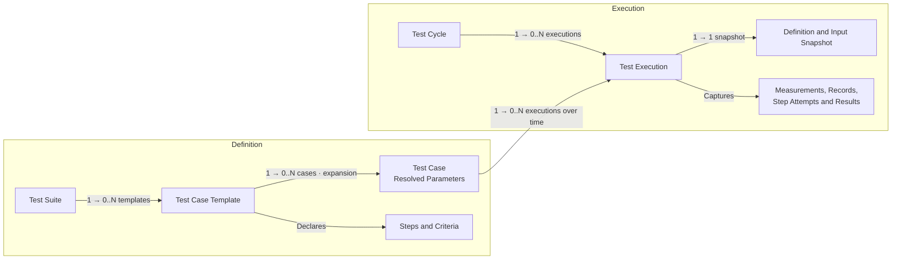

# Dokime

**Run repeatable engineering tests. Keep the evidence.**

Dokime turns hardware and software test procedures into operator workflows,
live measurements, and self-contained reports. Use it for bench testing,
device qualification, and manufacturing checks where a result needs more
context than pass or fail.

Define the procedure in Rust. Run it across operating conditions. Review what
happened, with the inputs, measurements, and decisions that explain the result.

[Quick Start](#quick-start) · [The Test Domain](#the-test-domain) ·
[Examples](#examples) · [Documentation](#documentation)


## Features

- **Test Procedures**

  Define reusable suites and templates with typed parameters, ordered steps,
  acceptance criteria, and explicit cleanup. Keep the procedure readable
  alongside the equipment operations it calls.

- **Parameter Sweeps**

  Expand one template across combinations of operating conditions. Three input
  voltages and three loads produce nine cases without duplicating the procedure.

- **Live Measurements**

  Capture typed measurements while a test runs. Compose time-series plots,
  distributions, and other views with units and reference limits tied to the
  case's parameters.

- **Acceptance Criteria**

  Evaluate captured samples and structured records. Keep the actions that
  perform a test separate from the criteria that judge its evidence.

- **Operator Interaction**

  Combine automation with confirmations, forms, and manual checkpoints.
  Retain operator responses with the execution they belong to.

- **Traceability**

  Capture specimen identity, resolved inputs, and execution context. Keep logs,
  structured records, and attached files alongside the measurements they explain.

- **Self-Contained Reports**

  Present results, plots, and captured evidence in self-contained HTML reports.
  Review them without installing Dokime or connecting to a running server.

- **Plugins**

  Integrate equipment and contribute suites, operations, observers, and settings.
  Dokime builds on [Harmos](https://github.com/stokker-technologies/harmos)
  for typed contracts and managed plugin lifecycles.

- **Automation**

  Run through the desktop application or control execution through the CLI and
  programmatic interfaces. A desktop session can use its local backend or attach
  to an explicitly configured remote server.

## The Test Domain

Definitions describe what can be tested. Execution captures what happened when
concrete cases ran. A **suite** organizes related **templates**; each template
materializes **cases** with resolved parameter values. A **cycle** groups the
executions selected for a test campaign.



Each execution identifies exactly one case and one cycle. Repeating a case
creates another execution; retrying a step is recorded as a step attempt within
that execution. A cycle can bring together cases from different templates and
suites—it is not a copy of one suite. Empty collections are possible before
cases are materialized or executions are created.

For a charger campaign, one template might measure steady-state charging while
another checks overcurrent protection. Cartesian expansion turns the operating
points into concrete cases:

```text
Input Voltage:  207 V, 230 V, 253 V
Load Impedance: 80 Ω, 100 Ω, 120 Ω

3 Voltages × 3 Loads → 9 Cases Of The Same Procedure
```

A list can also be one parameter value. An ordered load sequence such as
`[100, 50, 10]` Ω can describe three steps within one case; it does not have to
mean three separate cases. Expansion is declared explicitly.

## Quick Start

Dokime is pre-1.0 and currently supports Windows and Linux. To launch from
source, install [mise](https://mise.jdx.dev) and use the pinned toolchain:

```sh
git clone https://github.com/stokker-technologies/dokime.git
cd dokime
mise trust
mise install --locked
mise run sync
mise run dev:desktop:dev
```

This starts the desktop application with its local backend. The
[Mini plugin](plugins/mini/) supplies a simulated charger; no physical charger
is required. Build its installable bundle from the repository root:

```sh
cargo run -p cargo-dokime -- build --package mini-sidecar --output target/debug/plugins/mini-sidecar.dokime
```

Install the `.dokime` bundle through the application's plugin settings and
restart the application to activate it. Use its charging templates to assemble
a cycle, choose operating points, and inspect live measurements and results.

## Examples

### Qualify An On-Board Charger

Harmos supplies the runtime and plugin boundary. Dokime adds the testing domain:
procedures, parameter expansion, operator interaction, acceptance criteria, and
self-contained reports.

The [Mini charger simulation](plugins/mini/src/suites/) demonstrates startup,
steady-state measurement, overcurrent protection, and recovery. It models a
charger testbench for learning the workflow; it is not a validated electrical
model or a ready-made vehicle qualification standard.

### Define The Operating Points

A shortened version of Mini's
[steady-state parameters](plugins/mini/src/suites/parameters.rs) declares the
nine-case voltage/load sweep:

```rust
use dokime::definition::ParameterDefault;

#[dokime::parameters]
pub struct Steady {
    #[parameter(
        label = "AC Voltage (RMS)", unit = "V",
        expansion = "cartesian",
        default = ParameterDefault::space([207.0, 230.0, 253.0]),
    )]
    pub ac_voltage_v: f64,

    #[parameter(
        label = "Load Impedance", unit = "ohm",
        expansion = "cartesian",
        default = ParameterDefault::linspace(80.0, 120.0, 3),
    )]
    pub load_ohm: f64,
}
```

The template names its parameter type once. Every expanded case resolves those
inputs before execution, so the procedure and its document see the same values.

### Run The Procedure And Capture Evidence

Mini's [steady-state template](plugins/mini/src/suites/steady/measurement.rs)
initializes shared device resources, energizes the charger, observes its
waveform, asks the operator to inspect the trace, and attaches a measurement
summary. Cleanup stops the simulated device.

This excerpt is the template's measurement observer. `InputMeasurement`,
`Samples`, `ObserverStreams`, and `reading` belong to the example:

```rust
#[dokime::observer(interval_ms = 5, streams = ObserverStreams)]
async fn samples(ctx: &mut ObserverContext<'_>) -> Result<(), Error> {
    let row = reading(ctx.resources())?;
    ctx.stream::<InputMeasurement>()
        .into::<Samples>()
        .push(row)
        .await;
    Ok(())
}
```

The same template uses `ctx.ask(...)` for operator sign-off and writes its
summary through `ctx.artifacts()`. Its criterion checks that enough samples
were captured and that the completion record accepted the run:

```rust
#[dokime::criterion(id = STEADY_ACCEPTANCE_CRITERION, label = "Trace Accepted")]
fn accepted(ctx: &CriterionContext<'_>) -> Result<bool, Error> {
    Ok(
        ctx.samples::<Samples>().len() as u64 >= ctx.parameters().sample_count()?
            && super::super::support::decided(
                ctx.records::<Completed>(),
                |run| run.accepted,
            )?,
    )
}
```

These are excerpts from the complete template, not standalone programs.
The [protection template](plugins/mini/src/suites/protection/overcurrent.rs)
adds an automated load ladder and verifies that an overcurrent fault disconnects
the supply and prevents restart. A real charger integration can extend these
procedures with regulation, efficiency, and thermal criteria for its hardware.

### Present The Result

Compose plots from the same typed measurement fields used by the procedure.
This shortened example follows Mini's
[measurement document](plugins/mini/src/suites/measurement.rs); `stream` selects
the suite-owned stream carrying `InputMeasurement` rows:

```rust
let mut voltage = Plot::xy_line("Battery Voltage");
voltage.unit("V");
voltage.x(InputMeasurement::column_elapsed_s().on(stream));
voltage.y(InputMeasurement::column_dc_voltage_v().on(stream));

let mut charging = Section::new("charging", "Battery Charging");
charging.plot(voltage);

let mut document = Document::new("default", "Charger Qualification");
document.section(charging);
```

Column handles keep plot expressions tied to the declared data shape. Templates
can also add parameter-based reference bands; the
[soak starter](crates/cargo-dokime/templates/src/suites/soak/hold.rs) demonstrates
a target-temperature band and event markers.

Export the captured result as a **self-contained report** to share the plots,
verdicts, and context without requiring access to the testbench.

## Cargo Features

These flags configure the `dokime` Rust SDK dependency. Desktop application
users do not need to select them. The default SDK includes native plugin support
and authoring macros.

| Feature | Default | Enables |
| --- | --- | --- |
| `native` | Yes | Native plugin SDK, sidecar support, and plugin prelude. |
| `derive` | Yes | Suite, template, step, observer, and other authoring macros. |
| `client` | No | Rust client for remote Dokime instances. |
| `storage` | No | Storage APIs and the SQLite backend. |

For a remote automation client that does not author native plugins, select only
`client`:

```toml
[dependencies]
dokime = { git = "https://github.com/stokker-technologies/dokime", rev = "<tested-commit>", default-features = false, features = ["client"] }
```

Replace `<tested-commit>` with the revision used by your integration. The flags
are independent: `client` and `storage` do not enable `native` or `derive`.
Disabling defaults does not remove the SDK's underlying Harmos runtime
dependency. See the [crate manifest](crates/dokime/Cargo.toml) for details.

## Documentation

- [Mini Plugin](plugins/mini/) — the charger simulation and complete test templates.
- [Plugin Starter](crates/cargo-dokime/templates/) — a complete temperature-soak procedure.
- [Rust SDK](crates/dokime/src/lib.rs) — public authoring APIs and module documentation.
- [Client API](crates/dokime/src/client/) — programmatic access to cycles and executions.
- [Contributing](CONTRIBUTING.md) — repository setup and development workflow.

## Project Status & Roadmap

Dokime is in active development. Pin the revision you integrate: public APIs,
plugin contracts, and development storage formats may change before 1.0.
Existing development data has no compatibility guarantee; incompatible storage
must use a fresh root rather than silently resetting an existing one.

The public introduction will grow with a complete on-board charger walkthrough
and a downloadable self-contained example report. GitHub hosts the authoritative source and native validation workflows.

Follow [issues](https://github.com/stokker-technologies/dokime/issues)
for development discussions and [the changelog](CHANGELOG.md) for recorded changes.

## Development Setup

Use the source setup in [Quick Start](#quick-start). For a headless server:

```sh
mise run build:cli:dev
cargo run -p dokime-cli -- serve
```

The main repository checks are:

```sh
mise run check
mise run test
```

Dev integration requires the full Linux check, release build, correctness tests,
and exact-revision artifact catalog. Windows validation runs independently as
advisory, with its results and artifacts retained. Main and releases require both
native platforms. Trusted Dev-push Linux check and test jobs use the
restricted local runner; Docker-dependent release builds remain hosted.

See [Contributing](CONTRIBUTING.md) for prerequisites and the full workflow.

## Contributing

Bug reports, focused fixes, clearer examples, and equipment integrations are
welcome. [Open an issue](https://github.com/stokker-technologies/dokime/issues)
to discuss a proposal, and read the [contribution guide](CONTRIBUTING.md) before
submitting changes.

## License

Dokime is licensed under [Apache-2.0](LICENSE-APACHE).
