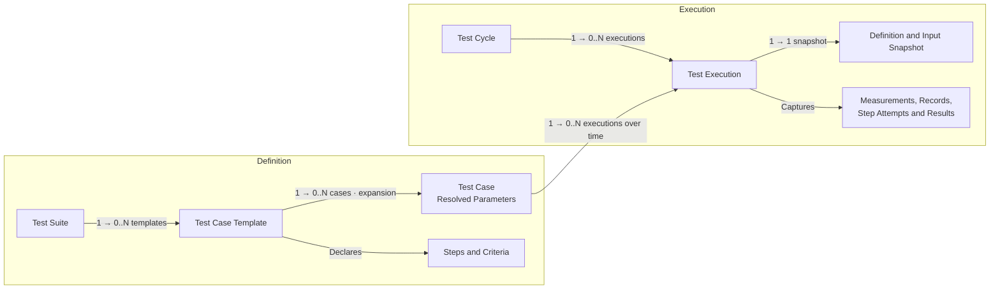

# Dokime

**Run repeatable engineering tests. Keep the evidence.**

Dokime turns hardware and software test procedures into operator workflows,
live measurements, and self-contained reports. Use it for bench testing,
device qualification, and manufacturing checks where a result needs more
context than pass or fail.

Define the procedure in Rust. Run it across operating conditions. Review what
happened, with the inputs, measurements, and decisions that explain the result.

[Quick Start](#quick-start) · [The Test Domain](#the-test-domain) ·
[Examples](#examples) · [Documentation](#documentation)


## Features

- **Test Procedures**

  Define reusable suites and templates with typed parameters, ordered steps,
  acceptance criteria, and explicit cleanup. Keep the procedure readable
  alongside the equipment operations it calls.

- **Parameter Sweeps**

  Expand one template across combinations of operating conditions. Three input
  voltages and three loads produce nine cases without duplicating the procedure.

- **Live Measurements**

  Capture typed measurements while a test runs. Compose time-series plots,
  distributions, and other views with units and reference limits tied to the
  case's parameters.

- **Acceptance Criteria**

  Evaluate captured samples and structured records. Keep the actions that
  perform a test separate from the criteria that judge its evidence.

- **Operator Interaction**

  Combine automation with confirmations, forms, and manual checkpoints.
  Retain operator responses with the execution they belong to, along with
  screenshots, camera photos, and audio recordings captured on the testbench.

- **Traceability**

  Capture specimen identity, resolved inputs, and execution context. Keep logs,
  structured records, and attached files alongside the measurements they explain,
  including files watched in a local or FTPS folder while the execution runs.

- **Self-Contained Reports**

  Present results, plots, and captured evidence in self-contained HTML reports.
  Review them without installing Dokime or connecting to a running server.

- **Plugins**

  Integrate equipment and contribute suites, operations, observers, and settings.
  Dokime builds on [Harmos](https://github.com/stokker-technologies/harmos)
  for typed contracts and managed plugin lifecycles.

- **Automation**

  Run through the desktop application or control execution through the CLI and
  programmatic interfaces. A desktop session can use its local backend or attach
  to an explicitly configured remote server.

## The Test Domain

Definitions describe what can be tested. Execution captures what happened when
concrete cases ran. A **suite** organizes related **templates**; each template
materializes **cases** with resolved parameter values. A **cycle** groups the
executions selected for a test campaign.



Each execution identifies exactly one case and one cycle. Repeating a case
creates another execution; retrying a step is recorded as a step attempt within
that execution. A cycle can bring together cases from different templates and
suites—it is not a copy of one suite. Empty collections are possible before
cases are materialized or executions are created.

For a charger campaign, one template might measure steady-state charging while
another checks overcurrent protection. Cartesian expansion turns the operating
points into concrete cases:

```text
Input Voltage:  207 V, 230 V, 253 V
Load Impedance: 80 Ω, 100 Ω, 120 Ω

3 Voltages × 3 Loads → 9 Cases Of The Same Procedure
```

A list can also be one parameter value. An ordered load sequence such as
`[100, 50, 10]` Ω can describe three steps within one case; it does not have to
mean three separate cases. Expansion is declared explicitly.

## Quick Start

Dokime is pre-1.0 and currently supports Windows and Linux. To launch from
source, install [mise](https://mise.jdx.dev) and use the pinned toolchain:

```sh
git clone https://github.com/stokker-technologies/dokime.git
cd dokime
mise trust
mise install --locked
mise run sync
mise run dev:desktop:dev
```

This starts the desktop application with its local backend. The
[Mini plugin](plugins/mini/) supplies a simulated charger; no physical charger
is required. The task builds Mini and a suite fixture into
`target/debug/plugins/` and points `DOKIME_PLUGINS_DIR` at that directory, so
the backend loads both for the session without installing them. Use Mini's
charging templates to assemble a cycle, choose operating points, and inspect
live measurements and results.

To install Mini into a regular application instead, build its bundle and add
it through the application's plugin settings, then restart:

```sh
cargo run -p cargo-dokime -- build --package mini-sidecar --output target/debug/plugins/mini-sidecar.dokime
```

## Browser Clients

The desktop never needs gRPC-Web: its WebView reaches the backend only through
the shell. A browser client is the one caller that does, so a backend serves it
only when asked, together with each exact page origin allowed to call:

```sh
dokime-server --grpc-web --allowed-origin https://frontend.example
```

Repeat `--allowed-origin` for additional origins. An origin contains only its
scheme and authority; paths, credentials and wildcards are refused, and an
origin without `--grpc-web` is an error. Remote listeners still require
explicit remote configuration, TLS and bearer credentials; browser-origin
permission does not grant operation access. A GUI built with
`DOKIME_TRANSPORT=grpc-web` is such a browser client.

## Plugin Operation Permissions

Remote plugin calls require an explicit permission on the existing server
`--auth-file` bearer grant. Product operations keep their declared role policy:

```json
{
  "grants": [{
    "subject": "operator",
    "role": "control",
    "token": "REPLACE_WITH_A_PRIVATE_TOKEN_OF_AT_LEAST_32_BYTES",
    "operations": [{ "owner": "chamber", "id": "chamber.read", "grants": [] }]
  }]
}
```

The owner and operation ID are exact; wildcards and duplicate permissions are
refused. Unlisted plugin operations remain denied, including trusted-local
connections. `grants` contains only explicitly configured Harmos capability
grants required by that operation; an empty list grants none. The same permission
filters live discovery and actual invocation. Rediscover after a provider changes;
metadata does not promise admission or bypass request-dependent grants.

## Backend Profiles

The CLI connects to an existing server. Save and select a backend with:

```sh
dokime backend add lab --endpoint https://dokime.example:8765 --expected-backend BACKEND_ID --ca /path/to/ca.pem --keyring
dokime backend use lab
dokime auth login --backend lab --token-file /path/to/token
dokime status --backend lab --json
dokime operation list --backend lab
dokime operation show dokime.runtime.health --backend lab --json
dokime auth logout --backend lab
```

`operation list` and `operation show` read live provider contracts, including
owner, generation, grants, gRPC availability and conditional access. Discovery
is bounded and does not promise admission of a later invocation. `show` retains
all visible providers of the selected operation.

`operation list` displays operation ID, provider owner and description. Select a
provider explicitly for metadata or a call:

```sh
dokime operation show OPERATION_ID --owner OWNER --backend lab --json
dokime operation call OPERATION_ID --owner OWNER --backend lab --input-file request.json --json
dokime operation call OPERATION_ID --owner OWNER --backend lab --input-file request.json --input-stream-file items.jsonl --json
```

Inputs use the discovered contract's protobuf JSON shape. Streaming input is one
item per line; output emits item and completion events. Ctrl+C closes the local
call. The [Remote Operations Example](crates/dokime-client/examples/remote_operations/main.rs)
uses the same live contract discovery and shared Harmos codec from Rust.

Browse the registered suite catalog, stop work explicitly and re-run a case:

```sh
dokime catalog list --backend lab --json
dokime catalog show REGISTERED_SUITE_ID --backend lab --json
dokime execution stop EXECUTION_UUID --backend lab --json
dokime cycle stop CYCLE_UUID --backend lab --json
dokime cycle rerun CYCLE_UUID CASE_UUID --key rerun-1 --backend lab --json
```

Replace the identifiers with those returned by the backend. `catalog list
--json` emits one complete suite definition per line; a later read failure
returns a nonzero exit status after any earlier lines. `execution stop` stops
one execution while the rest of its cycle keeps running; `cycle stop` stops
every execution of the cycle. Both return the observed cursor and do not wait
for a sealed report. `cycle rerun` appends the case's next attempt as a new
execution, leaving earlier attempts and their evidence untouched, and admits it
once under the given key. Cancelling a local request wait leaves backend work running;
query the durable request again to observe settlement.

Selection uses explicit `--backend` or `--endpoint`, then `DOKIME_BACKEND`, then
that configuration's saved default. An explicit endpoint uses only credentials
supplied for that invocation. Profile edits affect future connections.
`backend list`, `show`, `use`, and `remove` operate offline; removal clears a
matching default and retains OS credentials. `auth login` negotiates backend
identity and caller capabilities with the supplied bearer, then saves it for
that endpoint and marks the selected profile for keyring lookup. It refuses a
profile whose target changed during login. `auth logout` removes the local
credential; it sends no revocation request. Use `--token-file` on individual
commands for headless connections when an OS store is unavailable.

`status` and `auth status` perform a bounded live check. JSON distinguishes
`ready`, `unreachable`, `authentication`, `permission_denied`, `incompatible`,
`not_ready`, `timed_out` and `credentials_unavailable`; failed checks return exit
code 1. `--timeout-seconds` bounds connection and credential-store waits. A
store operation already in progress can finish after its caller times out.
Profile settings and OS credentials are separate writes: a file publication
failure can leave the credential saved, and explicit logout removes it.

Configuration lives at `$XDG_CONFIG_HOME/dokime/backends.json` (falling back to
`$HOME/.config/dokime/backends.json`) on Linux, `$APPDATA/dokime/backends.json` on
Windows, or `$HOME/Library/Application Support/dokime/backends.json` on macOS.
`--profiles-file` overrides `DOKIME_PROFILES_FILE` and the standard location.

The version 1 JSON contract keeps secrets in a separate OS credential store:

```json
{
  "version": 1,
  "default": "lab",
  "profiles": [{
    "name": "lab",
    "endpoint": "https://dokime.example:8765",
    "expected_backend_id": "BACKEND_ID",
    "ca_certificate_pem": null,
    "credential": "keyring"
  }]
}
```

Names contain 1–64 ASCII letters, digits, dots, underscores or hyphens. Unknown
fields, duplicate names, unsupported versions, invalid endpoints and dangling
defaults are refused. Files are limited to 1 MiB and 128 profiles. CLI edits lock
and atomically replace the file; contention refuses the edit for retry. Tokens
stay outside JSON. Python reads explicitly named profiles with
`DokimeClient.from_profile("lab", token=token)`; it uses the same configuration
location and accepts an explicit `path` override.

## Planning And Creating Cycles

Name a template by its readable ID, `<suite id>.<segment>`, as `dokime catalog
show` lists it:

```sh
dokime plan preview --template mini.charger.steady.measurement --backend lab --json
dokime plan register --template mini.charger.steady.measurement --request-key campaign-1 --backend lab --json
dokime cycle create --case-id CASE_ID --identifier campaign.1 --label "Campaign 1" --backend lab --json
```

Preview leaves registration unchanged. Registration returns case IDs; retain its
key and repeat the same request to recover registration after an uncertain
response. Repeated selections and `--case-id` arguments preserve order and
create distinct attempts. Omitted parameters and files use registered backend
defaults. `--selection-json` accepts a canonical `RegisteredSelection` and can
be repeated for parameter sweeps and file selections.

Each `--input-file` takes the operation's canonical JSON request and refuses
selection or metadata flag overrides. For example, `plan register` accepts:

```json
{
  "plan": {
    "selections": [{
      "suite_id": "SUITE_ID",
      "template_id": "TEMPLATE_ID",
      "parameters": [],
      "files": []
    }],
    "max_cases": 0,
    "case_ids": []
  },
  "idempotency_key": "campaign-1"
}
```

`plan preview` uses the same `plan` without `idempotency_key`. The backend
validates expansion and materializes cases; zero `max_cases` selects its limit
of 1000. A plan selects templates or registered case IDs. For `cycle create`,
save this canonical request as `cycle.json`:

```json
{
  "plan": {"selections": [], "max_cases": 0, "case_ids": ["CASE_ID"]},
  "metadata": {
    "identifier": "campaign.1",
    "label": "Campaign 1",
    "description": null,
    "tags": [],
    "attributes": [],
    "created_at": null,
    "updated_at": null
  },
  "continue_on_failure": false,
  "context": null
}
```

```sh
dokime cycle create --input-file cycle.json --request-key run-1 --wait-seconds 60 --backend lab --json
```

Creation prints and flushes the cycle ID before submitting work. Retain the
cycle ID and run key to recover an uncertain admission. Creation, admission and
an optional terminal receipt are separate JSON lines; a later failure leaves
already emitted recovery identities available. Creating a cycle does not
itself run it. Waiting locally does not seal a report or cancel backend work.

## Examples

### Qualify An On-Board Charger

Harmos supplies the runtime and plugin boundary. Dokime adds the testing domain:
procedures, parameter expansion, operator interaction, acceptance criteria, and
self-contained reports.

The [Mini charger simulation](plugins/mini/src/suites/) demonstrates startup,
steady-state measurement, overcurrent protection, and recovery. It models a
charger testbench for learning the workflow; it is not a validated electrical
model or a ready-made vehicle qualification standard.

### Define The Operating Points

A shortened version of Mini's
[steady-state parameters](plugins/mini/src/suites/parameters.rs) declares the
nine-case voltage/load sweep:

```rust
use dokime::definition::ParameterDefault;

#[dokime::parameters]
pub struct Steady {
    #[parameter(
        label = "AC Voltage (RMS)", unit = "V",
        expansion = "cartesian",
        default = ParameterDefault::space([207.0, 230.0, 253.0]),
    )]
    pub ac_voltage_v: f64,

    #[parameter(
        label = "Load Impedance", unit = "ohm",
        expansion = "cartesian",
        default = ParameterDefault::linspace(80.0, 120.0, 3),
    )]
    pub load_ohm: f64,
}
```

The template names its parameter type once. Every expanded case resolves those
inputs before execution, so the procedure and its document see the same values.

### Run The Procedure And Capture Evidence

Mini's [steady-state template](plugins/mini/src/suites/steady/measurement.rs)
initializes shared device resources, energizes the charger, observes its
waveform, asks the operator to inspect the trace, and attaches a measurement
summary. Cleanup stops the simulated device.

This excerpt is the template's measurement observer. `InputMeasurement`,
`Samples`, `ObserverStreams`, and `reading` belong to the example:

```rust
#[dokime::observer(interval_ms = 5, streams = ObserverStreams)]
async fn samples(ctx: &mut ObserverContext<'_>) -> Result<(), Error> {
    let row = reading(ctx.resources())?;
    ctx.stream::<InputMeasurement>()
        .into::<Samples>()
        .push(row)
        .await;
    Ok(())
}
```

The same template uses `ctx.ask(...)` for operator sign-off and writes its
summary through `ctx.artifacts()`. Its criterion checks that enough samples
were captured and that the completion record accepted the run:

```rust
#[dokime::criterion(id = STEADY_ACCEPTANCE_CRITERION, label = "Trace Accepted")]
fn accepted(ctx: &CriterionContext<'_>) -> Result<bool, Error> {
    Ok(
        ctx.samples::<Samples>().len() as u64 >= ctx.parameters().sample_count()?
            && super::super::support::decided(
                ctx.records::<Completed>(),
                |run| run.accepted,
            )?,
    )
}
```

These are excerpts from the complete template, not standalone programs.
The [protection template](plugins/mini/src/suites/protection/overcurrent.rs)
adds an automated load ladder and verifies that an overcurrent fault disconnects
the supply and prevents restart. A real charger integration can extend these
procedures with regulation, efficiency, and thermal criteria for its hardware.

### Present The Result

Compose plots from the same typed measurement fields used by the procedure.
This shortened example follows Mini's
[measurement document](plugins/mini/src/suites/measurement.rs); `stream` selects
the suite-owned stream carrying `InputMeasurement` rows:

```rust
let mut voltage = Plot::xy_line("Battery Voltage");
voltage.unit("V");
voltage.x(InputMeasurement::column_elapsed_s().on(stream));
voltage.y(InputMeasurement::column_dc_voltage_v().on(stream));

let mut charging = Section::new("charging", "Battery Charging");
charging.plot(voltage);

let mut document = Document::new("default", "Charger Qualification");
document.section(charging);
```

Column handles keep plot expressions tied to the declared data shape. Templates
can also add parameter-based reference bands; the
[soak starter](crates/cargo-dokime/templates/src/suites/soak/hold.rs) demonstrates
a target-temperature band and event markers.

Open or download a cycle's or an execution's **self-contained report** to share
the plots, verdicts, and context without requiring access to the testbench. A
running cycle's report is generated from the evidence so far; a finished one is
the report sealed at finalization, generated again from its sealed evidence if
the file has gone missing.

## Cargo Features

These flags configure the `dokime` Rust SDK dependency. Desktop application
users do not need to select them. The default SDK includes native plugin support
and authoring macros.

| Feature | Default | Enables |
| --- | --- | --- |
| `native` | Yes | Native plugin SDK, sidecar support, and plugin prelude. |
| `derive` | Yes | Suite, template, step, observer, and other authoring macros. |
| `storage` | No | Storage APIs and the SQLite backend. |

For remote automation, depend on the reusable client crate:

```toml
[dependencies]
dokime-client = { git = "https://github.com/stokker-technologies/dokime", rev = "<tested-commit>" }
```

Replace `<tested-commit>` with the revision used by your integration.
`dokime-client` owns remote connection, authentication, discovery, listening,
recovery and profile access. The `dokime` crate owns plugin authoring; its
`storage` feature does not enable `native` or `derive` when defaults are disabled.
Disabling defaults retains the SDK's underlying Harmos dependency. See the
[SDK manifest](crates/dokime/Cargo.toml) and
[client manifest](crates/dokime-client/Cargo.toml) for details.

## Documentation

- [Mini Plugin](plugins/mini/) — the charger simulation and complete test templates.
- [Plugin Starter](crates/cargo-dokime/templates/) — a complete temperature-soak procedure.
- [Rust SDK](crates/dokime/src/lib.rs) — public authoring APIs and module documentation.
- [Client API](crates/dokime-client/src/) — programmatic access to cycles and executions.
- [Contributing](CONTRIBUTING.md) — repository setup and development workflow.

## Project Status & Roadmap

Dokime is in active development. Pin the revision you integrate: public APIs,
plugin contracts, and development storage formats may change before 1.0.
Existing development data has no compatibility guarantee; incompatible storage
must use a fresh root rather than silently resetting an existing one.

The public introduction will grow with a complete on-board charger walkthrough
and a downloadable self-contained example report. GitHub hosts the authoritative source and native validation workflows.

Follow [issues](https://github.com/stokker-technologies/dokime/issues)
for development discussions and [the changelog](CHANGELOG.md) for recorded changes.

## Development Setup

Use the source setup in [Quick Start](#quick-start). For a headless server:

```sh
mise run build:server:dev
cargo run -p dokime-server --
```

The main repository checks are:

```sh
mise run check
mise run test
```

Dev integration requires Linux checks, release builds, ordinary correctness
scenarios and the exact-revision artifact catalog. Each native platform prepares
its compatible release applications, installers, test executables, fixtures and
Python packages once; downstream ordinary correctness consumes those exact bytes.
JavaScript generation scenarios can start from the verified portable contract
export while application packaging continues. Full premerge and protected Dev/Main
updates also retain a separate coverage lane; ordinary correctness stays
uninstrumented. Windows validation runs independently as advisory for ordinary
Dev updates, with its results and artifacts retained. Main and releases require
both native platforms. Windows validation also installs that candidate's NSIS
package and requires native launch, control, live listening and restart evidence.
Run `mise run test:system:javascript` on a disposable interactive Windows account
with `DOKIME_E2E_DISPOSABLE_WINDOWS=1`, WebView2 and a matching `msedgedriver.exe`
(`DOKIME_E2E_DRIVER` can select it). Restore the exact build package first with
`mise run ci:artifacts:restore`; the runner verifies its manifest and supplies the
installer, executable and fixture hashes. Linux desktop system scenarios require
a display and WebKitWebDriver.

See [Contributing](CONTRIBUTING.md) for prerequisites and the full workflow.

### Python Contract Preparation

Maintainers prepare Python contracts from a selected successful portable Rust contract build:

```sh
mise run prepare:harmos
mise run contracts:prepare:dev
mise exec -- uv run --no-sync python -m dokime_tools.bindings --build-json target/contracts/build.jsonl
mise exec -- uv run --no-sync python -m dokime_tools.bindings --build-json target/contracts/build.jsonl --check
```

The selected `dokime-contract-export` build exports the `operations` catalog under Cargo's output
directory. Preparation invokes Harmos's shared `cargo harmos bindings python`
exporter and copies its exact generated `dokime` package assets alongside the
maintained client subpackage. The exporter must match the Harmos revision this
checkout depends on: a pinned `rev`, or the revision `Cargo.lock` locks a
`branch` source to. Ordinary wheel and source-package installation
uses prepared files and requires no Rust compiler or contract generation.

`prepare:harmos` installs that exact CLI in this checkout's cache and verifies its
revision, compiler inputs and binary hash. Binding generation refuses a missing
or mismatched receipt. CI consumers use the prepared tool artifact and never rebuild it.

The desktop WebView never talks to the network. Every call from the generated
client crosses one opaque IPC bridge into the shell, which forwards the
protobuf bytes undecoded to the session's Rust client, owned backend or
attached: one `rpc` command for unary calls, and one Tauri channel per server,
client or bidirectional stream. The bridge knows paths and bytes only, fences
every request and reply with the connection generation, cancels a stream when
its subscription or session ends, and bounds messages by the limits the backend
advertises. Endpoints and credentials stay in the shell. Artifact uploads and
recordings keep a native file-backed adapter, because their bytes are hashed and
patched in the shell rather than framed by the WebView.

## Contributing

Bug reports, focused fixes, clearer examples, and equipment integrations are
welcome. [Open an issue](https://github.com/stokker-technologies/dokime/issues)
to discuss a proposal, and read the [contribution guide](CONTRIBUTING.md) before
submitting changes.

## License

Dokime is licensed under [Apache-2.0](LICENSE-APACHE).
