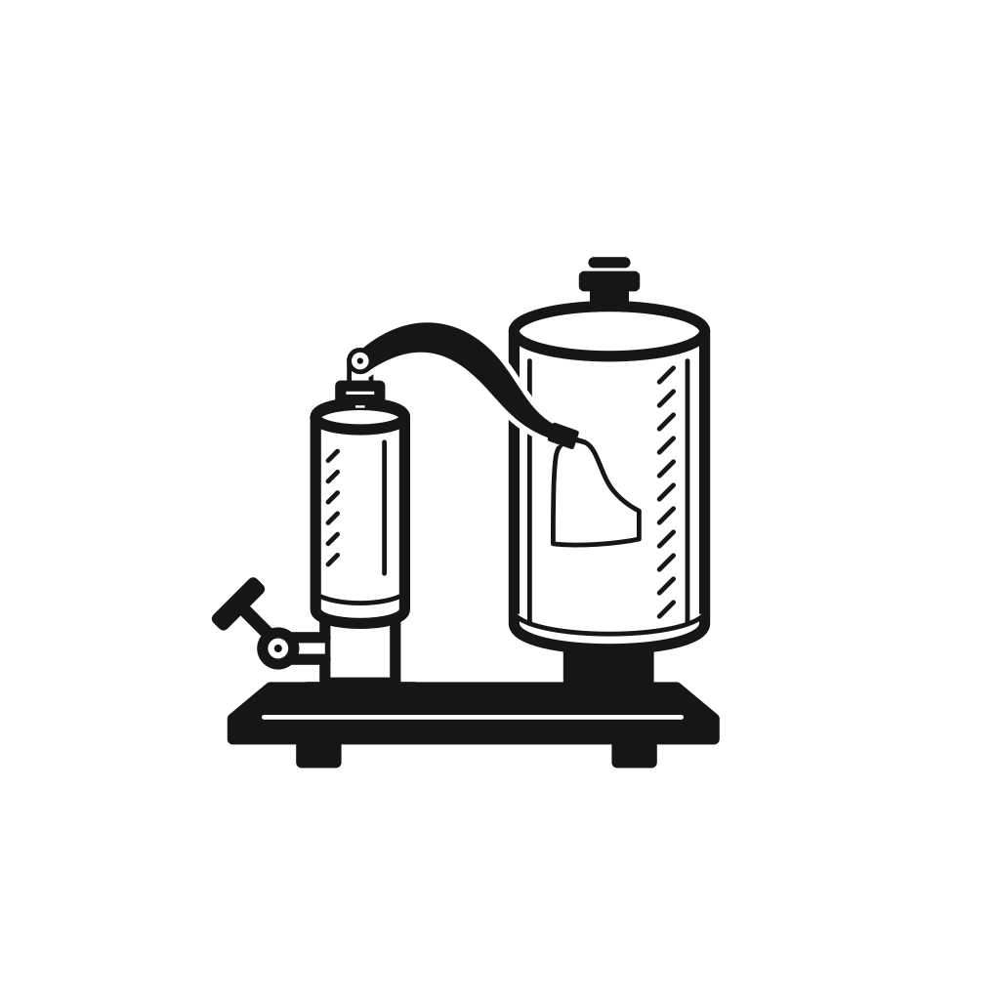
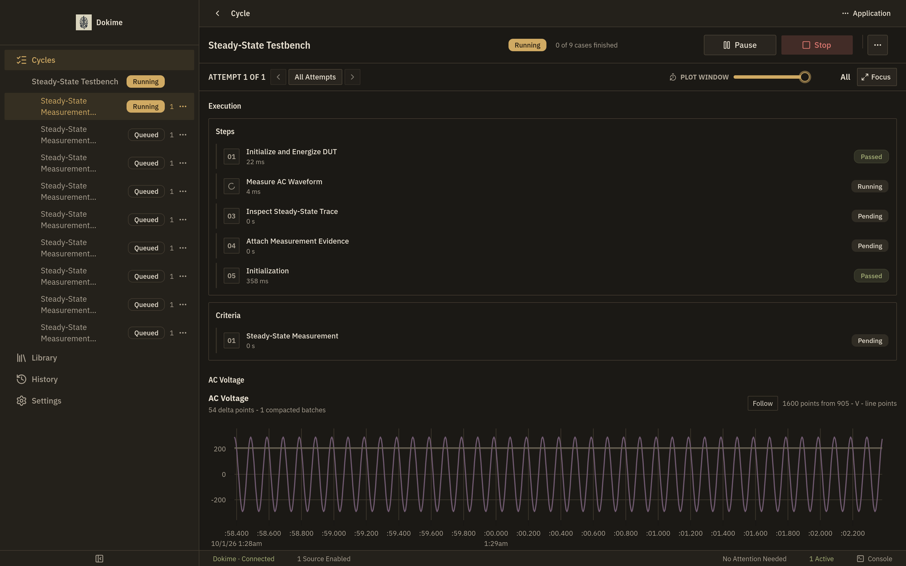
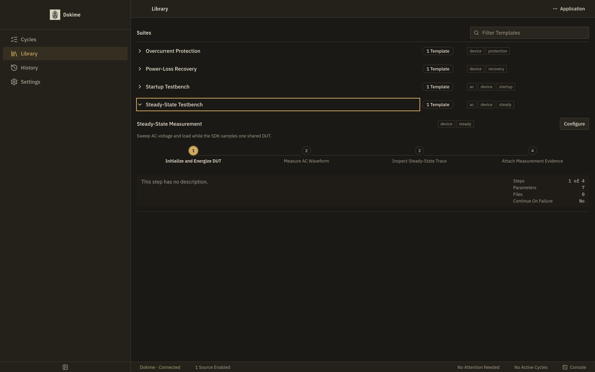
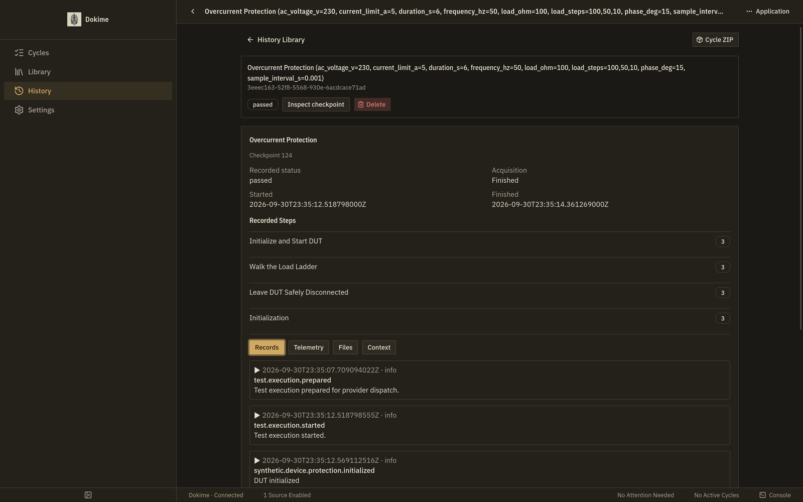

# Dokime

[](https://github.com/stokker-technologies/dokime/releases)
[](https://github.com/stokker-technologies/dokime/actions/workflows/ci.yml)
[](https://github.com/stokker-technologies/dokime/actions/workflows/nightly.yml)
[](#quick-start)
[](#quick-start)
[](LICENSE)

<p align="center">
  <picture>
    <source media="(prefers-color-scheme: dark)" srcset="organization/logos/transparent-on-dark.svg">
    
  </picture>
</p>

[Website](https://stokkertechnologies.ch/en/open-source/dokime) · [Getting Started](#quick-start) · [Tutorials](docs/remote/overview.md) · [Examples](docs/product-guide.md#examples) · [Documentation](docs/product-guide.md)

**Run repeatable engineering tests. Keep the evidence.**

Dokime turns hardware and software test procedures into operator workflows,
live measurements and HTML reports. Define a procedure, run it across
operating conditions, and review the evidence behind each result.



## Features

- **Reusable Procedures:** Define suites, typed parameters, ordered steps, acceptance criteria and explicit cleanup.
- **Traceability:** Capture and edit device and bench identity from steps; retain it with the execution and reports.
- **Parameter Sweeps:** Expand one template into operating points without copying the procedure.
- **Measurements And Reports:** Capture live data and retain plots and records in HTML reports, with links to execution artifacts.
- **Operator Workflows:** Combine automation with confirmations and manual checkpoints; keep responses with the execution.
- **Equipment Plugins** [`plugin`]: Extend Dokime with equipment operations, test suites and settings through its Rust authoring API.
- **Remote Control** [`client`]: Control an existing backend through the CLI or a programmatic client.
- **Native Media Capture** [`media-native`]: Attach screenshots, camera photos and audio where the platform supports them.

## Interfaces

### GUI

The desktop brings the test library, active cycles, measurements and evidence
together. Start with the built-in Local backend or select a saved remote in
Settings. Export a `.dokime-remote` access file on the host and import or drop it
on another desktop to connect. The desktop remembers that choice; operators do
not need a source checkout.

Feedback appears in toasts and remains in [Notifications](docs/product-guide.md#notifications) until cleared.

#### Examples




### CLI

Use `dokime` to run a server or control an existing backend. Use
`cargo dokime sidecar` to create, build and inspect plugins, and
`cargo dokime installer` to package prebuilt binaries with an organization pack.
`cargo dokime bindings` exports protobuf contracts and Python clients. The [CLI reference](docs/product-guide.md#cli-reference)
contains the complete workflow.

#### Examples

```sh
dokime server --application-root ~/dokime-lab
dokime status --backend lab --json
dokime operation list --backend lab
```

### Python

The async Python client controls a running backend with owned cycle contexts,
terminal evidence iterators and saved bundles with digest manifests. The distribution is `dokime-client`; imports use `dokime_client`.
Follow the [locked remote tutorial](docs/remote/python.md) for a complete example.

#### Examples

Install the wheel from the same candidate as your backend:

```sh
uv add ./dokime_client-0.1.0-py3-none-any.whl
```

The [Python client guide](packages/dokime-client/README.md) covers authentication,
backend profiles and execution APIs; the [runnable examples](docs/remote/python.md) retain their complete setup.

### Rust

The Rust SDK defines plugins, test templates, equipment operations and typed
evidence. Dokime builds on [Harmos](https://github.com/stokker-technologies/harmos)
(currently pinned to revision `a3fbb927f85b815449e4b4c43085fd254cde06a3`)
for contracts and managed plugin lifecycles.

#### Examples

The test-only [OBC plugin](docs/plugin-obc.md) simulates a charger without physical
hardware. Follow its [procedure and measurement examples](docs/product-guide.md#run-the-procedure-and-capture-evidence)
to see the public authoring API in context.

Use the starter's `dokime` dependency with the `plugin-sidecar` feature. Authoring
macros and contracts come through that facade. For example, the
[capture template](plugins/sidecars/obc/src/suites/benchmarks/capture.rs) declares
validated parameters and cartesian expansion with:

```rust
#[dokime::parameters]
pub struct Parameters {
    #[parameter(label = "Rows", default = 100_000, min = 1, max = 200_000)]
    pub rows: u64,

    #[parameter(label = "Member", default = 0, expansion = "cartesian")]
    pub member: u64,
}
```

The same plugin uses `#[dokime::observer]` for its
[system measurements](plugins/sidecars/obc/src/observers/system.rs) and
`#[dokime::criterion]` for its
[pulse acceptance check](plugins/sidecars/obc/src/suites/checks/pulse.rs).

Custom installers can declare `[installer] identifier = "com.hilti.dokime"` to
keep their installation and storage separate from plain Dokime. They include
plugins selected by version and feed name, plus external bundles from an
organization pack or repeatable `cargo dokime installer package --plugin <path>`
arguments. Release distributions and plugin archives are verified and cached. Bundled plugins
install on startup without replacing newer installed versions. See the
[installer guide](docs/product-guide.md#native-installers)
for packaging options.

## Quick Start

1. **Download An Installer.** Choose a matching [release](https://github.com/stokker-technologies/dokime/releases) or successful [CI candidate](https://github.com/stokker-technologies/dokime/actions); the [download walkthrough](docs/remote/overview.md#obtain-one-matching-candidate) identifies the Windows and Linux packages.
2. **Inspect Host Telemetry.** The installer includes `plugin-host.dokime`, selected explicitly by the Dokime packaging task. Host streams arrive through the supervised plugin boundary.
3. **Try The Test Fixture.** In a source checkout, build the explicit [OBC fixture](docs/plugin-obc.md#build-and-validate), install its bundle, then run a charging template and inspect its measurements and report.
4. **Write Your Plugin.** Start with the [plugin starter](crates/cargo-dokime/templates/) and [authoring commands](docs/product-guide.md#plugin-authoring).

Dokime is pre-1.0. Pin matching application, client and plugin revisions;
public APIs and development storage formats may change. See the
[product guide](docs/product-guide.md) for the detailed model and limitations.

CLI and authoring-tool releases use target-specific ZIP (Windows) or tar.gz
(Unix) archives. See [Install Tools With Mise](docs/product-guide.md#install-tools-with-mise)
for archive selection and the release download inventory. Distributors use
`dokime-distribution-<version>-<target>.zip`; shipping plugins share native
`dokime-sidecars` archives described by `plugins.json` format 2.
Custom installers select plugins through top-level `[[plugin]]` entries: set
either `name` for a release plugin or `path` for a bundle relative to the
organization pack. Its `plugins/` folder is storage only; files ship only when
selected explicitly. See [Native Installers](docs/product-guide.md#native-installers)
for the manifest and equivalent repeatable `--plugin` arguments.

### Configuration

Dokime stores application preferences in its SQLite storage root. Use Settings
in the desktop application to change appearance, client timeouts, report plot
defaults, telemetry cadence and remote listener preferences. Updates carry a
revision; conflicting edits require refreshing before saving again.

The application folder derives from the installed distribution identifier, falling
back to the compiled identifier when `distribution.json` is absent. Plain Dokime
defaults to `%LOCALAPPDATA%/com.stokker.dokime` on Windows or `${XDG_DATA_HOME:-$HOME/.local/share}/com.stokker.dokime` on Linux.
`dokime server --application-root <directory>` selects another application folder;
storage paths are bootstrap options, not editable preferences. Dokime ignores legacy `config.toml` and `settings.json` files and preserves them; settings live in the database.
Development roots containing older stream-row formats, earlier plugin identities,
or evidence indexes without incremental numeric summaries require a fresh storage
root. Dokime reports incompatible data and never resets an existing root.

The Backends table and CLI backend commands share `backends.json`. Import a `.dokime-remote` file with an Identifier and Label, connect to it, or
remove it from the registry without connecting first. Revoke individual clients
from the host’s Paired Clients table.
Credentials remain in protected credential stores. Plugin settings and secret
catalog metadata persist in SQLite; credential values are not stored there.
Settings → Plugins keeps installed plugin settings and secrets editable after
startup fails. Save corrections and restart Dokime from the plugin page to retry.

Implementation limits use domain and subsystem constants. See the
[application settings model](crates/dokime-domain/src/model/settings/application.rs)
and [storage defaults](crates/dokime-runtime/src/config/storage/defaults.rs).
Plugin metadata preparation uses the shared [schema budget configuration](docs/product-guide.md#plugin-schema-budgets)
for packaging, inspection and installation.

Live plots display saved telemetry. The time-range slider filters storage queries:
selecting a wider range retrieves older saved samples, and selecting a narrower
range changes only what is displayed. It does not change storage retention.

Client sample following watches saved storage progress and resumes from delivered
stream cursors after reconnecting. Execution-scoped follows drain the saved seal
before ending; they do not poll a second live-sample history.

Plot Default uses each plot's authored window; All queries its full saved history.

Plot groups show numeric labels in ascending order, then text labels alphabetically.
Different labels with equal numeric values remain separate and sort alphabetically.

The live log, diagnostics bundle and remote sessions remain available; remote sessions refresh when opened or focused; remote sessions
also provide Refresh. Cycle history shows absolute update times. Busy document
reads continue retrying, while other document failures retry once.

## Contributing

Bug reports, focused fixes, clearer examples and equipment integrations are
welcome. Read [Contributing](CONTRIBUTING.md) for setup and the review workflow.
The [storage benchmarks](CONTRIBUTING.md#storage-benchmarks) mirror Harmos's storage
suite using Dokime's default settings and SQLite backend, including writes, reads,
queries, filesystem operations and concurrent workloads.

## About

Dokime is developed by [Stokker Technologies](https://stokkertechnologies.ch)
for engineering test workflows that need traceable measurements and evidence.
It is available under [Apache-2.0](LICENSE).
