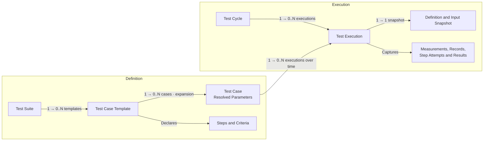

# Dokime

<p align="center">
  <picture>
    <source media="(prefers-color-scheme: dark)" srcset="organization/logos/transparent-on-dark.svg">
    
  </picture>
</p>

[](https://github.com/stokker-technologies/dokime/actions/workflows/ci.yml?query=branch%3Adev)
[](https://crates.io/crates/dokime)
[](https://pypi.org/project/dokime-client/)
[](https://github.com/stokker-technologies/dokime/releases/latest)
[](LICENSE)

**Run repeatable engineering tests. Keep the evidence.**

Dokime turns hardware and software test procedures into operator workflows,
live measurements, and self-contained reports. Use it for bench testing,
device qualification, and manufacturing checks where a result needs more
context than pass or fail.

Define the procedure in Rust. Run it across operating conditions. Review what
happened, with the inputs, measurements, and decisions that explain the result.

[Quick Start](#quick-start) · [The Test Domain](#the-test-domain) ·
[Examples](#examples) · [Documentation](#documentation)


## Features

- **Test Procedures**

  Define reusable suites and templates with typed parameters, ordered steps,
  acceptance criteria, and explicit cleanup. Keep the procedure readable
  alongside the equipment operations it calls.

- **Parameter Sweeps**

  Expand one template across combinations of operating conditions. Three input
  voltages and three loads produce nine cases without duplicating the procedure.

- **Live Measurements**

  Capture typed measurements while a test runs. Compose time-series plots,
  distributions, and other views with units and reference limits tied to the
  case's parameters.

- **Acceptance Criteria**

  Evaluate captured samples and structured records. Keep the actions that
  perform a test separate from the criteria that judge its evidence.

- **Operator Interaction**

  Combine automation with confirmations, forms, and manual checkpoints.
  Retain operator responses with the execution they belong to, along with
  screenshots, camera photos, and audio recordings captured on the testbench.

- **Traceability**

  Capture specimen identity, resolved inputs, and execution context. Keep logs,
  structured records, and attached files alongside the measurements they explain,
  including files watched in a local or FTPS folder while the execution runs.

- **Self-Contained Reports**

  Present results, plots, and captured evidence in self-contained HTML reports.
  Review them without installing Dokime or connecting to a running server.

- **Plugins**

  Integrate equipment and contribute suites, operations, observers, and settings.
  Dokime builds on [Harmos](https://github.com/stokker-technologies/harmos)
  for typed contracts and managed plugin lifecycles.

- **Automation**

  Run through the desktop application or control execution through the CLI and
  programmatic interfaces. A desktop session can use its local backend or attach
  to an explicitly configured remote server.

## The Test Domain

Definitions describe what can be tested. Execution captures what happened when
concrete cases ran. A **suite** organizes related **templates**; each template
materializes **cases** with resolved parameter values. A **cycle** groups the
executions selected for a test campaign.



Each execution identifies exactly one case and one cycle. Repeating a case
creates another execution; retrying a step is recorded as a step attempt within
that execution. A cycle can bring together cases from different templates and
suites—it is not a copy of one suite. A cycle is created explicitly, starts
empty and grows as explicit execution attempts are appended. Appending never
starts hardware; an execution is the Start/Stop unit.

Several cycles can stay **Active** at once, with one execution running across
the server. Start admits an execution once by its durable identity. Optional
server-owned ordered continuation can start the next unstarted member after
natural completion and sealing; it defaults to false. Stop durably disables that
continuation policy. Each execution saves and seals its evidence while its cycle stays
Active. Select the destination cycle in the Library before adding attempts.

**Seal Cycle** closes admission immediately, stops that cycle's running work,
cancels unrun executions and waits for every execution and the cycle report to
be durably saved. The phase advances through **Sealing** to **Sealed**. Other
cycles continue. Shutdown stops running executions without regenerating cycle
reports. Startup seals previous-session Active cycles without replaying device
operations.

For a charger campaign, one template might measure steady-state charging while
another checks overcurrent protection. Cartesian expansion turns the operating
points into concrete cases:

```text
Input Voltage:  207 V, 230 V, 253 V
Load Impedance: 80 Ω, 100 Ω, 120 Ω

3 Voltages × 3 Loads → 9 Cases Of The Same Procedure
```

A list can also be one parameter value. An ordered load sequence such as
`[100, 50, 10]` Ω can describe three steps within one case; it does not have to
mean three separate cases. Expansion is declared explicitly.

## Quick Start

For an installed host and a second PC, follow the
[candidate-artifact OBC walkthrough](packages/dokime-client/examples/remote/README.md).
It uses matching CI installers, plugin and examples without a source checkout;
a matching published release combination remains separate.

Dokime is pre-1.0 and currently supports Windows and Linux. To launch from
source, install [mise](https://mise.jdx.dev) and use the pinned toolchain:

```sh
git clone https://github.com/stokker-technologies/dokime.git
cd dokime
mise trust
mise install --locked
mise run prepare
mise run dev
```

This starts the desktop application with its local backend. The
[OBC plugin](plugins/obc-plugin/) supplies a simulated charger; no physical charger
is required. The task builds the OBC bundle into `target/debug/plugins/` and
points `DOKIME_PLUGINS_DIR` at that directory, so the backend loads it for the
session without installing it. Create a cycle
with **New Cycle** (its title defaults to the current date and time), then add
OBC's charging templates to it from the library, choose operating points, and
inspect live measurements and results.

To install OBC into a regular application instead, build its bundle and add
it through the application's plugin settings, then restart:

```sh
cargo run -p cargo-dokime -- build --package obc-plugin --output target/debug/plugins/obc-plugin.dokime
```

An installed Dokime places `dokime`, `dokime-server` and `dokime-gui` side by
side, and the CLI launches the other two: it looks beside itself, then in
`DOKIME_HOME` when that is set and otherwise in the platform's installation
directories. Arguments after
`--` reach the launched program unchanged:

```sh
dokime serve -- --application-root ~/dokime-lab
dokime gui --endpoint http://127.0.0.1:50051
dokime plugin install target/debug/plugins/obc-plugin.dokime --backend lab
```

`dokime plugin install` stages the bundle on the backend, shows its identity,
digest and the environment variables its secrets read (names only), and records
consent for the next restart; `--yes` consents without the prompt. Plugin authors
use `cargo dokime new`, `build`, `inspect` and `dev`; `dev` rebuilds on every
change and runs the bundle through `dokime serve` and `dokime gui`.

## Browser Clients

The desktop never needs gRPC-Web: its WebView reaches the backend only through
the shell. A browser client is the one caller that does, so a backend serves it
only when asked, together with each exact page origin allowed to call:

```sh
dokime-server --grpc-web --allowed-origin https://frontend.example
```

Repeat `--allowed-origin` for additional origins. An origin contains only its
scheme and authority; paths, credentials and wildcards are refused, and an
origin without `--grpc-web` is an error. The standalone listener is native and
requires a loopback address. Remote listeners use the persistent Remote Access
settings, with TLS and access-key authentication selected independently;
browser-origin permission does not grant operation access. A GUI built with
`DOKIME_TRANSPORT=grpc-web` is such a browser client.

## Native Remote Access

Settings → Remote Access owns persistent listener settings, one-time key
generation, public certificate download and explicit key/certificate rotation.
Management operations are available only through the native local listener.
The access key is shown once and can be copied or saved through the native
file picker. The application root's private `remote/access.json` retains its
SHA-256 verifier and the TLS certificate/private key; it never retains the
access key. Certificate DNS/IP identities change only through explicit
regeneration. TLS and authentication are independent choices, with separate
isolated-lab warnings.

The remote listener shares the runtime with the native listener and has its own
transport and authentication settings. Reconfiguring it does not stop admitted
executions. A rotated key can recover their receipts and control them without
repeating execution. Remote connections through loopback retain remote access
rules, including native-only management and host-path restrictions.

## Full-Control Access And Plugin Capabilities

A valid access key grants full control over remote product operations and
installed plugins, including request-dependent channel, stream and source scopes.
An authentication-off listener grants the same control to every connection;
use that setting only in an isolated lab. There are no per-user roles or server
permission files. TLS controls transport encryption and certificate verification
independently of access-key authentication.

Native-only operations and internal host providers remain unavailable remotely.
Plugin identity comes from the original runtime registration, never an owner
name supplied by a caller. Plugins still declare their own requirements for
calls into other plugins or host services; an operator's key cannot expand those
capabilities. A grant must name the operation being called. Discovery and
invocation use the current provider contract; rediscover after provider changes.

## Backend Profiles

The CLI connects to an existing server. Save and select a backend with:

```sh
dokime backend add lab --endpoint https://dokime.example:8765 --expected-backend BACKEND_ID --ca /path/to/ca.pem --keyring
dokime backend use lab
dokime auth login --backend lab --key-file /path/to/remote.key
dokime status --backend lab --json
dokime operation list --backend lab
dokime operation show dokime.runtime.health --backend lab --json
dokime auth logout --backend lab
```

`operation list` and `operation show` read live provider contracts, including
owner, generation, grants, gRPC availability and conditional access. Discovery
is bounded and does not promise admission of a later invocation. `show` retains
all visible providers of the selected operation.

`operation list` displays operation ID, provider owner and description. Select a
provider explicitly for metadata or a call:

```sh
dokime operation show OPERATION_ID --owner OWNER --backend lab --json
dokime operation call OPERATION_ID --owner OWNER --backend lab --input request.json --output response.json
dokime operation call OPERATION_ID --owner OWNER --backend lab --json '{"enabled":true}'
dokime operation call OPERATION_ID --owner OWNER --backend lab --input request.json --input-stream-file items.jsonl --output response.json
```

`--input` and `--json` are mutually exclusive request sources; omitting both
sends `{}`. Inputs use the discovered contract's protobuf JSON shape. Streaming
input is one item per line. Without `--output`, stdout emits one JSON item or
completion event per line. A response file contains one JSON array of those
events, including the final completion; a unary call has only that completion.

Existing response files require `--overwrite`. Predictable output conflicts are
rejected before dispatch. The complete response is written to a temporary sibling
and published atomically after successful completion. A failed output write
never replays the device command. Diagnostics go to stderr and failures return
nonzero.

Ctrl+C stops waiting locally. A timeout or disconnection after dispatch can leave
the device outcome unknown, even when no response was received. Check device
state before manually resending; calls are never retried automatically. Manual
operations can affect a running test and are not logged into its execution
evidence. From Rust, `dokime::client::Client::call_operation` uses the same live
contract discovery and shared Harmos codec:

```rust
let client = Client::connect(Target::new(endpoint, None)?, Some(token), None).await?;
let stream = client
    .call_operation("obc-plugin.get_status", Some("obc-plugin"), b"{}", Vec::new())
    .await?;
while let Some(event) = stream.message().await? {
    println!("{event:?}");
}
stream.close().await;
```

Browse the registered suite catalog, start an attempt and stop work explicitly:

```sh
dokime catalog list --backend lab --json
dokime catalog show REGISTERED_SUITE_ID --backend lab --json
dokime execution start EXECUTION_UUID --backend lab --json
dokime execution stop EXECUTION_UUID --backend lab --json
dokime cycle seal CYCLE_UUID --backend lab --json
```

Replace the identifiers with those returned by the backend. `catalog list
--json` emits one complete suite definition per line; a later read failure
returns a nonzero exit status after any earlier lines. `execution stop` stops
the selected execution and halts its cycle's automatic continuation. Wait for
its saved outcome before downloading evidence. To repeat a case, append a new
execution identity and Start that attempt; earlier evidence remains unchanged.
Cancelling an ordinary local wait leaves admitted backend work running.

`cycle seal` waits for the durable cycle seal. Repeating it is safe, including
after a lost response. Other cycles remain available. The Python
client provides the same durable boundary with `await cycle.seal()`.

Download saved evidence without running any work again:

```sh
dokime execution export EXECUTION_UUID --backend lab --output execution.zip
dokime cycle seal CYCLE_UUID --backend lab --json
dokime cycle export CYCLE_UUID --backend lab --output cycle.zip
```

A sealed execution is exportable while its cycle stays Active. A cycle export
requires its durable seal and includes every exact member revision. The ZIP
contains `manifest.json`, `evidence.sqlite`, captured files and saved HTML
reports. The manifest records source identities, revisions, row counts and
payload checksums; SQLite exposes inputs, definitions, outcomes, records and
typed stream columns. Query `streams` and `stream_columns` to find each stream's
tables, field names and units. Wide streams use partitions joined by `m_row`.
Canonical JSON retains nested values and unsigned integer identity.

Exports use saved storage snapshots and survive server restart. Missing
required evidence fails the export. The server admits one export at a time,
with an 8 GiB archive limit. The client verifies contiguous chunks, size,
SHA-256 and final transport success before publishing the ZIP atomically.
Existing destinations require `--overwrite`. Failed downloads preserve the
previous output; retry starts a fresh download and never repeats execution.
The desktop's **Export Evidence** action uses the same exporter and a native
save dialog. The Python handles provide `await execution.export(path)` and
`await cycle.export(path)`, with `overwrite=True` for explicit replacement.

Selection uses explicit `--backend` or `--endpoint`, then `DOKIME_BACKEND`, then
that configuration's saved default. An explicit endpoint uses only credentials
supplied for that invocation. Profile edits affect future connections.
`backend list`, `show`, `use`, and `remove` operate offline; removal clears a
matching default and retains OS credentials. `auth login` negotiates backend
identity and the operations available to the caller with the supplied bearer, then saves it for
that endpoint and marks the selected profile for keyring lookup. It refuses a
profile whose target changed during login. `auth logout` removes the local
credential; it sends no revocation request. Use `--key-file` on individual
commands for headless connections when an OS store is unavailable.

Backend identity includes the server's compiled Rust `target` alongside its
product version, even when the desktop runs on a different operating system.

Credential precedence is `--key-file`, process `DOKIME_KEY`, then `DOKIME_KEY`
from an explicitly selected `--env-file`. Dotenv values fill absent process
variables; they never override them or search parent directories. Selected
files must be valid UTF-8 regular files, even when another source supplies the
key. Keys contain 32–4096 visible ASCII characters; dotenv input is bounded to
64 KiB. Copy [.env.example](.env.example) to the ignored `.env`, replace its
placeholder and select it explicitly:

```sh
dokime status --endpoint https://dokime.example:8765 --ca server.pem --env-file .env
```

Clients also accept an explicitly selected `http://` origin for native gRPC in
an isolated lab whose listener has TLS disabled. Plaintext exposes both keys
and data. The receiving listener decides whether authentication is required,
independently of TLS; omitting a key never bypasses that check. HTTPS always
verifies certificates, and a CA file is refused for HTTP. Local-only native
operations still depend on the receiving listener's policy.

`status` and `auth status` perform a bounded live check. JSON distinguishes
`ready`, `unreachable`, `authentication`, `permission_denied`, `incompatible`,
`not_ready`, `timed_out` and `credentials_unavailable`; failed checks return exit
code 1. `--timeout-seconds` bounds connection and credential-store waits. A
store operation already in progress can finish after its caller times out.
Profile settings and OS credentials are separate writes: a file publication
failure can leave the credential saved, and explicit logout removes it.

Configuration lives at `$XDG_CONFIG_HOME/dokime/backends.json` (falling back to
`$HOME/.config/dokime/backends.json`) on Linux, `$APPDATA/dokime/backends.json` on
Windows, or `$HOME/Library/Application Support/dokime/backends.json` on macOS.
`--profiles-file` overrides `DOKIME_PROFILES_FILE` and the standard location.

The version 1 JSON contract keeps secrets in a separate OS credential store:

```json
{
  "version": 1,
  "default": "lab",
  "profiles": [{
    "name": "lab",
    "endpoint": "https://dokime.example:8765",
    "expected_backend_id": "BACKEND_ID",
    "ca_certificate_pem": null,
    "credential": "keyring"
  }]
}
```

Names contain 1–64 ASCII letters, digits, dots, underscores or hyphens. Unknown
fields, duplicate names, unsupported versions, invalid endpoints and dangling
defaults are refused. Files are limited to 1 MiB and 128 profiles. CLI edits lock
and atomically replace the file; contention refuses the edit for retry. Tokens
stay outside JSON. Python reads explicitly named profiles with
`DokimeClient.from_profile("lab", key_file="remote.key")`; it uses the same configuration
location and accepts an explicit `path` override.

## Planning And Creating Cycles

Name a template by the readable ID that `dokime catalog show` lists. Preview
its cases, then materialize them before constructing execution attempts:

```sh
dokime plan preview --template obc.charger.steady.measurement --backend lab --json
dokime plan materialize --template obc.charger.steady.measurement --backend lab --json
dokime cycle create --label "Campaign 1" --backend lab --json
dokime cycle append CYCLE_ID --case-id CASE_ID --backend lab --json
```

Materialization captures the case's definition and provider revision. Append
refuses stale cases and creates distinct execution UUIDs for each repeated
`--case-id`, preserving order. A cycle is explicitly created empty; append
registers attempts without starting hardware. An omitted cycle `--identifier`
is derived by the backend.

For a linear script, `--id-only` prints materialized case IDs, the created cycle
UUID, or execution UUIDs from that exact append. This pulse selection produces
one case and one attempt:

```sh
case_id=$(dokime plan materialize --template obc.checks.pulse --parameters-json '{"sample_count":8}' --backend lab --id-only)
cycle_id=$(dokime cycle create --label "Remote Pulse" --backend lab --id-only)
execution_id=$(dokime cycle append "$cycle_id" --case-id "$case_id" --backend lab --id-only)
dokime execution run "$execution_id" --records --samples --record-type 'obc.run.*' --stream obc.pulse --wait-seconds 60 --backend lab
dokime execution export "$execution_id" --output pulse.zip --backend lab
dokime cycle seal "$cycle_id" --backend lab
dokime cycle export "$cycle_id" --output cycle.zip --backend lab
```

`execution start` admits one execution and returns without waiting.
`execution run` composes that same Start with a durable wait and requested
listener drain. Both use the execution's identity for idempotency: reconnect
with the same UUID and mode after an uncertain Start response. A finished
execution never restarts; append a fresh attempt to run its case again.
There are no caller-managed Start keys or cycle Run/Stop commands.

`--records` and `--samples` observe all captured records and samples.
Repeated `--record-type` and `--stream` flags restrict their respective
selection with case-sensitive whole-identifier globs. Observations and the final
drain summary appear on stderr; the final result appears on stdout.
`execution wait` observes an already admitted execution without starting it.
A saved nonpassing outcome returns nonzero. Interrupting an ordinary wait leaves
remote work running; `execution stop EXECUTION_ID` requests a cooperative stop.

Several cycles can stay Active, with one execution running server-wide.
`continue_automatically` defaults to false. To let the server continue with
the next unstarted member after natural completion and durable sealing, create
the cycle with `--continue-automatically`. A failed execution is a result, not
a reason to halt: continuation proceeds regardless of verdicts. Explicit execution Stop durably sets the cycle's
`continue_automatically=false`. Later explicit Start runs only the selected
attempt until the user explicitly re-enables that policy.
Appending to an idle cycle starts no hardware, and reaching the end keeps the
cycle Active until it is explicitly sealed.

Sealed cycles remain in History after a server restart, including cycles with
no executions. History lists their saved headers independently of execution
results; an empty cycle has no passing or failing outcome and its saved report
can still be opened.

Scripts can opt into cancellation and evidence recovery while running or waiting:

```sh
mkdir -p recovery
dokime execution wait "$execution_id" --backend lab \
  --cancel-on-interrupt --owned-cycle "$cycle_id" --recovery-directory recovery
```

The same options work with `cycle append`, `execution start`, `execution run`,
`execution export` and prompt `next/show/answer`.
They verify exact cycle membership before mutation. Use `--owned-cycle` only
for a cycle created and reserved by the script: Ctrl+C stops that execution,
seals that cycle and downloads `execution-<UUID>.zip` and `cycle-<UUID>.zip`.
Sealing cancels its unstarted members; other cycles and the shared server remain
available. Existing recovery files are refused before connection. A lost
connection cannot confirm cancellation or a completed download; retain the
original identities and inspect them before resubmitting.
PowerShell terminates a native command whose output it captures when Ctrl+C
arrives, before recovery can finish. Run recovery-armed commands uncaptured and
read their UUIDs from `--id-file <path>`, which `cycle append` and prompt `next`
truncate before connecting and fill with one confirmed UUID per line.
Batch recovery applies while these native commands are observing an interrupt;
it cannot reliably cover connection setup or gaps between commands. A lost
Create reply leaves the cycle identity unknown and requires manual inspection.

The [Remote CLI Workflows](packages/dokime-client/examples/remote/cli/README.md) include
linear device, test and confirmation exercises for POSIX shell, PowerShell 7.3+ and
Command Prompt. Edit their connection, execution, observation and file globals,
then run without arguments. Their names, grouping and meanings match the
[Python examples](packages/dokime-client/examples/remote/python/control-test.py).
The scripts require the matching CLI and simulated OBC plugin; a matching
first-party release combination and native workflow validation remain pending.
The [candidate walkthrough](packages/dokime-client/examples/remote/README.md) explains
how to obtain one matching CI artifact set and use its bundled Python wheel.

`--parameters-json` supplies single template parameter values as a plain
JSON object. The default pulse has no prompt. To require one confirmation,
materialize that case and explicitly Start its attempt so the script can answer:

```sh
case_id=$(dokime plan materialize --template obc.checks.pulse \
  --parameters-json '{"require_confirmation":true}' --backend lab --id-only)
cycle_id=$(dokime cycle create --label "Remote Confirmation" --backend lab --id-only)
execution_id=$(dokime cycle append "$cycle_id" --case-id "$case_id" --backend lab --id-only)
dokime execution start "$execution_id" --backend lab
prompt_id=$(dokime execution prompt next "$execution_id" --wait-seconds 60 --backend lab --id-only)
dokime execution prompt show "$execution_id" "$prompt_id" --backend lab
dokime execution prompt answer "$execution_id" "$prompt_id" --action yes --backend lab
dokime execution wait "$execution_id" --wait-seconds 60 --backend lab
```

Prompt reads and answers require both exact identities. The server refuses stale
or duplicate answers. After an ambiguous response, inspect `prompt show`
before deciding what to do. Actions `cancel` and `abort` submit a cancelled
response. Seal the script-owned cycle before exporting its complete bundle.

`--input-file` takes the operation's canonical JSON without flag overrides.
For `plan materialize`, the request contains one registered template selection:

```json
{
  "selection": {
    "suite_id": "SUITE_ID",
    "template_id": "TEMPLATE_ID",
    "parameters": [],
    "files": []
  }
}
```

For an append whose exact identities must survive a lost response, retain its
canonical `AppendExecutions` input before calling `cycle append --input-file`:

```json
{
  "cycle_id": "CYCLE_UUID",
  "executions": [
    { "execution_id": "EXECUTION_UUID", "case_id": "CASE_UUID" }
  ]
}
```

Repeating that append with the same bindings cannot duplicate attempts;
conflicting identity reuse fails. Flag-based appends print their registration
identities to stderr before transmission. Retain those identities if the reply
is lost.

Until a cycle or execution seals, operators can rename it with the pencil
beside its desktop title or with `Execution/RenameCycle` and
`Execution/RenameExecution`. Sealed, archived and History subjects refuse
with `FailedPrecondition`. Renaming an execution renames its case, including
other attempts, and records an `operator.label_edited` record with both labels.

For `cycle create --input-file cycle.json`, retain the explicit continuation
policy alongside its metadata:

```json
{
  "metadata": {
    "identifier": "campaign.1",
    "label": "Campaign 1",
    "description": null,
    "tags": [],
    "attributes": [],
    "created_at": null,
    "updated_at": null
  },
  "continue_automatically": false,
  "context": null
}
```

```sh
dokime cycle create --input-file cycle.json --backend lab --id-only
```

Cycle creation is a separate non-idempotent mutation. If its response is
uncertain, inspect the backend before creating another container.

## Examples

### Qualify An On-Board Charger

Harmos supplies the runtime and plugin boundary. Dokime adds the testing domain:
procedures, parameter expansion, operator interaction, acceptance criteria, and
self-contained reports.

The [OBC charger simulation](plugins/obc-plugin/src/suites/) demonstrates startup,
steady-state measurement, overcurrent protection, and recovery. It models a
charger testbench for learning the workflow; it is not a validated electrical
model or a ready-made vehicle qualification standard.

### Define The Operating Points

A shortened version of OBC's
[steady-state parameters](plugins/obc-plugin/src/suites/steady/measurement.rs) declare the
nine-case voltage/load sweep:

```rust
// Cargo.toml: dokime = { git = "https://github.com/stokker-technologies/dokime", features = ["plugin-sidecar"] }
use dokime::definition::ParameterDefault;

#[dokime::parameters]
pub struct Parameters {
    #[parameter(
        label = "AC Voltage (RMS)", unit = "V",
        expansion = "cartesian",
        default = ParameterDefault::space([207.0, 230.0, 253.0]),
    )]
    pub ac_voltage_v: f64,

    #[parameter(
        label = "Load Impedance", unit = "ohm",
        expansion = "cartesian",
        default = ParameterDefault::linspace(80.0, 120.0, 3),
    )]
    pub load_ohm: f64,
}
```

The template names its parameter type once. Every expanded case resolves those
inputs before execution, so the procedure and its document see the same values.

### Run The Procedure And Capture Evidence

OBC's [steady-state template](plugins/obc-plugin/src/suites/steady/measurement.rs)
initializes shared device resources, energizes the charger, observes its
waveform, asks the operator to inspect the trace, and attaches a measurement
summary. Cleanup stops the simulated device.

This excerpt is the template's measurement observer. `InputMeasurement`,
`Samples`, `ObserverStreams`, and `reading` belong to the example:

```rust
#[dokime::observer(interval_ms = 5, streams = ObserverStreams)]
async fn samples(ctx: &mut ObserverContext<'_>) -> Result<(), Error> {
    let row = reading(ctx.resources())?;
    ctx.stream::<InputMeasurement>()
        .into::<Samples>()
        .push(row)
        .await;
    Ok(())
}
```

The same template uses `ctx.ask(...)` for operator sign-off and writes its
summary through `ctx.artifacts()`. Its criterion checks that enough samples
were captured and that the completion record accepted the run:

```rust
#[dokime::criterion(id = STEADY_ACCEPTANCE_CRITERION, label = "Trace Accepted")]
fn accepted(ctx: &CriterionContext<'_>) -> Result<bool, Error> {
    Ok(
        ctx.samples::<Samples>().len() as u64 >= ctx.parameters().sample_count()?
            && super::super::support::decided(
                ctx.records::<Completed>(),
                |run| run.accepted,
            )?,
    )
}
```

These are excerpts from the complete template, not standalone programs.
The [protection template](plugins/obc-plugin/src/suites/protection/overcurrent.rs)
adds an automated load ladder and verifies that an overcurrent fault disconnects
the supply and prevents restart. A real charger integration can extend these
procedures with regulation, efficiency, and thermal criteria for its hardware.

A step also reaches two built-in operations through `ctx.host()`, with nothing
to declare. `RunProcess` runs a vendor tool in the execution's artifact folder,
sends its output to the execution log or into an artifact, and records its exit.
`WatchFile` captures a device log written during the step into an artifact and
turns matching lines into rows and records. The
[startup template](plugins/obc-plugin/src/suites/startup/sequence.rs) tails the
simulated charger's log this way:

```rust
let watch = ctx
    .host()
    .submit(WatchFile {
        execution_id: None,
        source: Some(FileWatchSource {
            payload: Some(FileWatchSourcePayload::Local(LocalWatchSource {
                root: self.log.to_string_lossy().into_owned(),
            })),
        }),
        output: "charger".into(),
        artifact: Some("charger/device.log".into()),
        policy: FileWatchPolicy::Stream,
        selection: FileWatchSelection::All,
        wait_for_source_seconds: None,
        poll_interval_ms: Some(100),
        maximum_seconds: Some(1),
        maximum_bytes: None,
        matchers: vec![LineMatcher::publishing::<ChargerLog>(
            r"t=(?P<elapsed_s>[\d.]+) state=Running input_power_w=(?P<input_power_w>[\d.]+)",
        )],
        markers: Vec::new(),
    })
    .await?;
watch.armed().await?;
// The baseline is established; the charger can now start logging its readings.
let captured = watch.join().await?.into_owned();
```

`All` follows baseline files and later arrivals. `Latest` selects the newest
baseline file, while `New` captures only files discovered after the baseline.
Use `wait_for_source_seconds` for bounded waiting when a local source or an FTP
file beneath an accessible root may appear later. Unavailable FTP roots fail
immediately because FTP status 550 cannot distinguish missing roots from denied
access. Permission and invalid-path failures remain immediate.

Anything a step leaves running is cancelled when the step ends, with a warning
record.

### Present The Result

Compose plots from the same typed measurement fields used by the procedure.
This shortened example follows OBC's
[measurement document](plugins/obc-plugin/src/suites/common/measurement.rs); `stream` selects
the suite-owned stream carrying `InputMeasurement` rows:

```rust
let mut voltage = Plot::xy_line("Battery Voltage");
voltage.unit("V");
voltage.x(InputMeasurement::column_elapsed_s().on(stream));
voltage.y(InputMeasurement::column_dc_voltage_v().on(stream));

let mut charging = Section::new("Battery Charging");
charging.plot(voltage);

let mut document = Document::new("default", "Charger Qualification");
document.section(charging);
```

Column handles keep plot expressions tied to the declared data shape, and they
compare straight into filters: `voltage.only(column.gt(0.0))` narrows a plot,
and `section.each(column, "Point {value}")` repeats a section once per distinct
value, in ascending order. Templates can also add parameter-based reference
bands; the
[soak starter](crates/cargo-dokime/templates/src/suites/soak/hold.rs) demonstrates
a target-temperature band and event markers.

Time series and scatter plots list their traces in a statistics table beneath
the plot instead of a legend: count, min, max, mean, median, std, and rms of
each trace over the window shown, computed by the backend over the exact rows
rather than the reduced points the plot draws. Clicking a row hides or shows its
trace, a live plot's table also reads the value under the cursor, and the report
freezes the table with its plot.

Open or download a cycle's or an execution's **self-contained report** to share
the plots, verdicts, and context without requiring access to the testbench. A
running cycle's report is materialized at a fixed persisted-data boundary. Final
reports retain their original HTML and frozen execution context. A cycle report
queries each member's retained evidence at its original persisted boundary. Missing or damaged report artifacts
produce an explicit error. Stopping a test preserves the last persisted evidence
boundary for report finalization. If publication fails, the recorded test
verdicts stand and no partial report is kept. Retrying cycle sealing publishes
from the same persisted boundary, including after a restart. Cycle Seal also
finalizes an empty cycle with its report.

## CLI Reference

The `dokime-cli` package installs the `dokime` executable.

`dokime` connects to a backend; `cargo dokime` authors plugin bundles. Every
command prints its full flags with `--help`. Commands that connect accept
`--endpoint` or `--backend`, `--key-file` (or `DOKIME_KEY`), `--ca`,
`--env-file` and `--timeout-seconds`; most accept `--json` for scripts.

### Connection And Backends

| Command | Purpose | Key Flags |
| --- | --- | --- |
| `dokime status` | Check backend identity, authentication and readiness. | `--endpoint`, `--expected-backend` |
| `dokime auth login\|status\|logout` | Validate, save or remove local credentials. | `--key-file` |
| `dokime backend add\|list\|show\|use\|remove` | Manage saved backend profiles without connecting. | `--endpoint`, `--keyring`, `--profiles-file` |
| `dokime serve` | Run the installed `dokime-server`; arguments after `--` pass through. | `--server` |
| `dokime gui` | Open the installed desktop GUI on a running backend. | `--endpoint`, `--gui` |

### Catalog And Plans

| Command | Purpose | Key Flags |
| --- | --- | --- |
| `dokime catalog list\|show` | Browse registered suites and their templates. | `--json` |
| `dokime plan preview` | Preview cases without registering them. | `--template`, `--parameters-json` |
| `dokime plan register` | Register cases with a caller-retained idempotency key. | `--template`, `--request-key`, `--max-cases` |
| `dokime plan materialize` | Materialize template cases without creating executions. | `--template`, `--parameters-json`, `--id-only` |

### Cycles And Executions

Exercised by [control-test](packages/dokime-client/examples/remote/cli/control-test.sh)
and [control-prompt](packages/dokime-client/examples/remote/cli/control-prompt.sh).

| Command | Purpose | Key Flags |
| --- | --- | --- |
| `dokime cycle create` | Create an empty active cycle. | `--label`, `--continue-automatically`, `--id-only` |
| `dokime cycle append` | Register executions in an existing cycle. | `--case-id`, `--id-only`, `--cancel-on-interrupt` |
| `dokime cycle seal` | Close admission, stop the cycle's work and wait for sealing. | `--json` |
| `dokime cycle export` | Download the evidence ZIP of a sealed cycle. | `--output`, `--overwrite` |
| `dokime execution start\|run` | Start one execution; `run` also waits for its seal. | `--mode`, `--wait-seconds`, `--samples` |
| `dokime execution wait\|stop` | Wait for a durable outcome or stop one execution. | `--wait-seconds` |
| `dokime execution prompt next\|show\|answer` | Find, inspect and answer an execution's prompts. | `--action`, `--values-json` |
| `dokime execution export` | Download a sealed execution's evidence. | `--output`, `--overwrite` |

### Operations And Plugins

Exercised by [control-device](packages/dokime-client/examples/remote/cli/control-device.sh).

| Command | Purpose | Key Flags |
| --- | --- | --- |
| `dokime operation list\|show` | Discover operations and their provider contracts. | `--json` |
| `dokime operation call` | Call a provider and read its items and completion. | `--json`, `--input`, `--output` |
| `dokime plugin install` | Stage a bundle, review it and authorize next-boot activation. | `--yes` |

### Plugin Authoring

| Command | Purpose | Key Flags |
| --- | --- | --- |
| `cargo dokime new` | Create a native plugin offline. | `--name` |
| `cargo dokime build` | Compile a plugin and freeze it into a `.dokime` bundle. | `-p`, `--release`, `-o` |
| `cargo dokime package` | Bundle a collected build without compiling. | `--build-json`, `-o` |
| `cargo dokime dev` | Rebuild on change and run the bundle in an isolated host. | `-p`, `--headless`, `--port` |
| `cargo dokime inspect` | Verify a bundle and print its manifest as JSON. | |

## Crate Layout

| Crate | Responsibility |
| --- | --- |
| `dokime` | Entry library for plugins, Rust consumers and shipped interfaces. |
| `dokime-cli` | Installs the `dokime` command; owns parsing and commands. |
| `dokime-domain` | Internal pure definitions, exposed as `dokime::domain`. |
| `dokime-runtime` | Internal runtime implementation, re-exported by `dokime`. |
| `dokime-client` | Remote implementation, exposed as `dokime::client`. |
| `dokime-server`, `dokime-gui` | Server and desktop interfaces. |
| `dokime-packaging`, `cargo-dokime` | Plugin packaging and authoring tools. |

The entry library also owns connection, installation and version helpers. With
`client` enabled, connection errors live under `dokime::client_error`; root
`dokime::Error` and `dokime::Result` always name the runtime's error contract.

## Cargo Features

These flags configure the `dokime` entry library. Defaults are empty; plugin
authors enable `plugin` for native support and authoring macros. Shared
definitions are available under `dokime::domain` in every feature set.

| Feature | Default | Enables |
| --- | --- | --- |
| `plugin` | No | Native plugin support and authoring macros (`native`, `derive`). |
| `client` | No | Remote access under `dokime::client` and connection/installation helpers. |
| `diagnostics` | No | Captured error chains, span traces and backtraces. |
| `terminal` | No | Shared terminal output used by command-line interfaces and packaging. |
| `native` | No | Native plugin SDK, sidecar support, and plugin prelude. |
| `derive` | No | Suite, template, step, observer, and other authoring macros. |
| `storage` | No | Storage APIs and the SQLite backend. |
| `host` | No | The application host the server embeds: storage, gRPC and host collectors. |
| `fft` | No | Spectrum analyses on top of `host`. |
| `simulation` | No | Simulated time and devices on top of `host`. |
| `media-native` | No | Native camera, microphone and screen capture on top of `host`. |

The application stores state checkpoints and their journal through Harmos's file
state backend; SQLite holds the data catalog and evidence. A root written by an
earlier storage layout is refused as incompatible with this build and needs a
fresh storage root. Existing data is never silently reset.

For remote automation, enable the entry library's client surface:

```toml
[dependencies]
dokime = { git = "https://github.com/stokker-technologies/dokime", rev = "<tested-commit>", features = ["client"] }
```

Replace `<tested-commit>` with the revision used by your integration.
`dokime::client` exposes remote connection, authentication, discovery, listening,
recovery and profile access. The `dokime` crate also exposes plugin authoring; its
`storage` feature does not enable `native` or `derive` when defaults are disabled.
Disabling defaults retains the SDK's underlying Harmos dependency. See the
[Entry Library Manifest](crates/dokime/Cargo.toml) and
[client manifest](crates/dokime-client/Cargo.toml) for details.

## Documentation

- [Remote OBC Walkthrough](packages/dokime-client/examples/remote/README.md) — candidate installation, host setup, second-PC scripts and SQLite evidence.
- [OBC Plugin](plugins/obc-plugin/) — the charger simulation and complete test templates.
- [Plugin Starter](crates/cargo-dokime/templates/) — a complete temperature-soak procedure.
- [Entry Library And Plugin SDK](crates/dokime/src/lib.rs) — public entry point for authoring APIs.
- [Client API](crates/dokime-client/src/) — programmatic access to cycles and executions.
- [Contributing](CONTRIBUTING.md) — repository setup and development workflow.

## Project Status & Roadmap

Dokime is in active development. Pin the revision you integrate: public APIs,
plugin contracts, and development storage formats may change before 1.0.
Existing development data has no compatibility guarantee; incompatible storage
must use a fresh root rather than silently resetting an existing one. When the
desktop's local backend refuses its data root, the startup failure screen offers
**Back Up And Reset Local Storage**: it archives the root into
`<root name>-backup-<UTC stamp>.zip` beside it, or wherever you pick, then
empties the root and starts the backend again.

The public introduction will grow with a complete on-board charger walkthrough
and a downloadable self-contained example report. GitHub hosts the authoritative source and native validation workflows.

Follow [issues](https://github.com/stokker-technologies/dokime/issues)
for development discussions and [releases](https://github.com/stokker-technologies/dokime/releases) for recorded changes.

## Development Setup

Use the source setup in [Quick Start](#quick-start). For a headless server:

```sh
mise run build
cargo run -p dokime-server --
```

The repository flows are mise tasks:

```sh
mise run format --check
mise run lint
mise run check
mise run build
mise run build:tests
mise run test
mise run build:bench
mise run bench
mise run package
mise run ci --event pr
```

`check` covers every Rust feature combination and the WebAssembly domain build.
`build` produces packageable Product outputs in `dev` or `release`: shipping
binaries and libraries, the OBC bundle, generated clients, the frontend, the
Python distribution and its tutorial. It resolves the server contracts before
compiling the frontend, then builds the desktop shell with those assets
embedded in both profiles. Dev applies basic optimization to the packaged Rust
crates while retaining debug information and assertions. Package defaults to
`dev` and prints the packaged profile; select `--profile release` explicitly
for release packages. Release test archives use the internal `release-tests`
Cargo profile: release optimization and debug settings, with LTO disabled,
sixteen codegen units and incremental compilation disabled.
Interactive `tauri dev` continues to use the Vite server.

After an intentional Python client change, refresh the tutorial lock from the
built candidate wheel, then rerun the Python Build and Package tasks:

```sh
uv run --locked --project tools/python python -m dokime_tools.package.examples --profile dev --relock
mise run build:python --profile dev
mise run package:python --profile dev
```

`build:tests --profile dev` separately compiles the shared test archive and
test fixtures and runs the macro compile contracts in the build tree,
requiring the matching Product outputs first. Use `release`
instead for release-profile test preparation. Test lanes consume that archive,
its fixtures and, for acceptance and system lanes, the whole matching Product
export; Product Build does not compile the
test archive. The archive lives under `tests/archive.tar.zst`, with its compiler
messages and resolved dependency metadata beside it for authoring checks.
Test fixtures live under `fixtures/` within the selected native Build output.

`build:bench` uses the fixed `bench` profile and separately builds benchmark
executables, their matching server/packaging hosts and plugin fixture. It does
not build a test archive or a desktop GUI. Benchmark executables and compiler
metadata live under `bench/`, hosts under `bin/`, and plugin fixtures under
`fixtures/plugins/` within the native bench Build output.

The server system benchmarks use a bench-only OBC capture suite with generated
100k/200k-row telemetry and two operator prompts. They cover a 50 MiB plugin
install, running execution and ten-member cycle reports, durable execution
sealing, operator notes, and the first recovery plot frame containing points.
Counters distinguish explicit SQLite transaction commits, data batches, native
file durability confirmations and transferred payload bytes; SQLite autocommit
statements and the separate Harmos state journal are outside these counters.
Build with `mise run build:bench`, then run
`mise run bench:system:rust`; ordinary product builds omit this fixture suite.

`package --profile dev` consumes matching Product outputs without compiling;
select `release` to package release Product bytes. Tests and Bench outputs are
separate preparation inputs for their own lanes.
Build exports live under `target/build/<profile>/<target>/`; packages use
`target/package/<profile>/<target>/`. Native targets include `linux-x86_64`
and `windows-x86_64`; the pure Python distributions and remote examples use
`any`. One canonical Python Build runs before native Product builds; both
platforms consume that same wheel. Packages are separated by language: raw
`dokime`, `dokime-server` and `cargo-dokime` executables, installers and plugin
carriers live under the native `rust/` subtree; Python distributions and the
declared tutorial ZIP live under `any/python/`. Raw executable names include
the package version and ABI-accurate Rust target triple.
Linux packaging requires `rpm` for payload inspection and rejects a desktop
launcher whose icon is missing from the assembled RPM. The installers use the
existing generated application icons.
Stable Windows release packages require the protected updater signing key;
their signatures are verified against the configured public key and exact
installer bytes. Development packages remain unsigned. Python publication
selects the client wheel and source distribution; the examples ZIP is a
separate downloadable bundle.

`Release / Prepare` opens a `release/v<version>` review into `dev`. That review
requires the native graph and unsigned `Release / Rehearsal`. Its squash merge
starts `Release / Tag`, which checks the rehearsed tree, tags the merged `dev`
commit, publishes Rust crates and fast-forwards protected `main`. The tag
pipeline publishes the signed packages and Python client, then verifies native
installation. Release notes come from Conventional Commits at tag time.
Generated TypeScript messages live under `target/generated/typescript/`.
`test` composes the layers as dependencies, each with its own task:

| Task | Layer |
| --- | --- |
| `mise run test:unit` | Curated Rust, Python and TypeScript invariants. |
| `mise run test:integration` | In-process stories per crate, plus Python and TypeScript client stories. |
| `mise run test:generated` | The generated Python and TypeScript clients: types, lint and an import smoke. |
| `mise run test:acceptance` | Whole stories over one process and a client: the server, the CLI, the Python client. |
| `mise run test:system` | Two walkthroughs: the server with the built OBC plugin, and the desktop shell over its backend. |

The desktop walkthrough drives the built shell through WebKitWebDriver on Linux
and needs an X11 display (a private Xvfb display is suitable). Its native plugin
picker uses `xdotool`; Windows uses PowerShell UI Automation.
The installation journey selects a real bundle,
checks its digest in the consent dialog and verifies the saved restart requirement.
`mise run ci --event pr` simulates the rendered provider
graph from committed source with cold dependency homes;
`mise run ci:nightly` adds `test:coverage` and benches.

See [Contributing](CONTRIBUTING.md) for prerequisites and the full workflow.

### Organization

Brand identity is configured in [organization/organization.toml](organization/organization.toml).
The [logo pack](organization/logos) provides SVG and PNG exports in four categories:
`transparent-on-light`, `transparent-on-dark`, `contained-on-light`, and
`contained-on-dark`. The suffix identifies the intended background. The shell
and captured reports select artwork for the current light or dark surface.
After changing the pack, run `mise run prepare:organization` and rebuild. Desktop
icons are regenerated from [the icon master](organization/icons/icon.png), which
uses the contained light-surface artwork.

An installed desktop can be rebranded without a rebuild. Zip the organization
folder as is, then choose it under Settings › Appearance › Organization Pack. The
zip can hold the files at its root or under one top folder. The pack applies
on the next start and takes precedence over the compiled brand. It can set the
app label, title template, organization, logos, theme CSS and fonts. The
slug, bundle identifier, deep-link scheme and OS icon stay compiled into the
build, so the pack's values for them are ignored. The `icons/` and
`generated/` folders are skipped. A pack is refused unless it is a zip of at
most 20 MiB and 200 entries holding only `.toml`, `.css`, `.woff2`, `.svg` and
`.png` files. Licence `.txt` and `.md` files are skipped. A pending pack is
validated again at startup; invalid input keeps the last valid active pack
and remains on disk for diagnosis. If the active pack itself stops loading,
the compiled brand applies. Activation errors show under Settings › Diagnostics.

To import an installed legacy Branding Pack, keep its existing `branding/active`
folder under the desktop's application-data directory, zip that folder's contents,
and choose the archive under Organization Pack. The importer accepts `brand.toml`
and stores it as `organization.toml`; it leaves the original folder untouched.
Packs containing both manifest names are rejected. New packs use only
`organization.toml` and are stored separately under `organization/`.

### Generated Clients

The server contract producer generates the protobuf descriptors of every public operation;
`mise run build` regenerates the Python package's contract files from them with
Harmos's `cargo harmos bindings python` exporter and refuses a stale tracked
copy. The desktop's TypeScript client is generated from the same descriptors
by the Buf generator before compiling its frontend and packaged shell. Ordinary wheel and source-package
installation uses the tracked files and needs no Rust compiler.

The desktop WebView never talks to the network. Every call from the generated
client crosses one opaque IPC bridge into the shell, which forwards the
protobuf bytes undecoded to the session's Rust client, owned backend or
attached: one `rpc` command for unary calls, and one Tauri channel per server,
client or bidirectional stream. The bridge knows paths and bytes only, fences
every request and reply with the connection generation, cancels a stream when
its subscription or session ends, and bounds messages by the limits the backend
advertises. Endpoints and credentials stay in the shell. Artifact uploads and
recordings keep a native file-backed adapter, because their bytes are hashed and
patched in the shell rather than framed by the WebView.

## Contributing

Bug reports, focused fixes, clearer examples, and equipment integrations are
welcome. [Open an issue](https://github.com/stokker-technologies/dokime/issues)
to discuss a proposal, and read the [contribution guide](CONTRIBUTING.md) before
submitting changes.

## License

Dokime is licensed under [Apache-2.0](LICENSE).
