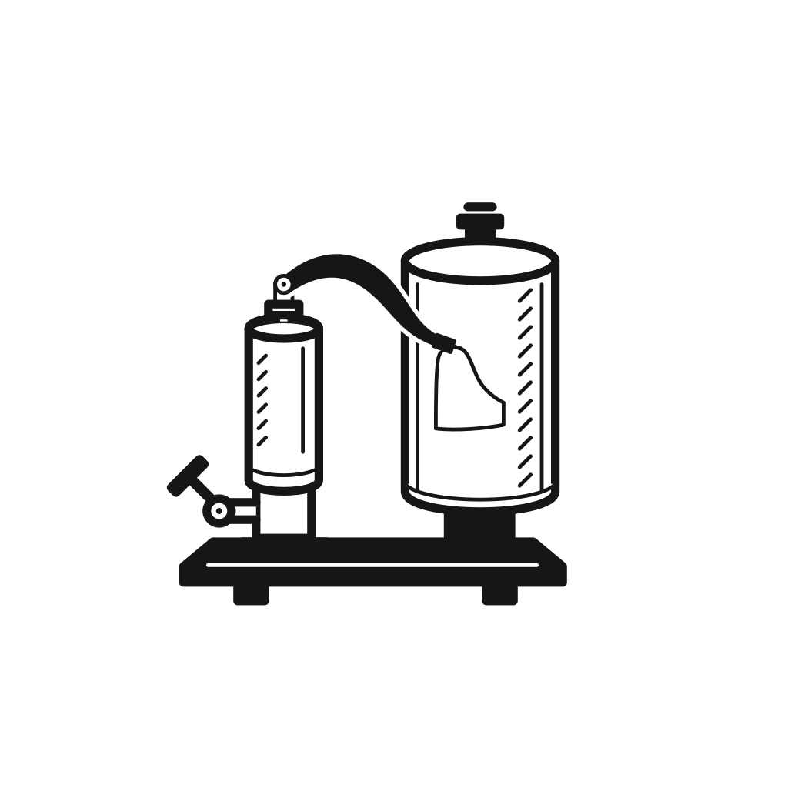
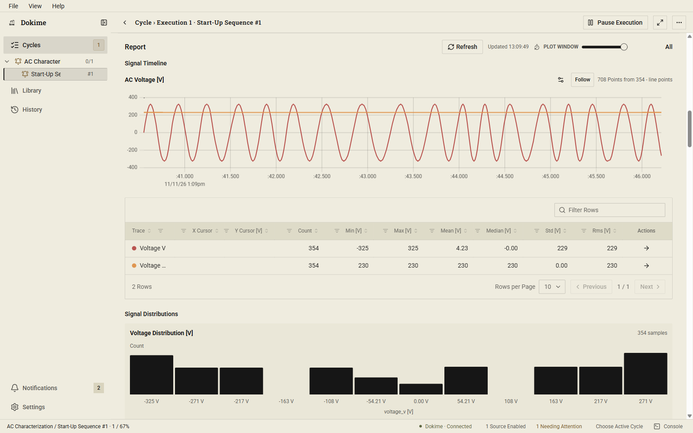
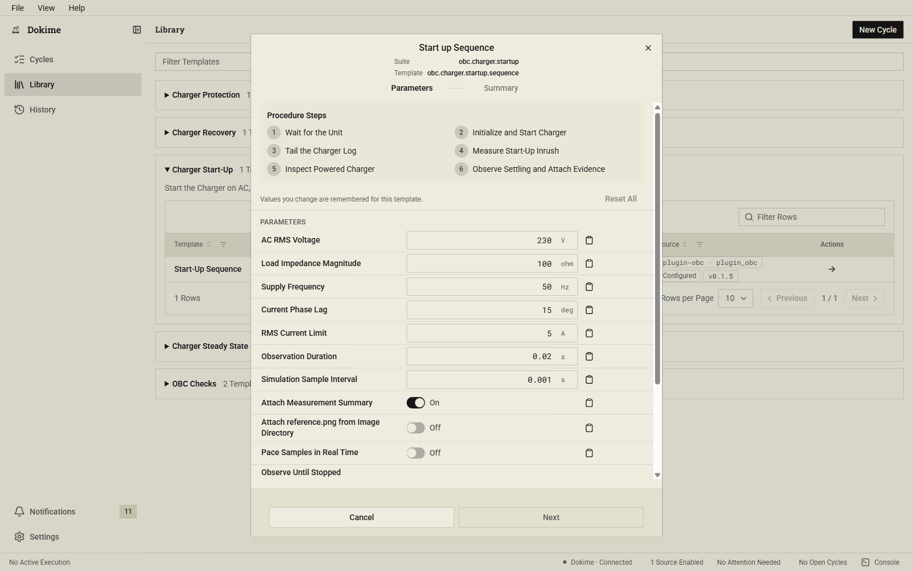

# Dokime

[](https://github.com/stokker-technologies/dokime/releases)
[](https://github.com/stokker-technologies/dokime/actions/workflows/ci.yml)
[](https://github.com/stokker-technologies/dokime/actions/workflows/nightly.yml)
[](https://crates.io/crates/dokime)
[](LICENSE)

<!-- OpenSSF Scorecard badge: pending verified URL from the supply-chain owner. -->
<!-- OpenSSF Best Practices badge: pending enrolled project ID and verified status from the supply-chain owner. -->

<p align="center">
  <picture>
    <source media="(prefers-color-scheme: dark)" srcset="organization/logos/transparent-on-dark.svg">
    
  </picture>
</p>

[Website](https://stokkertechnologies.ch/en/open-source/dokime) · [Getting Started](#quick-start) · [Tutorials](docs/remote/overview.md) · [Examples](docs/product-guide.md#examples) · [Documentation](docs/product-guide.md)

**Run repeatable engineering tests. Keep the evidence.**

Dokime turns hardware and software test procedures into operator workflows,
live measurements and HTML reports. Define a procedure, run it across
operating conditions, and review the evidence behind each result.



## Features

- **Reusable Procedures:** Define suites, typed parameters, ordered steps, acceptance criteria and explicit cleanup.
- **Traceability:** Capture and edit device and bench identity from steps; retain it with the execution and reports.
- **Parameter Sweeps:** Expand one template into operating points without copying the procedure.
- **Measurements and Reports:** Capture live data with the [ten plot kinds](docs/product-guide.md#plot-catalog), including sparse contours and generic grids. Retain plots, local trajectory/grid playback and records in self-contained HTML reports, with links to execution artifacts. Stream row changes apply on plugin reload; saved measurements retain their original definitions.
- **Operator Workflows:** Combine automation with confirmations and manual checkpoints; keep responses with the execution.
- **Equipment Plugins** [`plugin`]: Extend Dokime with equipment operations, test suites and settings through its Rust and remote Python authoring APIs.
- **Remote Control** [`client`]: Control an existing backend through the CLI or a programmatic client.
- **Native Media Capture** [`media-native`]: Attach screenshots, camera photos and audio where the platform supports them.

### Why Dokime?

Engineering tests need a procedure, an operator, high-rate data and evidence
someone can trust. Existing tools cover parts of that, so teams glue together
sequencers, scripts, data tools and report generators.

Dokime keeps them together: publish your streams, and Dokime handles storage,
live plots and the HTML report. Plugins are native processes with a clear
structure, so you can use any instrument library.

| Feature | Dokime | pytest Harness | OpenHTF | OpenTAP / PathWave | NI TestStand |
| --- | :-: | :-: | :-: | :-: | :-: |
| **Getting Started** | | | | | |
| Low Setup Effort | ✓ | ✓ | ✓ | ✓ | ✗ |
| Open Source | ✓ | ✓ | ✓ | ✓ | ✗ |
| Repeatable Procedures | ✓ | ✓ | ✓ | ✓ | ✓ |
| Pass/Fail Criteria | ✓ | ✗ | ✓ | ✗ | ✓ |
| **Running It with People** | | | | | |
| GUI & Operator Flow | ✓ | ✗ | ✓ | ✓ | ✓ |
| Device & Bench Traceability | ✓ | ✗ | ✓ | ✓ | ✓ |
| HTML Report Generation | ✓ | ✓ | ✗ | ✓ | ✓ |
| **Scaling the Test** | | | | | |
| Parameter Sweeps | ✓ | ✓ | ✗ | ✓ | ✓ |
| Storage Layer Abstraction | ✓ | ✗ | ✓ | ✓ | ✓ |
| Live Measurements | ✓ | ✗ | ✓ | ✓ | ✓ |
| Remote Control | ✓ | ✗ | ✓ | ✓ | ✓ |
| Long-Run Reliability | Planned | ✗ | ✗ | ✗ | ✗ |
| End-Of-Line Readiness | Planned | ✗ | ✓ | ✓ | ✓ |
| **Extending and Pushing Limits** | | | | | |
| Plugin Template | ✓ | ✓ | ✗ | ✓ | ✗ |
| Sidecar Plugin System | ✓ | ✗ | ✗ | ✗ | ✗ |
| Fast Stream Support | Planned | ✗ | ✗ | ✗ | ✗ |
| Ready-Made Instrument Drivers | Not Planned | ✗ | ✗ | ✓ | ✓ |

✓ Has It · Planned Will Be Implemented · Not Planned Not Planned by Us · ✗ Does Not Have It. A framework has a feature only when it or its vendor ships it; competitor cells were checked against their documentation on 2026-11-08.

| | Dokime | OpenHTF | OpenTAP / PathWave | NI TestStand |
| --- | --- | --- | --- | --- |
| **Authoring Language** | Rust, Python (remote), C# and C++ SDKs | Python | C#, Python | Several |
| **Licence** | Apache-2.0 | Apache-2.0 | MPL-2.0, Keysight GUI bundle | Commercial |
| **Maturity** | Young | Established | Established | Industry standard |

Dokime is young. Choose an established test executive if you need mature
production-line tooling or ready-made instrument drivers today.

## Interfaces

### GUI

The desktop brings the test library, active cycles, measurements and evidence
together. Start with the built-in Local backend or select a saved remote in
Settings. Export a `.pair` access file on the host and import or drop it
on another desktop to connect. The desktop remembers that choice; operators do
not need a source checkout. Windows installation needs no administrator rights;
exposing remote access to other PCs may need an administrator to allow the app
through Windows Firewall on the exporting computer.
Linux x86-64 packages support Ubuntu 22.04+, Debian 12+ and current Fedora;
RHEL and Rocky Linux lack WebKitGTK 4.1 and are unsupported. Install with the
package manager so it resolves the desktop dependencies:

```sh
sudo apt install ./dokime_<version>_amd64.deb      # Ubuntu, Debian
sudo dnf install ./dokime-<version>-1.x86_64.rpm   # Fedora
```

Direct Ethernet cables support static or automatic IPv4 link-local addresses;
see [Direct Cable Between Two PCs](docs/product-guide.md#direct-cable-between-two-pcs).

Unavailable views show an inline failure card with retry and copyable technical details.
Failed actions and background failures appear in toasts and remain in [Notifications](docs/product-guide.md#notifications) until cleared.
Click either to inspect the full message, failure causes and available technical details, or copy them for troubleshooting.

#### Examples



### CLI

Use `dokime` to run a server or control an existing backend. Use
`cargo dokime sidecar` to create, build and inspect plugins, and
`cargo dokime installer` to package prebuilt binaries with a complete organization pack.
Installer packaging is the only way to apply a pack; Settings has no pack import.
`cargo dokime bindings proto` exports protobuf contracts. The [CLI reference](docs/product-guide.md#cli-reference)
contains the complete workflow, including
[finite query paging](docs/query-api.md#transport-access-and-cli-paging).

The additive `dokime-next` candidate hosts the new execution runtime and embeds
all four SDK starters. See the [new-host CLI guide](docs/execution-host.md#command-line-candidate)
for its explicit endpoint, configuration and current service coverage.

#### Examples

```sh
dokime server --application-root ~/dokime-lab
dokime status --remote lab.pair --json
dokime operation list --remote lab.pair
```

### Python

The pure `dokime` package serves remote plugins over Harmos gRPC and generates
messages and client stubs from the repository's proto sources at wheel build time.
Suite instances hold execution resources; clients and plugins use explicit close.
See the [Python SDK guide](sdk/python/README.md) for the API and current host/proto
integration prerequisites.

#### Examples

The [starter](sdk/python/examples/starter/) owns the source embedded by
`dokime new bench --lang python`. It serves a remote suite with measurement,
operator confirmation, an observer, records, a criterion and a document.

```sh
HARMOS_AUDIENCE=host uv add --no-cache /path/to/dokime-0.1.5-py3-none-any.whl
mise run test
mise run serve
```

### Rust

The new `dokime` crate at [`sdk/rust`](sdk/rust) provides composed plugin authoring
and a typed client over Harmos gRPC, with protocol-only product dependencies.
See the [Rust SDK guide](docs/rust-sdk.md) for host calls, execution resources,
managed/remote placement and the remaining host/consumer cutover.

#### Examples

The [thermal suite](sdk/rust/examples/thermal.rs) composes a template, steps,
observer, criterion, prompt and record with `use dokime::prelude::*;`.
Build the SDK and sample with `mise -C sdk/rust run sdk:build`;
its [focused proof](docs/rust-sdk.md#focused-proof) runs independently of the host.
Existing plugins and starters still use their current authoring API until migrated.

Custom installers can declare `[installer] identifier = "com.example.testhub"` to
keep their installation and storage separate from plain Dokime. They include
plugins selected by version and feed name, plus external bundles from an
organization pack or repeatable `cargo dokime installer package --plugin <path>`
arguments. Release distributions and plugin archives are verified and cached. Bundled plugins
install on startup without replacing newer installed versions. An optional
`[license]` table adds the organization's own terms beside Dokime's unchanged
Apache-2.0 license. See the
[installer guide](docs/product-guide.md#native-installers)
for packaging options.

### C#

The development [C# SDK](docs/sdk-csharp.md) builds the `Dokime` NuGet package for
managed and remote gRPC plugins on .NET 10. It includes composed authoring and
canonical plot/document builders, composed library clients and generated product clients.

#### Examples

Build the package-consuming [executable starter](sdk/csharp/starter/) with
`mise -C sdk/csharp run build:starter` after building and packing the SDK.

### C++

The [C++ source SDK](docs/sdk-cpp.md) composes managed or remote plugins with
ordinary C++20 values and provides generated protocol types, a thin client layer,
and plot/document builders. CMake generates clients for all 23 services from the
authoritative proto sources.

#### Examples

The [CMake starter](sdk/cpp/starter/) builds a plugin executable using a
versioned SDK source archive and vcpkg dependencies:

```cpp
dokime::Plugin plugin("sample", "0.1.0");
plugin.suite({dokime::metadata("sample", "Sample"), {std::move(test_template)}});
plugin.serve();
```

## Quick Start

1. **Download An Installer.** Choose a matching [release](https://github.com/stokker-technologies/dokime/releases), the [nightly prerelease](https://github.com/stokker-technologies/dokime/releases/tag/nightly) or a successful [CI candidate](https://github.com/stokker-technologies/dokime/actions); the [download walkthrough](docs/remote/overview.md#obtain-one-matching-candidate) identifies the Windows and Linux packages.
2. **Inspect Host Telemetry.** The installer includes `plugin-host.dokime`, selected explicitly by the Dokime packaging task. Host streams arrive through the supervised plugin boundary.
3. **Try The Test Fixture.** In a source checkout, build the explicit [OBC fixture](docs/plugin-obc.md#build-and-validate), install its bundle, then run a charging template and inspect its measurements and report.
4. **Write Your Plugin.** Run `dokime new bench --lang python` for the [Python starter](sdk/python/examples/starter/), or use the [Rust plugin starter](crates/cargo-dokime/templates/) and [authoring commands](docs/product-guide.md#plugin-authoring).

Dokime is pre-1.0. Pin matching application, client and plugin revisions;
public APIs and development storage formats may change. See the
[product guide](docs/product-guide.md) for the detailed model and limitations.
Read the [architecture contract](docs/architecture.md) before proposing architecture, protocol or public API changes.

CLI and authoring-tool releases use target-specific ZIP (Windows) or tar.gz
(Unix) archives. See [Install Tools With Mise](docs/product-guide.md#install-tools-with-mise)
for archive selection and the release download inventory; each release and the
nightly prerelease publish `release.json`; its `downloads` section classifies payloads by
kind, OS, architecture and format. Distributors use
`dokime-distribution-<version>-<target>.zip`; shipping plugins share native
`dokime-plugins` archives described by the index’s `plugins` section (format 2).
Protocol definitions and compliance notices have separate ZIPs; the changelog is
the release body. Nightly also includes benchmark and coverage reports.
Custom installers select plugins through top-level `[[plugin]]` entries: set
either `name` for a release plugin or `path` for a bundle relative to the
organization pack. Its `plugins/` folder is storage only; files ship only when
selected explicitly. See [Native Installers](docs/product-guide.md#native-installers)
for the manifest and equivalent repeatable `--plugin` arguments.

### Configuration

Dokime stores application preferences in its SQLite storage root. Use Settings
in the desktop application to change appearance, client timeouts, report plot
defaults, telemetry cadence and remote listener preferences. Updates carry a
revision; conflicting edits require refreshing before saving again.

The application folder derives from the installed distribution identifier, falling
back to the compiled identifier when `distribution.json` is absent. Plain Dokime
defaults to `%LOCALAPPDATA%/com.stokker.dokime` on Windows or `${XDG_DATA_HOME:-$HOME/.local/share}/com.stokker.dokime` on Linux.
`dokime server --application-root <directory>` selects another application folder;
storage paths are bootstrap options, not editable preferences. Dokime ignores legacy `config.toml` and `settings.json` files and preserves them; settings live in the database.
Telemetry uses ZSTD-compressed Arrow IPC files with a SQLite catalog. Stream and
record identities derive from their schemas; saved execution evidence retains
its definitions across plugin changes. Only unreadable Dokime-owned persistent
state requires a fresh storage root. Dokime reports what cannot be decoded and
preserves the existing data.
Scoped evidence reads isolate other cycles; see the
[storage read policies](docs/product-guide.md#storage-read-isolation)
for corruption reporting and whole-root failures.

The Backends table lists a folder of `.pair` files. Import a file to connect, or
name it with `--remote lab.pair` or `DOKIME_REMOTE`. Each file contains the backend's
single access key, server certificate, endpoints and expected backend identifier.
Exporting again replaces the key for every client. Every connected client can call
every operation the backend serves to clients. Plugin secrets remain in protected
credential stores, with their catalog metadata in SQLite.
Settings → Plugins keeps ordinary settings editable after startup fails and shows
required secret identifiers. A missing-secret failure offers Set Secret, which opens
Secret Storage's Add Secret dialog with its identifier prefilled; then retry the
plugin. Installing, updating, disabling and removing plugins apply without restarting
Dokime. See [Shared Plugin Secrets](docs/product-guide.md#shared-plugin-secrets)
and [Plugin Start Failures](docs/product-guide.md#plugin-start-failures).

Implementation limits use domain and subsystem constants. See the
[application settings model](crates/dokime-domain/src/model/settings/application.rs)
and [storage defaults](crates/dokime-runtime/src/config/storage/defaults.rs).
Plugin metadata preparation uses the shared [schema budget configuration](docs/product-guide.md#plugin-schema-budgets)
for packaging, inspection and installation.

Timed live plots combine saved telemetry batches with the bounded, unflushed admission tail,
independently of the save interval. Finite queries, All refreshes and frozen reports use saved data.
The time-range slider filters storage queries:
selecting a wider range retrieves older saved samples, and zooming retrieves
finer detail for the visible range at the panel width. It does not change storage retention.

Client sample following watches saved storage progress and resumes from delivered
stream cursors after reconnecting. Execution-scoped follows drain the closed evidence frontier
before ending; they do not poll a second live-sample history.

The viewer defaults to 5 min and offers 1 min, 2 min, 5 min, 10 min, 30 min, 1 h
and All for every plot in the view. Timed windows refresh automatically; All loads
once and refreshes only when Refresh is pressed. Reports always cover all captured samples.
All delivers each plot independently from bounded report previews, so one plot's
failure leaves the others available. Markers follow the display point budget.

Live summary tiles fold finite saved-evidence queries with bounded memory. Document
capture no longer rejects estimated work based on retained source-row count.
The page shows its structure first, then each data card loads and refreshes
independently. A failed card leaves the others available.
Repeated sections use indexed pages; page navigation keeps one saved evidence cut.

Plot groups show numeric labels in ascending order, then text labels alphabetically.
Different labels with equal numeric values remain separate and sort alphabetically.

The live log and diagnostics bundle remain available. Cycle history shows absolute update times. Busy document
reads continue retrying, while other document failures retry once.

### Support and Security

See the [support and end-of-life policy](docs/support.md),
[vulnerability reporting policy](docs/SECURITY.md), [privacy guidance](docs/privacy.md),
[plugin security model](docs/plugin-security.md), [compliance assessment](docs/compliance.md)
and [signed and managed deployment](docs/deployment.md).
The security policy link is pending its owner's publication.
Support targets are proposed until confirmed by the owner; OpenSSF badges are
pending verified supply-chain evidence and do not imply product certification.

## Contributing

The independent execution host serves plugin and settings administration, protected secrets,
remote pairing and diagnostics alongside execution. Its client gRPC stories are described in the
[execution host guide](docs/execution-host.md).

Bug reports, focused fixes, clearer examples and equipment integrations are
welcome. Read [Contributing](docs/CONTRIBUTING.md) for setup and the review workflow.
Frozen documents share the live card query path, retain complete authored tables
and include every repeated-section page at the sealed evidence cut.
Rendering a selected document returns temporary output; durable report publication
and sealing happen separately, after rendering succeeds.

The [storage benchmarks](docs/CONTRIBUTING.md#storage-benchmarks) mirror Harmos's storage
suite using Dokime's default settings and SQLite backend, including writes, reads,
queries, filesystem operations and concurrent workloads.

## About

Dokime is developed by [Stokker Technologies](https://stokkertechnologies.ch)
for engineering test workflows that need traceable measurements and evidence.
It is available under [Apache-2.0](LICENSE).
