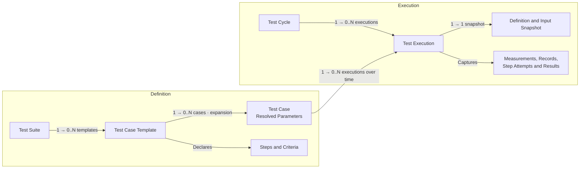

# Dokime

**Run repeatable engineering tests. Keep the evidence.**

Dokime turns hardware and software test procedures into operator workflows,
live measurements, and self-contained reports. Use it for bench testing,
device qualification, and manufacturing checks where a result needs more
context than pass or fail.

Define the procedure in Rust. Run it across operating conditions. Review what
happened, with the inputs, measurements, and decisions that explain the result.

[Quick Start](#quick-start) · [The Test Domain](#the-test-domain) ·
[Examples](#examples) · [Documentation](#documentation)


## Features

- **Test Procedures**

  Define reusable suites and templates with typed parameters, ordered steps,
  acceptance criteria, and explicit cleanup. Keep the procedure readable
  alongside the equipment operations it calls.

- **Parameter Sweeps**

  Expand one template across combinations of operating conditions. Three input
  voltages and three loads produce nine cases without duplicating the procedure.

- **Live Measurements**

  Capture typed measurements while a test runs. Compose time-series plots,
  distributions, and other views with units and reference limits tied to the
  case's parameters.

- **Acceptance Criteria**

  Evaluate captured samples and structured records. Keep the actions that
  perform a test separate from the criteria that judge its evidence.

- **Operator Interaction**

  Combine automation with confirmations, forms, and manual checkpoints.
  Retain operator responses with the execution they belong to, along with
  screenshots, camera photos, and audio recordings captured on the testbench.

- **Traceability**

  Capture specimen identity, resolved inputs, and execution context. Keep logs,
  structured records, and attached files alongside the measurements they explain,
  including files watched in a local or FTPS folder while the execution runs.

- **Self-Contained Reports**

  Present results, plots, and captured evidence in self-contained HTML reports.
  Review them without installing Dokime or connecting to a running server.

- **Plugins**

  Integrate equipment and contribute suites, operations, observers, and settings.
  Dokime builds on [Harmos](https://github.com/stokker-technologies/harmos)
  for typed contracts and managed plugin lifecycles.

- **Automation**

  Run through the desktop application or control execution through the CLI and
  programmatic interfaces. A desktop session can use its local backend or attach
  to an explicitly configured remote server.

## The Test Domain

Definitions describe what can be tested. Execution captures what happened when
concrete cases ran. A **suite** organizes related **templates**; each template
materializes **cases** with resolved parameter values. A **cycle** groups the
executions selected for a test campaign.



Each execution identifies exactly one case and one cycle. Repeating a case
creates another execution; retrying a step is recorded as a step attempt within
that execution. A cycle can bring together cases from different templates and
suites—it is not a copy of one suite. A cycle is created explicitly, starts
empty and grows only as cases are appended to it; running an empty cycle is
refused.

Several cycles can stay **Active** at once. An explicit run request selects the
unrun executions present when it is accepted; later additions need another run
request. Requests run in acceptance order, with one execution running across the
server. Each execution saves and seals its own evidence when it finishes, while
its cycle stays Active. Select the destination cycle in the Library before
adding cases.

**Seal Cycle** closes admission immediately, stops that cycle's running work,
cancels unrun executions and waits for every execution and the cycle report to
be durably saved. The phase advances through **Sealing** to **Sealed**. Other
cycles continue. Shutdown seals all Active cycles; startup finishes sealing
previous-session cycles without replaying device operations.

For a charger campaign, one template might measure steady-state charging while
another checks overcurrent protection. Cartesian expansion turns the operating
points into concrete cases:

```text
Input Voltage:  207 V, 230 V, 253 V
Load Impedance: 80 Ω, 100 Ω, 120 Ω

3 Voltages × 3 Loads → 9 Cases Of The Same Procedure
```

A list can also be one parameter value. An ordered load sequence such as
`[100, 50, 10]` Ω can describe three steps within one case; it does not have to
mean three separate cases. Expansion is declared explicitly.

## Quick Start

Dokime is pre-1.0 and currently supports Windows and Linux. To launch from
source, install [mise](https://mise.jdx.dev) and use the pinned toolchain:

```sh
git clone https://github.com/stokker-technologies/dokime.git
cd dokime
mise trust
mise install --locked
mise run prepare
mise run dev
```

This starts the desktop application with its local backend. The
[OBC plugin](plugins/obc-plugin/) supplies a simulated charger; no physical charger
is required. The task builds the OBC bundle into `target/debug/plugins/` and
points `DOKIME_PLUGINS_DIR` at that directory, so the backend loads it for the
session without installing it. Create a cycle
with **New Cycle** (its title defaults to the current date and time), then add
OBC's charging templates to it from the library, choose operating points, and
inspect live measurements and results.

To install OBC into a regular application instead, build its bundle and add
it through the application's plugin settings, then restart:

```sh
cargo run -p cargo-dokime -- build --package obc-plugin --output target/debug/plugins/obc-plugin.dokime
```

An installed Dokime places `dokime`, `dokime-server` and `dokime-gui` side by
side, and the CLI launches the other two: it looks beside itself, then in
`DOKIME_HOME`, then in the platform's installation directories. Arguments after
`--` reach the launched program unchanged:

```sh
dokime serve -- --application-root ~/dokime-lab
dokime gui --endpoint http://127.0.0.1:50051
dokime plugin install target/debug/plugins/obc-plugin.dokime --backend lab
```

`dokime plugin install` stages the bundle on the backend, shows its identity,
digest and the environment variables its secrets read (names only), and records
consent for the next restart; `--yes` consents without the prompt. Plugin authors
use `cargo dokime new`, `build`, `inspect` and `dev`; `dev` rebuilds on every
change and runs the bundle through `dokime serve` and `dokime gui`.

## Browser Clients

The desktop never needs gRPC-Web: its WebView reaches the backend only through
the shell. A browser client is the one caller that does, so a backend serves it
only when asked, together with each exact page origin allowed to call:

```sh
dokime-server --grpc-web --allowed-origin https://frontend.example
```

Repeat `--allowed-origin` for additional origins. An origin contains only its
scheme and authority; paths, credentials and wildcards are refused, and an
origin without `--grpc-web` is an error. Remote listeners still require
explicit remote configuration, TLS and bearer credentials; browser-origin
permission does not grant operation access. A GUI built with
`DOKIME_TRANSPORT=grpc-web` is such a browser client.

## Native Remote Access

Settings → Remote Access owns persistent listener settings, one-time key
generation, public certificate download and explicit key/certificate rotation.
Management operations are available only through the native local listener.
The access key is shown once and can be copied or saved through the native
file picker. The application root's private `remote/access.json` retains its
SHA-256 verifier and the TLS certificate/private key; it never retains the
access key. Certificate DNS/IP identities change only through explicit
regeneration. TLS and authentication are independent choices, with separate
isolated-lab warnings.

The pinned Harmos runtime permits one attached listener per runtime. The
desktop's native listener occupies that attachment, so enabling an additional
remote listener currently fails and preserves the previous settings. The
management surface does not yet provide a working second-PC connection.
Full control over request-dependent plugin scopes also requires an upstream
external-authorization capability; exact scoped plugin grants remain enforced.

## Plugin Operation Permissions

Standalone `--auth-file` plugin calls require an explicit permission on the server
`--auth-file` bearer grant. Product operations keep their declared role policy:

```json
{
  "grants": [{
    "subject": "operator",
    "role": "control",
    "token": "REPLACE_WITH_A_PRIVATE_TOKEN_OF_AT_LEAST_32_BYTES",
    "operations": [
      { "owner": "chamber", "id": "chamber.read", "grants": [] },
      {
        "owner": "chamber",
        "id": "chamber.stream",
        "grants": [{ "operation": "chamber.stream", "scope": "chamber.temperature" }]
      }
    ]
  }]
}
```

The owner and operation ID are exact; wildcards and duplicate permissions are
refused. Unlisted plugin operations remain denied on these bearer-grant
connections. Native trusted-local connections admit installed unscoped plugin
operations through their live contracts. Listing an operation grants it; `grants` adds only the scopes a
request may resolve to, such as the channel, stream or source it names. Each grant
names the listed operation and one exact scope; an empty list admits only requests
that resolve to no scope. The same permission
filters live discovery and actual invocation. Rediscover after a provider changes;
metadata does not promise admission or bypass request-dependent grants.

## Backend Profiles

The CLI connects to an existing server. Save and select a backend with:

```sh
dokime backend add lab --endpoint https://dokime.example:8765 --expected-backend BACKEND_ID --ca /path/to/ca.pem --keyring
dokime backend use lab
dokime auth login --backend lab --key-file /path/to/remote.key
dokime status --backend lab --json
dokime operation list --backend lab
dokime operation show dokime.runtime.health --backend lab --json
dokime auth logout --backend lab
```

`operation list` and `operation show` read live provider contracts, including
owner, generation, grants, gRPC availability and conditional access. Discovery
is bounded and does not promise admission of a later invocation. `show` retains
all visible providers of the selected operation.

`operation list` displays operation ID, provider owner and description. Select a
provider explicitly for metadata or a call:

```sh
dokime operation show OPERATION_ID --owner OWNER --backend lab --json
dokime operation call OPERATION_ID --owner OWNER --backend lab --input request.json --output response.json
dokime operation call OPERATION_ID --owner OWNER --backend lab --json '{"enabled":true}'
dokime operation call OPERATION_ID --owner OWNER --backend lab --input request.json --input-stream-file items.jsonl --output response.json
```

`--input` and `--json` are mutually exclusive request sources; omitting both
sends `{}`. Inputs use the discovered contract's protobuf JSON shape. Streaming
input is one item per line. Without `--output`, stdout emits one JSON item or
completion event per line. A response file contains one JSON array of those
events, including the final completion; a unary call has only that completion.

Existing response files require `--overwrite`. Predictable output conflicts are
rejected before dispatch. The complete response is written to a temporary sibling
and published atomically after successful completion. A failed output write
never replays the device command. Diagnostics go to stderr and failures return
nonzero.

Ctrl+C stops waiting locally. A timeout or disconnection after dispatch can leave
the device outcome unknown, even when no response was received. Check device
state before manually resending; calls are never retried automatically. Manual
operations can affect a running test and are not logged into its execution
evidence. From Rust, `dokime_client::Client::call_operation` uses the same live
contract discovery and shared Harmos codec:

```rust
let client = Client::connect(Target::new(endpoint, None)?, Some(token), None).await?;
let stream = client
    .call_operation("obc-plugin.get_status", Some("obc-plugin"), b"{}", Vec::new())
    .await?;
while let Some(event) = stream.message().await? {
    println!("{event:?}");
}
stream.close().await;
```

Browse the registered suite catalog, stop work explicitly and re-run a case:

```sh
dokime catalog list --backend lab --json
dokime catalog show REGISTERED_SUITE_ID --backend lab --json
dokime execution stop EXECUTION_UUID --backend lab --json
dokime cycle stop CYCLE_UUID --backend lab --json
dokime cycle seal CYCLE_UUID --backend lab --json
dokime cycle rerun CYCLE_UUID CASE_UUID --key rerun-1 --backend lab --json
```

Replace the identifiers with those returned by the backend. `catalog list
--json` emits one complete suite definition per line; a later read failure
returns a nonzero exit status after any earlier lines. `execution stop` stops
one execution while the rest of its cycle keeps running; `cycle stop` stops
every execution of the cycle. Both return the observed cursor and do not wait
for a sealed report. `cycle rerun` appends the case's next attempt as a new
execution, leaving earlier attempts and their evidence untouched, and admits it
once under the given key. Cancelling a local request wait leaves backend work running;
query the durable request again to observe settlement.

`cycle seal` waits for the durable cycle seal. Repeating it is safe, including
after a lost response. `cycle stop` leaves the container Active. The Python
client provides the same durable boundary with `await cycle.seal()`.

Download saved evidence without running any work again:

```sh
dokime execution export EXECUTION_UUID --backend lab --output execution.zip
dokime cycle seal CYCLE_UUID --backend lab --json
dokime cycle export CYCLE_UUID --backend lab --output cycle.zip
```

A sealed execution is exportable while its cycle stays Active. A cycle export
requires its durable seal and includes every exact member revision. The ZIP
contains `manifest.json`, `evidence.sqlite`, captured files and saved HTML
reports. The manifest records source identities, revisions, row counts and
payload checksums; SQLite exposes inputs, definitions, outcomes, records and
typed stream columns. Query `streams` and `stream_columns` to find each stream's
tables, field names and units. Wide streams use partitions joined by `m_row`.
Canonical JSON retains nested values and unsigned integer identity.

Exports use saved storage snapshots and survive server restart. Missing
required evidence fails the export. The server admits one export at a time,
with an 8 GiB archive limit. The client verifies contiguous chunks, size,
SHA-256 and final transport success before publishing the ZIP atomically.
Existing destinations require `--overwrite`. Failed downloads preserve the
previous output; retry starts a fresh download and never repeats execution.
The desktop's **Export Evidence** action uses the same exporter and a native
save dialog. The Python handles provide `await execution.export(path)` and
`await cycle.export(path)`, with `overwrite=True` for explicit replacement.

Selection uses explicit `--backend` or `--endpoint`, then `DOKIME_BACKEND`, then
that configuration's saved default. An explicit endpoint uses only credentials
supplied for that invocation. Profile edits affect future connections.
`backend list`, `show`, `use`, and `remove` operate offline; removal clears a
matching default and retains OS credentials. `auth login` negotiates backend
identity and the operations available to the caller with the supplied bearer, then saves it for
that endpoint and marks the selected profile for keyring lookup. It refuses a
profile whose target changed during login. `auth logout` removes the local
credential; it sends no revocation request. Use `--key-file` on individual
commands for headless connections when an OS store is unavailable.

Credential precedence is `--key-file`, process `DOKIME_KEY`, then `DOKIME_KEY`
from an explicitly selected `--env-file`. Dotenv values fill absent process
variables; they never override them or search parent directories. Selected
files must be valid UTF-8 regular files, even when another source supplies the
key. Keys contain 32–4096 visible ASCII characters; dotenv input is bounded to
64 KiB. Copy [.env.example](.env.example) to the ignored `.env`, replace its
placeholder and select it explicitly:

```sh
dokime status --endpoint https://dokime.example:8765 --ca server.pem --env-file .env
```

`status` and `auth status` perform a bounded live check. JSON distinguishes
`ready`, `unreachable`, `authentication`, `permission_denied`, `incompatible`,
`not_ready`, `timed_out` and `credentials_unavailable`; failed checks return exit
code 1. `--timeout-seconds` bounds connection and credential-store waits. A
store operation already in progress can finish after its caller times out.
Profile settings and OS credentials are separate writes: a file publication
failure can leave the credential saved, and explicit logout removes it.

Configuration lives at `$XDG_CONFIG_HOME/dokime/backends.json` (falling back to
`$HOME/.config/dokime/backends.json`) on Linux, `$APPDATA/dokime/backends.json` on
Windows, or `$HOME/Library/Application Support/dokime/backends.json` on macOS.
`--profiles-file` overrides `DOKIME_PROFILES_FILE` and the standard location.

The version 1 JSON contract keeps secrets in a separate OS credential store:

```json
{
  "version": 1,
  "default": "lab",
  "profiles": [{
    "name": "lab",
    "endpoint": "https://dokime.example:8765",
    "expected_backend_id": "BACKEND_ID",
    "ca_certificate_pem": null,
    "credential": "keyring"
  }]
}
```

Names contain 1–64 ASCII letters, digits, dots, underscores or hyphens. Unknown
fields, duplicate names, unsupported versions, invalid endpoints and dangling
defaults are refused. Files are limited to 1 MiB and 128 profiles. CLI edits lock
and atomically replace the file; contention refuses the edit for retry. Tokens
stay outside JSON. Python reads explicitly named profiles with
`DokimeClient.from_profile("lab", key_file="remote.key")`; it uses the same configuration
location and accepts an explicit `path` override.

## Planning And Creating Cycles

Name a template by its readable ID, `<suite id>.<segment>`, as `dokime catalog
show` lists it:

```sh
dokime plan preview --template obc.charger.steady.measurement --backend lab --json
dokime cycle create --label "Campaign 1" --backend lab --json
dokime cycle append CYCLE_ID --template obc.charger.steady.measurement --backend lab --json
```

A cycle is always created explicitly and empty; `cycle append` adds the cases a
plan generates to an existing cycle and never creates one. An omitted
`--identifier` is derived by the backend.

For a linear script, `--id-only` prints the created cycle UUID or the ordered
execution UUIDs from that exact append. It never infers new executions by
comparing a cycle before and after a concurrent mutation. This pulse template
produces one execution:

```sh
cycle_id=$(dokime cycle create --label "Remote Pulse" --backend lab --id-only)
execution_id=$(dokime cycle append "$cycle_id" --template obc.checks.pulse --backend lab --id-only)
dokime execution run "$execution_id" --request-key pulse-1 --backend lab
dokime execution wait "$execution_id" --wait-seconds 60 --backend lab
dokime execution export "$execution_id" --output pulse.zip --backend lab
```

`execution wait` waits for the durable saved result and returns nonzero for a
failed, blocked or cancelled execution. Interrupting that wait leaves remote
work running; request `execution stop EXECUTION_ID` explicitly, then wait and
export the collected evidence. Retain the execution ID and request key after a
disconnection; never submit another command just to discover whether it ran.

Scripts can opt into cancellation and evidence recovery during that wait:

```sh
mkdir -p recovery
dokime execution wait "$execution_id" --backend lab \
  --cancel-on-interrupt --owned-cycle "$cycle_id" --recovery-directory recovery
```

The same three options work with `execution prompt next`. They verify that the
execution belongs to the named cycle before mutation. Use `--owned-cycle` only
for a cycle your script created and reserves for itself: on Ctrl+C, recovery
requests an execution stop, seals that cycle and downloads
`execution-<UUID>.zip` and `cycle-<UUID>.zip`. Sealing cancels its other pending
members. Existing files are refused before connection, and bundles use the
shared verified atomic downloader. The interrupted command returns nonzero;
successful ordinary waiting leaves the cycle Active. A failed connection does
not confirm cancellation or a completed download; retain the original IDs.
Waits report their execution identity and Ctrl+C behavior on stderr once the
interrupt listener is ready; JSON and `--id-only` results stay on stdout.

The [Remote CLI Workflows](packages/dokime/examples/remote/cli/README.md) include
device, test and confirmation scripts for POSIX shell, PowerShell 7.3+ and
Command Prompt. They require the matching CLI and simulated OBC plugin;
the matching first-party release combination is still pending.

`--parameters-json` supplies single values for `--template` as a plain JSON
object. The default pulse has no prompt. To require its one confirmation:

```sh
execution_id=$(dokime cycle append "$cycle_id" --template obc.checks.pulse \
  --parameters-json '{"require_confirmation":true}' --backend lab --id-only)
dokime execution run "$execution_id" --request-key pulse-confirm-1 --backend lab
prompt_id=$(dokime execution prompt next "$execution_id" --wait-seconds 60 --backend lab --id-only)
dokime execution prompt show "$execution_id" "$prompt_id" --backend lab
dokime execution prompt answer "$execution_id" "$prompt_id" --action yes --backend lab
dokime execution wait "$execution_id" --wait-seconds 60 --backend lab
```

Prompt reads and answers require the matching execution and prompt UUIDs.
The server refuses stale or duplicate answers. After an ambiguous response,
inspect `prompt show` before deciding what to do; answers are never retried
automatically. Actions `cancel` and `abort` submit a cancelled response.
When finished, use `cycle seal CYCLE_ID` before `cycle export CYCLE_ID`.

Preview leaves registration unchanged. `plan register` materializes cases
without a cycle; append them by ID with `cycle append CYCLE_ID --case-id CASE_ID`. Registration returns case IDs; retain its
key and repeat the same request to recover registration after an uncertain
response. Repeated selections and `--case-id` arguments preserve order and
create distinct attempts. Omitted parameters and files use registered backend
defaults. `--selection-json` accepts a canonical `RegisteredSelection` and can
be repeated for parameter sweeps and file selections.

Each `--input-file` takes the operation's canonical JSON request and refuses
selection or metadata flag overrides. For example, `plan register` accepts:

```json
{
  "plan": {
    "selections": [{
      "suite_id": "SUITE_ID",
      "template_id": "TEMPLATE_ID",
      "parameters": [],
      "files": []
    }],
    "max_cases": 0,
    "case_ids": [],
    "cycle_id": ""
  },
  "idempotency_key": "campaign-1"
}
```

`plan preview` uses the same `plan` without `idempotency_key`, and `cycle
append` takes it with the target `cycle_id`. The backend
validates expansion and materializes cases; zero `max_cases` selects its limit
of 1000. A plan selects templates or registered case IDs. Each materialized
case is labelled `<Template Label> #<n>`, numbered per template from `#1`; a
cycle being appended to continues its own numbering, and
the case's parameter values stay on the case rather than in its label.
Until a cycle or execution seals, operators can rename it with the pencil
beside its title in the desktop app or with `Execution/RenameCycle` and
`Execution/RenameExecution`; a sealed, archived or History subject refuses with
`FailedPrecondition`. Renaming an execution renames its case, every attempt
included, and each rename is recorded as an `operator.label_edited` record
carrying the old and new label. Numbering continues from each case's stored
ordinal, so a renamed `#2` is never reused. For `cycle create`, save this
canonical request as `cycle.json`:

```json
{
  "metadata": {
    "identifier": "campaign.1",
    "label": "Campaign 1",
    "description": null,
    "tags": [],
    "attributes": [],
    "created_at": null,
    "updated_at": null
  },
  "continue_on_failure": false,
  "context": null
}
```

```sh
dokime cycle create --input-file cycle.json --case-id CASE_ID --request-key run-1 --wait-seconds 60 --backend lab --json
```

For scripts, `--case-id` appends registered cases right after creation and
`--request-key` then runs the cycle. Creation prints and flushes the cycle ID
before appending or submitting work. Retain the
cycle ID and run key to recover an uncertain admission. Creation, admission and
an optional terminal receipt are separate JSON lines; a later failure leaves
already emitted recovery identities available. Creating a cycle does not
itself run it. Waiting locally does not seal a report or cancel backend work.

## Examples

### Qualify An On-Board Charger

Harmos supplies the runtime and plugin boundary. Dokime adds the testing domain:
procedures, parameter expansion, operator interaction, acceptance criteria, and
self-contained reports.

The [OBC charger simulation](plugins/obc-plugin/src/suites/) demonstrates startup,
steady-state measurement, overcurrent protection, and recovery. It models a
charger testbench for learning the workflow; it is not a validated electrical
model or a ready-made vehicle qualification standard.

### Define The Operating Points

A shortened version of OBC's
[steady-state parameters](plugins/obc-plugin/src/suites/steady/measurement.rs) declare the
nine-case voltage/load sweep:

```rust
use dokime_runtime::definition::ParameterDefault;

#[dokime_runtime::parameters]
pub struct Parameters {
    #[parameter(
        label = "AC Voltage (RMS)", unit = "V",
        expansion = "cartesian",
        default = ParameterDefault::space([207.0, 230.0, 253.0]),
    )]
    pub ac_voltage_v: f64,

    #[parameter(
        label = "Load Impedance", unit = "ohm",
        expansion = "cartesian",
        default = ParameterDefault::linspace(80.0, 120.0, 3),
    )]
    pub load_ohm: f64,
}
```

The template names its parameter type once. Every expanded case resolves those
inputs before execution, so the procedure and its document see the same values.

### Run The Procedure And Capture Evidence

OBC's [steady-state template](plugins/obc-plugin/src/suites/steady/measurement.rs)
initializes shared device resources, energizes the charger, observes its
waveform, asks the operator to inspect the trace, and attaches a measurement
summary. Cleanup stops the simulated device.

This excerpt is the template's measurement observer. `InputMeasurement`,
`Samples`, `ObserverStreams`, and `reading` belong to the example:

```rust
#[dokime_runtime::observer(interval_ms = 5, streams = ObserverStreams)]
async fn samples(ctx: &mut ObserverContext<'_>) -> Result<(), Error> {
    let row = reading(ctx.resources())?;
    ctx.stream::<InputMeasurement>()
        .into::<Samples>()
        .push(row)
        .await;
    Ok(())
}
```

The same template uses `ctx.ask(...)` for operator sign-off and writes its
summary through `ctx.artifacts()`. Its criterion checks that enough samples
were captured and that the completion record accepted the run:

```rust
#[dokime_runtime::criterion(id = STEADY_ACCEPTANCE_CRITERION, label = "Trace Accepted")]
fn accepted(ctx: &CriterionContext<'_>) -> Result<bool, Error> {
    Ok(
        ctx.samples::<Samples>().len() as u64 >= ctx.parameters().sample_count()?
            && super::super::support::decided(
                ctx.records::<Completed>(),
                |run| run.accepted,
            )?,
    )
}
```

These are excerpts from the complete template, not standalone programs.
The [protection template](plugins/obc-plugin/src/suites/protection/overcurrent.rs)
adds an automated load ladder and verifies that an overcurrent fault disconnects
the supply and prevents restart. A real charger integration can extend these
procedures with regulation, efficiency, and thermal criteria for its hardware.

A step also reaches two built-in operations through `ctx.host()`, with nothing
to declare. `RunProcess` runs a vendor tool in the execution's artifact folder,
sends its output to the execution log or into an artifact, and records its exit.
`WatchFile` captures a device log written during the step into an artifact and
turns matching lines into rows and records. The
[startup template](plugins/obc-plugin/src/suites/startup/sequence.rs) tails the
simulated charger's log this way:

```rust
let watch = ctx
    .host()
    .submit_as::<WatchFile>(WatchFileRequest {
        execution_id: None,
        source: Some(FileWatchSource {
            payload: Some(FileWatchSourcePayload::Local(LocalWatchSource {
                root: self.log.to_string_lossy().into_owned(),
            })),
        }),
        output: "charger".into(),
        artifact: Some("charger/device.log".into()),
        policy: FileWatchPolicy::Stream,
        poll_interval_ms: Some(100),
        maximum_seconds: Some(1),
        maximum_bytes: None,
        matchers: vec![LineMatcher::publishing::<ChargerLog>(
            r"t=(?P<elapsed_s>[\d.]+) state=Running input_power_w=(?P<input_power_w>[\d.]+)",
        )],
        markers: Vec::new(),
    })
    .await?;
// The watch takes its baseline first; the charger then logs its readings.
let captured = watch.join().await?.into_owned();
```

Anything a step leaves running is cancelled when the step ends, with a warning
record.

### Present The Result

Compose plots from the same typed measurement fields used by the procedure.
This shortened example follows OBC's
[measurement document](plugins/obc-plugin/src/suites/common/measurement.rs); `stream` selects
the suite-owned stream carrying `InputMeasurement` rows:

```rust
let mut voltage = Plot::xy_line("Battery Voltage");
voltage.unit("V");
voltage.x(InputMeasurement::column_elapsed_s().on(stream));
voltage.y(InputMeasurement::column_dc_voltage_v().on(stream));

let mut charging = Section::new("Battery Charging");
charging.plot(voltage);

let mut document = Document::new("default", "Charger Qualification");
document.section(charging);
```

Column handles keep plot expressions tied to the declared data shape, and they
compare straight into filters: `voltage.only(column.gt(0.0))` narrows a plot,
and `section.each(column, "Point {value}")` repeats a section once per distinct
value, in ascending order. Templates can also add parameter-based reference
bands; the
[soak starter](crates/cargo-dokime/templates/src/suites/soak/hold.rs) demonstrates
a target-temperature band and event markers.

Time series and scatter plots list their traces in a statistics table beneath
the plot instead of a legend: count, min, max, mean, median, std, and rms of
each trace over the window shown, computed by the backend over the exact rows
rather than the reduced points the plot draws. Clicking a row hides or shows its
trace, a live plot's table also reads the value under the cursor, and the report
freezes the table with its plot.

Open or download a cycle's or an execution's **self-contained report** to share
the plots, verdicts, and context without requiring access to the testbench. A
running cycle's report is materialized at a fixed persisted-data boundary. Final
reports retain their original HTML and frozen execution context. A cycle report
queries each member's retained evidence at its original persisted boundary. Missing or damaged report artifacts
produce an explicit error. Stopping a test preserves the last persisted evidence
boundary for report finalization. If publication fails, the recorded test
verdicts stand and no partial report is kept; stopping the cycle again publishes
from the same persisted boundary, including after a restart. Stopping a cycle no
run will finish, even an empty one, seals it with its report.

## Cargo Features

These flags configure the `dokime-runtime` plugin SDK dependency. Desktop
application users do not need to select them. The default SDK includes native
plugin support and authoring macros; operation, model and record definitions
live in `dokime-domain`, which every feature set shares.

| Feature | Default | Enables |
| --- | --- | --- |
| `native` | Yes | Native plugin SDK, sidecar support, and plugin prelude. |
| `derive` | Yes | Suite, template, step, observer, and other authoring macros. |
| `storage` | No | Storage APIs and the SQLite backend. |
| `host` | No | The application host the server embeds: storage, gRPC and host collectors. |
| `fft` | No | Spectrum analyses on top of `host`. |
| `simulation` | No | Simulated time and devices on top of `host`. |
| `media-native` | No | Native camera, microphone and screen capture on top of `host`. |

The application stores state checkpoints and their journal through Harmos's file
state backend; SQLite holds the data catalog and evidence. A root written by an
earlier storage layout is refused as incompatible with this build and needs a
fresh storage root. Existing data is never silently reset.

For remote automation, depend on the reusable client crate:

```toml
[dependencies]
dokime-client = { git = "https://github.com/stokker-technologies/dokime", rev = "<tested-commit>" }
```

Replace `<tested-commit>` with the revision used by your integration.
`dokime-client` owns remote connection, authentication, discovery, listening,
recovery and profile access. The `dokime` crate owns plugin authoring; its
`storage` feature does not enable `native` or `derive` when defaults are disabled.
Disabling defaults retains the SDK's underlying Harmos dependency. See the
[SDK manifest](crates/dokime-runtime/Cargo.toml) and
[client manifest](crates/dokime-client/Cargo.toml) for details.

## Documentation

- [OBC Plugin](plugins/obc-plugin/) — the charger simulation and complete test templates.
- [Plugin Starter](crates/cargo-dokime/templates/) — a complete temperature-soak procedure.
- [Runtime And Plugin SDK](crates/dokime-runtime/src/lib.rs) — public authoring APIs and module documentation.
- [Client API](crates/dokime-client/src/) — programmatic access to cycles and executions.
- [Contributing](CONTRIBUTING.md) — repository setup and development workflow.

## Project Status & Roadmap

Dokime is in active development. Pin the revision you integrate: public APIs,
plugin contracts, and development storage formats may change before 1.0.
Existing development data has no compatibility guarantee; incompatible storage
must use a fresh root rather than silently resetting an existing one. When the
desktop's local backend refuses its data root, the startup failure screen offers
**Back Up And Reset Local Storage**: it archives the root into
`<root name>-backup-<UTC stamp>.zip` beside it, or wherever you pick, then
empties the root and starts the backend again.

The public introduction will grow with a complete on-board charger walkthrough
and a downloadable self-contained example report. GitHub hosts the authoritative source and native validation workflows.

Follow [issues](https://github.com/stokker-technologies/dokime/issues)
for development discussions and [the changelog](CHANGELOG.md) for recorded changes.

## Development Setup

Use the source setup in [Quick Start](#quick-start). For a headless server:

```sh
mise run build
cargo run -p dokime-server --
```

The repository flows are mise tasks:

```sh
mise run format --check
mise run lint
mise run check
mise run build
mise run test
mise run ci
```

`check` covers every Rust feature combination and the WebAssembly domain build.
`build` compiles once into binaries, the OBC bundle, the frontend, the
generated clients, the Python wheel and the test archive; every test layer runs
from those outputs. `test` runs the layers in order, each with its own task:

| Task | Layer |
| --- | --- |
| `mise run test:unit` | Curated invariants inside the crates. |
| `mise run test:integration` | In-process stories per crate, plus Python and TypeScript client stories. |
| `mise run test:generated` | The generated Python and TypeScript clients: types, lint and an import smoke. |
| `mise run test:acceptance` | Whole stories over one process and a client: the server, the CLI, the Python client. |
| `mise run test:system` | Two walkthroughs: the server with the built OBC plugin, and the desktop shell over its backend. |

The desktop walkthrough drives the built shell through WebKitWebDriver on Linux
and needs a display. `mise run ci` runs the same flow as the provider pipeline;
`mise run ci:nightly` adds coverage and benches.

See [Contributing](CONTRIBUTING.md) for prerequisites and the full workflow.

### Generated Clients

The Rust build generates the protobuf descriptors of every public operation;
`mise run build` regenerates the Python package's contract files from them with
Harmos's `cargo harmos bindings python` exporter and refuses a stale tracked
copy. The desktop's TypeScript client is generated from the same descriptors
by the Buf generator after the Cargo build. Ordinary wheel and source-package
installation uses the tracked files and needs no Rust compiler.

The desktop WebView never talks to the network. Every call from the generated
client crosses one opaque IPC bridge into the shell, which forwards the
protobuf bytes undecoded to the session's Rust client, owned backend or
attached: one `rpc` command for unary calls, and one Tauri channel per server,
client or bidirectional stream. The bridge knows paths and bytes only, fences
every request and reply with the connection generation, cancels a stream when
its subscription or session ends, and bounds messages by the limits the backend
advertises. Endpoints and credentials stay in the shell. Artifact uploads and
recordings keep a native file-backed adapter, because their bytes are hashed and
patched in the shell rather than framed by the WebView.

## Contributing

Bug reports, focused fixes, clearer examples, and equipment integrations are
welcome. [Open an issue](https://github.com/stokker-technologies/dokime/issues)
to discuss a proposal, and read the [contribution guide](CONTRIBUTING.md) before
submitting changes.

## License

Dokime is licensed under [Apache-2.0](LICENSE-APACHE).
