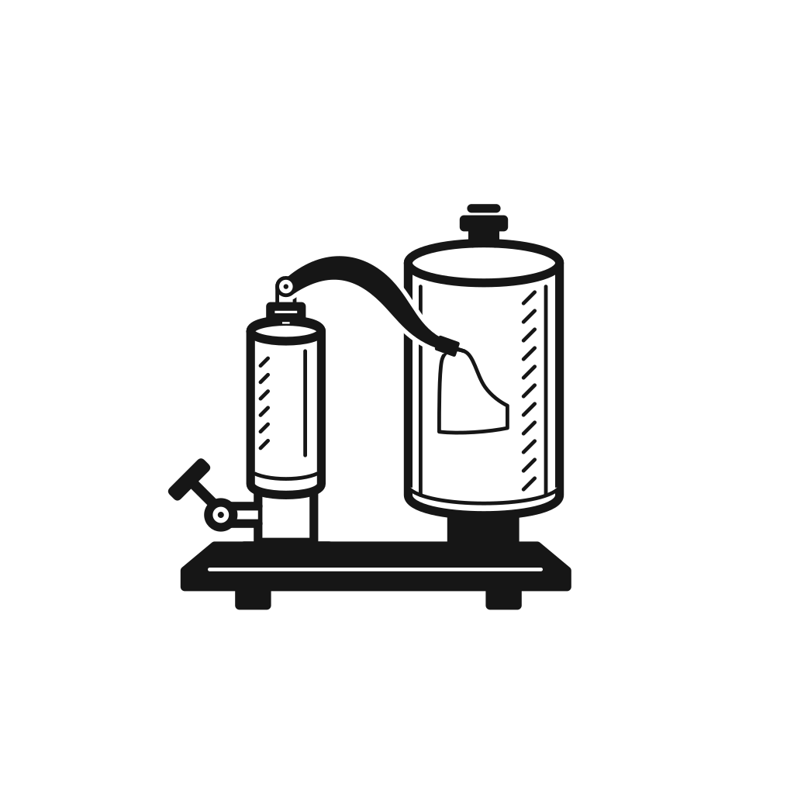

# Dokime

[](https://github.com/stokker-technologies/dokime/releases)
[](https://github.com/stokker-technologies/dokime/actions/workflows/ci.yml)
[](https://github.com/stokker-technologies/dokime/actions/workflows/nightly.yml)
[](https://crates.io/crates/dokime)
[](LICENSE)

<!-- OpenSSF Scorecard badge: pending verified URL from the supply-chain owner. -->
<!-- OpenSSF Best Practices badge: pending enrolled project ID and verified status from the supply-chain owner. -->

<p align="center">
  <picture>
    <source media="(prefers-color-scheme: dark)" srcset="organization/logos/transparent-on-dark.svg">
    
  </picture>
</p>

[Website](https://stokkertechnologies.ch/en/open-source/dokime) · [Getting Started](#quick-start) · [Tutorials](docs/remote/overview.md) · [Examples](docs/product-guide.md#examples) · [Documentation](docs/product-guide.md)

**Run repeatable engineering tests. Keep the evidence.**

Dokime runs plugin-defined procedures, captures typed measurements and records,
and retains the evidence behind each result. The execution host owns sequencing,
operator questions, retries, cancellation, cleanup and report publication.

## Features

- Reusable suites with parameters, ordered steps, observers and criteria.
- Managed executable plugins and remote gRPC plugins.
- Scoped records, typed Arrow stream files, frozen schemas and sealed evidence.
- Operator prompts, interactive execution controls and explicit cleanup.
- Bounded plot/document reads, self-contained HTML reports and explicit publication.
- Authenticated remote access through the composed library Access services.

## Interfaces

### GUI

The native desktop is back in the Cargo workspace and uses the execution host.
Its product includes native installers and self-contained HTML reports.
See [GUI Guidance](docs/gui.md) for host connections and controls.

#### Examples

The existing [screenshots](docs/screenshots/) document desktop workflows.

### CLI

`dokime` creates SDK projects, packages executable plugins, hosts Dokime and
controls a running host. `dokime new` embeds the SDK's `plugin` and `test` examples
(`Plugin` and `Test` for C#). See [Command-Line Usage](docs/execution-host.md#command-line-tool).

#### Examples

```sh
mise run build -- --package dokime-cli
./target/debug/dokime new bench --lang python
./target/debug/dokime dev --plugin ./bench/test
./target/debug/dokime dev --no-desktop --plugin ./bench/test
./target/debug/dokime plugin bundle ./bench/test --out ./bench.dokime
./target/debug/dokime server --endpoint 127.0.0.1:7000 --storage ./bench-data
./target/debug/dokime --endpoint http://127.0.0.1:7000 access pairing export --label Operator --out operator.pair
./target/debug/dokime --remote operator.pair status --json
```

### Python

The pure Python `dokime-sdk` package (import `dokime`) composes remote plugins and async clients over Harmos gRPC.
Resources close explicitly. See the [Python SDK](sdk/python/README.md).

#### Examples

The [Python test example](sdk/python/examples/test/) serves a suite with an
operator question, confirmation record and criterion:

```sh
mise -C sdk/python run build
mise -C sdk/python run install
mise -C sdk/python run test
```

### Rust

The [`dokime` crate](sdk/rust/) contains plugin authoring and a backend client;
its product dependencies stop at protocol. See the [Rust SDK](docs/rust-sdk.md).

#### Examples

```sh
mise -C sdk/rust run sdk:build
mise -C sdk/rust run sdk:test
```

The [plugin example](sdk/rust/examples/plugin/) uses the public `dokime` and
`dokime::plugin` barrels. `dokime::testing::Harness` runs a template under
`cargo test` with no host and no hardware; see
[Test Templates Without a Host](docs/rust-sdk.md#test-templates-without-a-host).

### C#

The [C# SDK](docs/sdk-csharp.md) provides managed/remote plugins and clients on .NET 10.

#### Examples

```sh
mise -C sdk/csharp run build
mise -C sdk/csharp run test
```

### C++

The [C++20 SDK](docs/sdk-cpp.md) uses CMake-generated protobuf/gRPC code and
composes ordinary values for plugins, documents and clients.

#### Examples

```sh
mise -C sdk/cpp run prepare
mise -C sdk/cpp run build
mise -C sdk/cpp run test
```

## Quick Start

### Install the Latest Nightly

Add the command-line tool from the `nightly` release to a `mise.toml`:

```toml
[tools."github:stokker-technologies/dokime"]
version = "nightly"
platforms.windows-x64 = { asset_pattern = "dokime-cli-*-x86_64-pc-windows-msvc.zip" }
platforms.linux-x64 = { asset_pattern = "dokime-cli-*-x86_64-unknown-linux-gnu.tar.gz" }
```

```sh
mise install
dokime --version
```

### Create a Python Starter

```sh
dokime new my-project --lang python
cd my-project/test
mise trust
dokime dev --plugin .
```

`dokime new` writes the `plugin` and `test` examples; `my-project/test` holds the suite,
its `plugin.py` entry point, the `main.py` client flow and `dokime.toml`.
Neither Python starter embeds `uv.lock`. The first `uv sync` resolves the SDK
dependency named in `pyproject.toml` and creates a lock file to commit with your project.
`dokime dev` starts a disposable host
with the plugin attached and prints its endpoint. Bundle the plugin for installation
with `dokime plugin bundle . --out ../my-project.dokime`.

### From Source

Build `dokime-cli`, create a project from the [SDK examples](docs/product-guide.md#examples), and
start the host with an explicit endpoint and fresh storage directory. Install a
managed `.dokime` bundle or add a remote plugin URL, materialize a case and run it.

For development, `dokime dev --plugin <bundle-or-plugin-folder>` reads `dokime.toml` in
plugin folders, runs their configured build, and starts a disposable host with console
logging. It opens a sibling `dokime-gui` desktop when installed and removes its data root
on exit.

Pass `--no-desktop` to start only the host and plugin without looking for a
desktop; automated callers always pass this flag. Python projects require `uv` on
PATH and `pyproject.toml`; the configured `uv sync` build creates `uv.lock` before launch or bundling.
The [Execution Host Guide](docs/execution-host.md) lists the exact commands and
configuration; the [Product Guide](docs/product-guide.md) explains the model.

Keep existing data when a development schema is incompatible: back it up, then
explicitly select a fresh root. An occupied root is refused before SQLite opens.
Database and evidence formats remain at baseline v1.

## Contributing

See [Contributing](docs/CONTRIBUTING.md), [Repository Tooling](docs/tooling.md),
[Architecture](docs/architecture.md) and [Security](docs/SECURITY.md).
`mise run docs:serve` previews the guides as the documentation website; see
[Documentation Site](docs/tooling.md#documentation-site).

## About

Dokime is developed by [Stokker Technologies](https://stokkertechnologies.ch)
for engineering test workflows that need traceable measurements and evidence.
It is available under [Apache-2.0](LICENSE).
