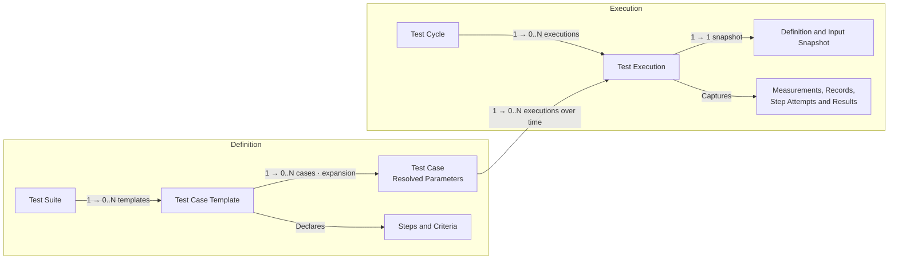

# Dokime Product Guide

Detailed concepts, supported interfaces and existing authoring examples. For installation, start with the [Quick Start](../README.md#quick-start).

The [Privacy and Data Flows](privacy.md) guide inventories evidence, host
measurements, settings, logs, exports and backups, and provides a customer
processing-record worksheet. Dokime does not encrypt evidence at rest; evidence
relies on operating-system disk encryption, which the customer must enable.
Archiving hides evidence rather than deleting it; scheduled retention and
per-execution deletion are not available.

## Install Tools with Mise

Select the CLI and authoring tool from one release in your mise configuration,
the same form generated plugin projects use:

```toml
[tool_alias]
dokime = "github:stokker-technologies/dokime"

[tools]
"github:stokker-technologies/dokime" = { version = "0.1.2", matching_regex = "^cargo-dokime-", bin = "cargo-dokime" }
dokime = { version = "0.1.2", matching_regex = "^dokime-cli-", bin = "dokime" }
```

Set both versions to `nightly` to follow the nightly prerelease. The CLI asset is
`dokime-cli-<version>-<Rust-target>` and the authoring tool
`cargo-dokime-<version>-<Rust-target>`; mise picks the native target. Release
v0.1.2 ships them as raw executables (`.exe` on Windows). Nightly ships ZIP
(Windows) or tar.gz (Unix) archives containing the command at the root, LICENSE,
README and generated CHANGELOG; Unix commands retain executable modes. The
[mise alias](https://mise.jdx.dev/dev-tools/aliases.html) gives the CLI its own
installation directory. Cargo-binstall metadata selects the same archive names,
although this Cargo subcommand is distributed through release assets and mise.

Release downloads include native installers, CLI and authoring-tool archives,
`dokime-distribution-<version>-<Rust-target>.zip` distributor inputs and
`dokime-plugins-<version>-<Rust-target>.zip` (Windows) or `.tar.gz` (Unix).
Each plugins archive contains shipping native plugins as unversioned `.dokime`
members. Python wheels and `cargo-dokime` archives remain downloads until
replaced by their owning SDK and CLI changes.

`dokime-proto-<version>.zip` contains the `dokime/v1/` and `harmos/v1/` definitions
written by `dokime proto export`. `dokime-compliance-<version>.zip` contains
`NOTICE` and `THIRD-PARTY-NOTICES` at its root, artifact bills of materials under
`artifacts/`, and source inventories under `crates/<platform>/` (`any` for the
frontend inventory). No bills of materials or notices are attached individually.
The changelog is the release body. Standalone `.sig` files are not downloads.

`release.json` is the single release index, available at
`/releases/latest/download/release.json` for stable releases and
`/releases/download/nightly/release.json` for Nightly. The desktop updater reads
its root `version`, `notes`, `pub_date` and `platforms` fields using Tauri’s native
manifest parser; unsigned Nightlies have an empty `platforms` map. The `plugins`
section is a format 2 feed mapping plugin names and targets to archive names,
members and member SHA-256 hashes. The `downloads` section classifies every
payload by `kind`, `os`, `arch` and `format` and includes its URL, size and digest.
Select downloads by these fields rather than matching asset names.

```json
{
  "version": "0.1.3",
  "notes": "Release notes",
  "pub_date": "2026-11-08T12:00:00Z",
  "platforms": {},
  "plugins": {"format_version": 2, "plugins": []},
  "downloads": {
    "version": "0.1.3",
    "channel": "nightly",
    "tag": "nightly",
    "pub_date": "2026-11-08T12:00:00Z",
    "artifacts": [{
      "kind": "installer", "os": "linux", "arch": "x86_64", "format": "deb",
      "name": "dokime_0.1.3_amd64.deb",
      "url": "https://github.com/stokker-technologies/dokime/releases/download/nightly/dokime_0.1.3_amd64.deb",
      "size": 48213504, "sha256": "<digest>"
    }]
  }
}
```

`SHA256SUMS` covers payloads and `release.json`. To avoid a digest cycle, neither
`SHA256SUMS` nor the index itself appears in `downloads.artifacts`. The old three
index files are no longer published or read. Older releases retain their original
layout and need their matching application versions.

Nightly uses the same staging and asset inventory as stable releases, adding
`dokime-reports-<version>.zip` and fixed-name `benchmarks.json`. Reports contain raw
benchmark and coverage output plus a summary. Each benchmark records `name`,
`suite`, `unit`, `value`, `baseline_value` (null when first seeded), `revision` and
`threshold_percent`. Baselines are captured before refresh. Notes summarize
coverage per language, benchmark regressions beyond their threshold, suite
results and the run link. Failed jobs do not block publication; unavailable
measurements are represented by the failed suite and retained partial reports.

Every build also carries its source commit and, for published builds, its
channel. `dokime --version` and `cargo dokime --version` print, for example,
`dokime 0.1.2 (766330b7 nightly)`; `version --json` adds `revision` and `channel`.
Backend `GetIdentity` returns them as `source_revision` and `channel`, and
diagnostics bundles include them. The build script in `crates/dokime/build.rs`
takes the commit from CI's `GITHUB_SHA`, otherwise from the Git checkout, marking
uncommitted tracked changes `-dirty`; without either it reports `unknown`.
Builds from `v*` tags are `release`, the nightly workflow's are `nightly`, and
other builds name no channel.
OBC and remote examples remain candidate/source fixtures. Native SDK wheels are
packaged per platform and attached to releases. Registry publication is refused
until the owner settles the Python package and import name. CI's `upload.json`
is not a release download.

`mise run release:rehearse` consumes existing release-profile packages for every
configured target and runs staging and registry dry runs with credentials
removed. It does not create a remote rehearsal release. The integration owner
must re-register crates.io and PyPI Trusted Publishing to `release.yml`,
environment `release`, before the first publication under this workflow.

The independent host's additive command surface is documented in the
[new-host CLI guide](execution-host.md#command-line-candidate). It uses
`dokime-next` until the installed-tool cutover.

## Start a Python Project

Use the pure [Python SDK](../sdk/python/README.md) with Python 3.13 or newer.
Python serves remote plugins; start Dokime separately.

```sh
dokime new bench --lang python
cd bench
uv add /path/to/dokime-0.1.5-py3-none-any.whl
mise run test
mise run serve
```

The [starter source](../sdk/python/examples/starter/) contains the suite and its
in-process host test. CLI embedding and real-host execution need the integration
work recorded in the [SDK guide](../sdk/python/README.md#validate). Generated
client calls await authoritative service definitions in `proto/dokime/v1`.

## The Test Domain

Definitions describe what can be tested. Execution captures what happened when
concrete cases ran. A **suite** organizes related **templates**; each template
materializes **cases** with resolved parameter values. A **cycle** groups the
executions selected for a test campaign.



Each execution identifies exactly one case and one cycle. Repeating a case
creates another execution; retrying a step is recorded as a step attempt within
that execution. A cycle can bring together cases from different templates and
suites—it is not a copy of one suite. A cycle is created explicitly, starts
empty and grows as explicit execution attempts are appended. Appending never
starts hardware; an execution is the Start/Stop unit.

Execution and cycle record and sample queries include evidence they produced
or captured. An observer row can belong to several executions through capture;
its producer scope remains unchanged. SQLite capture links and Arrow batch
ranges select that membership without storing additional sample payloads.

Several cycles can stay **Active** at once, with one execution running across
the server. Start admits an execution once by its durable identity. Optional
server-owned ordered continuation can start the next unstarted member after
natural completion and evidence drain; it defaults to false. Stop durably disables that
continuation policy. Each execution saves and seals its evidence while its cycle stays
Active. Select the destination cycle in the Library before adding attempts.

After an execution seals, managed recovery state keeps its control summary and
frozen plan. Generated telemetry outputs and artifact inventories remain in native
execution storage. Complete inspection reads that durable revision. Retiring a
sealed cycle also releases its completed requests and consumed case registrations;
saved cases can be reused without retaining every earlier cycle in recovery state.
Development roots without durable case registration revisions require a fresh
storage root. Existing roots are never reset automatically; storage remains v1.

**Seal Cycle** closes admission immediately, stops that cycle's running work,
cancels unrun executions and waits for every execution and the cycle report to
be durably saved. Other cycles continue. Shutdown stops running executions
without regenerating cycle reports. Startup marks unfinished executions
Interrupted and seals previous-session Active and Sealing cycles without
replaying device operations.

A cycle is in one of four phases:

| Phase | Meaning | Operator Actions |
| --- | --- | --- |
| **Active** | Admits cases and runs executions. | Start, Stop, Seal Cycle |
| **Sealing** | Admission is closed while work stops and evidence is saved. Startup resumes an interrupted seal. | None; it settles on its own |
| **Sealed** | Every execution and the cycle report are durably saved and immutable. | Archive, Export, Open Report |
| **Seal Failed** | The seal could not complete, for example because stored evidence was written by an incompatible build. The cause is shown with the cycle and recorded as a cycle finalization failure. All evidence is kept unsealed. | Retry Seal, Archive |

Completed work no longer depends on its plugin, even while unsealed. Completion
means a terminal execution outcome, settled plugin cleanup and stream drain, and
durably frozen report inputs. The provider task also protects the gap before
automatic continuation starts the next case. Sealing and report publication after
completion do not hold plugin reload, reinstall or removal. Reports, Retry Seal
and history reads use frozen documents, appearance, schemas, plugin analysis
results and stored evidence.
Starting an unrun case in an open cycle after its plugin is removed fails clearly
with `execution_plugin_unavailable`; install the original revision or add a case
from an available plugin.

**Rerun Cycle** creates a new Active cycle from any existing cycle, whether
Active, Sealed or archived. It takes the source's planned cases in order and
plans each again by suite, case and parameters, unrun and without attempts or
evidence. The new cycle keeps the source's title unless another is given, its
description, tags, attributes and Continue Automatically, and records the source
in its `rerun_of` attribute, which `CycleSummary.rerun_of` exposes. The source is
untouched. Cases resolve against the plugin installed now, not the source's
definition revision, so a changed plugin runs its current version. A case whose
suite or case is no longer declared is skipped, and parameters the current case
no longer declares are dropped; the reply reports both with their reasons. When
no case survives, the rerun is refused with `rerun_no_cases`, naming the plugin
and the missing cases, and nothing is created.

Seal Failed is settled: later startups do not seal it again. Retry Seal resumes
from the saved evidence, without requiring the plugin, and returns to
Seal Failed with the new cause if the seal still cannot complete. Archive hides
the cycle without deleting its evidence; Unarchive restores it. A cycle whose
seal kept failing in an earlier build settles as Seal Failed on the first
startup of this build.

The desktop reads a bounded record tail, then appends changes from its stream.
Execution files refresh with runtime changes; an idle view does not poll the
file list. The status bar follows the existing runtime subscription without
periodic health queries. Long record and execution lists render only the visible
rows and their nearby rows.

For a charger campaign, one template might measure steady-state charging while
another checks overcurrent protection. Cartesian expansion turns the operating
points into concrete cases:

```text
Input Voltage:  207 V, 230 V, 253 V
Load Impedance: 80 Ω, 100 Ω, 120 Ω

3 Voltages × 3 Loads → 9 Cases Of The Same Procedure
```

A list can also be one parameter value. An ordered load sequence such as
`[100, 50, 10]` Ω can describe three steps within one case; it does not have to
mean three separate cases. Expansion is declared explicitly.

## Notifications

Unavailable views show an inline failure card with Try Again when available, collapsed Technical Details and Copy of the complete failure. These view failures do not create toasts. Failed actions and background failures appear in the bottom-right toast area. Errors remain until dismissed; informational feedback closes automatically. The sidebar's Notifications page shows unread counts and records each message's time, source and detail. Dismissing a toast keeps its history. Use Clear Notifications to remove the saved history.

Routine background loading, page navigation and connection progress stay in the inline status indicators without toasts or history entries. Notifications record user-relevant outcomes and failures; backend failures identify the failed operation in their title.

The desktop's WebView stores notification history locally and reads it in bounded pages. Retry controls retain their operation context when a message moves to notifications. Execution evidence and reports retain their own authoritative records.

Each history entry shows a severity icon beside its primary title, with secondary message text and a muted source path below. Relative times align to the right; hover over a time to see its full local date and time. History and relative times update while the page is open. The toolbar keeps the count on the left and Clear Notifications on the right; Newer and Older navigate saved pages.

Click a toast or history entry, or focus it and press Enter or Space, to open its details. The dialog shows the full message, source, severity, absolute and relative time, and available failure reason, operation and request/invocation identifiers. Validation failures list each affected field and its reason. Causes appear with the root first; dependent startup consequences remain collapsed. Expand Technical Details for causes, identifiers, backend diagnostics/backtrace and the available client stacks. Copy includes all details, including collapsed sections. Press Esc or Close to return to the notification. Set Secret and Open Plugin Settings remain separate actions.

## Native Remote Access

Choose **Export Remote Access** in Settings → Remote Access. The native save
picker suggests a readable label and `.pair` filename. If the listener
is off, one confirmation enables it on the saved port (8765 by default) and
continues the export. The same confirmation warns that the file is secret.

The file contains the backend's access key and self-signed server certificate.
Anyone holding it has full control; transfer it privately. Exporting again replaces
the backend's single key and invalidates previously exported files. The host stores
only its verifier. Raw keys stay in native code and never enter the WebView or logs.

Endpoints are automatic: a specific bound address, or the hostname followed by
real interface addresses in the listener address family, with private networks first
and IPv4 link-local addresses last. Remote Access shows addresses and adapter names
before export. Virtual/VPN adapters are excluded. Loopback addresses work on the same
PC only. Clients try the file's endpoints in order and verify the expected backend
identifier on connection and before application calls.

Remote files are UTF-8 JSON v1, limited to 1 MiB, with exactly `version`,
`endpoints`, `backend_identifier`, `label`, `certificate_pem` and `access_key`.
The certificate and key may be null for explicitly unsecured lab listeners.
Unknown fields, invalid identities or PEM, wildcard origins and inconsistent
TLS/certificate combinations are rejected. There is one self-signed server
certificate, with no CA hierarchy. Replacing it requires exporting a new pairing.
Incompatible old security stores require a fresh application root; existing data
is never silently reset.

Every connected client may call every operation served to clients, including media
capture and listener management. TLS and access-key authentication remain independent
advanced settings; disable either only in an isolated lab.

Windows installation never needs administrator rights and does not change the
firewall. On the computer exporting remote access, Settings → Remote Access checks
Windows Firewall when the listener runs on a non-loopback address. If inbound access
is blocked, **Allow In Firewall…** requests administrator approval to allow the app
on the listener's active **Private**, **Public** or domain networks. The notice
identifies each adapter, network and profile. The inbound rule permits only this
executable's TCP listener port, with peers restricted to the local subnet.
Cancelled or refused approval leaves the app usable.
Connecting to another backend only uses outbound access and needs no firewall rule.
Disabling remote access attempts to remove this installation's rule without a UAC
prompt; a standard user is told when cleanup needs an administrator. Per-user
uninstall leaves any rule in place and never requests administrator access.
On other platforms, permit the saved listener port through the host firewall.

### Direct Cable Between Two PCs

Connect the Ethernet cable and use a different address on each PC in the same
subnet. Static addresses are recommended, for example `192.168.50.1/24` and
`192.168.50.2/24`, without a gateway; choose a subnet unused by other adapters.
Automatic IPv4 link-local addresses (`169.254.x.x`) also work once both adapters
have acquired them. IPv6 link-local is excluded because it requires an interface
zone identifier that remote files do not support.

On the exporting PC, check the cable address and adapter name in Remote Access,
then select **Export Remote Access**. Import the file on the second PC. A cable
without a gateway may be classified as a Public unidentified network. If the
firewall notice reports blocked access, optionally select **Allow In Firewall…**
and approve the administrator prompt; the rule covers that profile for peers on
the same subnet. Installation never changes firewall rules.

## Full-Control Access and Plugin Capabilities

A valid access key grants full control over remote product operations and
installed plugins, including request-dependent channel, stream and source scopes.
An authentication-off listener grants the same control to every connection;
use that setting only in an isolated lab. There are no per-user roles or server
permission files. TLS controls transport encryption and certificate verification
independently of access-key authentication.

Operations without a client transport binding remain unavailable through gRPC.
Plugin identity comes from the original runtime registration, never an owner
name supplied by a caller. Plugins still declare their own requirements for
calls into other plugins or host services; an operator's key cannot expand those
capabilities. A grant must name the operation being called. Discovery and
invocation use the current provider contract; rediscover after provider changes.

## Backend Pairing Files

Name the pairing file explicitly or set `DOKIME_REMOTE`. With neither configured,
the client reports how to set `DOKIME_REMOTE`; it never chooses an implicit remote.
Clients and the desktop read the process environment without searching for `.env`.
The server and development command retain explicit `--env-file` support.

```sh
DOKIME_REMOTE=./lab.pair dokime status --json
dokime status --remote lab.pair --json
dokime operation list --remote lab.pair
```

Settings → Backends lists the pairing-file folder. Import or drop one `.pair` file
to copy it into that folder and connect. Its filename is the listing identifier;
the file carries its label and complete connection data. Duplicate filenames are
refused. Deleting the active pairing disconnects it. There is no registry document,
default profile, OS credential-store association or remembered winning endpoint.
The folder is `$XDG_CONFIG_HOME/dokime/remotes` (or `$HOME/.config/dokime/remotes`)
on Linux, `$APPDATA/dokime/remotes` on Windows, and
`$HOME/Library/Application Support/dokime/remotes` on macOS.

Python uses `await dokime.connect(...)` and `await client.close()`.
The generated service stubs and thin client layer replace the native lifecycle
and dataframe APIs. Its current service-definition prerequisite is recorded in
the [Python SDK guide](../sdk/python/README.md#connect-a-client).

Clients try endpoint candidates in their listed order. A failed connection leaves
the pairing file available for retry. Certificate trust and expected backend
identity are checked before a candidate is accepted. Operation discovery uses the
current served contracts; rediscover after provider changes.

`operation list` displays operation ID, provider owner and description. Select a
provider explicitly for metadata or a call:

```sh
dokime operation show OPERATION_ID --owner OWNER --remote lab.pair --json
dokime operation call OPERATION_ID --owner OWNER --remote lab.pair --input request.json --output response.json
dokime operation call OPERATION_ID --owner OWNER --remote lab.pair --json '{"enabled":true}'
dokime operation call OPERATION_ID --owner OWNER --remote lab.pair --input request.json --input-stream-file items.jsonl --output response.json
```

`--input` and `--json` are mutually exclusive request sources; omitting both
sends `{}`. Inputs use the discovered contract's protobuf JSON shape. Streaming
input is one item per line. Without `--output`, stdout emits one JSON item or
completion event per line. Download streams with a header, byte chunks and a
completion save verified raw bytes with `--output`; stdout prints a JSON download
summary including header metadata. Other response files contain one JSON array of those
events, including the final completion; a unary call has only that completion.

Existing response files require `--overwrite`. Predictable output conflicts are
rejected before dispatch. The complete response is written to a temporary sibling
and published atomically after successful completion. A failed output write
never replays the device command. Diagnostics go to stderr and failures return
nonzero.

Ctrl+C stops waiting locally. A timeout or disconnection after dispatch can leave
the device outcome unknown, even when no response was received. Check device
state before manually resending; calls are never retried automatically. Manual
operations can affect a running test and are not logged into its execution
evidence. From Rust, `dokime::client::Client::call_operation` uses the same live
contract discovery and shared Harmos codec:

```rust
let client = Client::from_pairing(Some(std::path::Path::new("lab.pair"))).await?;
let stream = client
    .call_operation("obc.bench.get_status", Some("plugin_obc"), b"{}", Vec::new())
    .await?;
while let Some(event) = stream.message().await? {
    println!("{event:?}");
}
stream.close().await;
```

Browse the registered suite catalog, start an attempt and stop work explicitly:

```sh
dokime catalog list --remote lab.pair --json
dokime catalog show REGISTERED_SUITE_ID --remote lab.pair --json
dokime execution start EXECUTION_UUID --remote lab.pair --json
dokime execution stop EXECUTION_UUID --remote lab.pair --json
dokime cycle seal CYCLE_UUID --remote lab.pair --json
```

Replace the identifiers with those returned by the backend. `catalog list
--json` emits one complete suite definition per line; a later read failure
returns a nonzero exit status after any earlier lines. `execution stop` stops
the selected execution, halts its cycle's automatic continuation and waits for
its durable seal before returning. To repeat a case, append a new
execution identity and Start that attempt; earlier evidence remains unchanged.
Cancelling an ordinary local wait leaves admitted backend work running.

`cycle seal` waits for the durable cycle seal. Repeating it is safe, including
after a lost response. Other cycles remain available. The Python
client provides the same durable boundary with `await cycle.seal()`, and
the flat lifecycle target exposes `await cycle.close()` to seal and drain owned
work. Use `try/finally` when cleanup must survive exceptions or cancellation.

Download saved evidence without running any work again:

```sh
dokime execution export EXECUTION_UUID --remote lab.pair --output execution.zip
dokime cycle seal CYCLE_UUID --remote lab.pair --json
dokime cycle export CYCLE_UUID --remote lab.pair --output cycle.zip
```

A sealed execution is exportable while its cycle stays Active. A cycle export
requires its durable seal and includes every exact member revision. The ZIP
contains `manifest.json`, `evidence.sqlite`, captured files and saved HTML
reports. The manifest records source identities, revisions, row counts and
payload checksums. SQLite retains relational evidence and the `files`,
`artifacts`, `streams` and `stream_summaries` catalogs. Telemetry is stored in
ZSTD-compressed Arrow IPC files under `telemetry/<stream>.arrow`. Exports copy
complete finalized files produced by the execution byte-for-byte. Captured rows
from shared observer files are materialized from indexed ranges at the selected
evidence frontier, excluding unrelated samples. Producer scopes stay unchanged.
Each file contains typed `values` and
`_storage` metadata. Timestamps use UTC microseconds. Arrow field metadata retains units,
descriptions and stream identity; schema metadata identifies the execution, Dokime version and contract.

Execution bundles place captured files under `artifacts/<relative path>`.
Cycle bundles use `executions/<execution-id>/artifacts/` and
`executions/<execution-id>/telemetry/`, with their saved cycle report in `reports/`.
Telemetry is cataloged as a file and never appears as a captured artifact.

Exports use saved storage snapshots and survive server restart. Missing
required evidence fails the export. The server admits one export at a time,
with an 8 GiB archive limit. The client verifies contiguous chunks, size,
SHA-256 and final transport success before publishing the ZIP atomically.
Existing destinations require `--overwrite`. Failed downloads preserve the
previous output; retry starts a fresh download and never repeats execution.
The desktop's **Export Evidence** action uses the same exporter and a native
save dialog. The Python handles provide `await execution.export(path)` and
`await cycle.export(path)`, with `overwrite=True` for explicit replacement.

`status` performs a bounded live identity, authentication and readiness check and
returns nonzero on failure. Backend identity includes the compiled Rust target and
product version. The pairing file is the only remote connection input.

Changing a stream row's fields automatically creates a stored revision. Rebuild
and reload the plugin; no author version bump or backend restart is needed.
Each row retains its own definition, so earlier executions remain readable.
Queries and documents select stream ids and columns: a missing column contributes
no values, and an incompatible column is identified on its affected binding while
other evidence remains readable. Catalogs and live plots show the active stream.

Stream and record revisions are opaque identities derived from their schemas,
compared only for equality. Rebuild plugins against the matching Harmos SDK;
Python record declarations no longer accept a `schema` argument. Stored evidence
keeps the definitions captured for its execution, so changing or removing a
plugin does not invalidate the root or rewrite old evidence.

Root compatibility belongs to Dokime's built-in persistent state: journal replay,
snapshots and catalogs. Built-in object shape revisions are derived once per
type and reused during storage catalog validation. An unreadable built-in record names the state that cannot
be decoded and advises a fresh root. Evidence codecs, document definitions and
plugin schemas never participate in a whole-root digest. Obsolete digest markers
are preserved and ignored. The custom interned snapshot encoding retains its
existing key because Harmos cannot describe that custom Serde representation.
Database layout and supported input framing remain v1. There are no migrations,
compatibility aliases or automatic root resets; existing files are never silently
deleted. Keeping old built-in journal records across a product shape change would
require storing their definitions with each journal entry and decoding against
those definitions, rather than the running product's current typed identity.

## Shared Plugin Secrets

Each backend owns a catalog of secrets keyed by identifier. Plugins use the shared
`dokime.secrets.lookup` operation with an identifier; a missing or deleted identifier returns
an error. Replacing a value affects future lookups. A value already fetched by
a running plugin remains its responsibility.

A declared secret's identifier is its Secret Storage identifier. At plugin start,
Dokime reads each declaration directly from the store. A missing required secret
fails startup with ``secret `api_token` is not in Secret Storage; add it and reload the plugin``
(the identifier varies). Optional secrets are absent when missing. Add the exact
identifier in Secret Storage, then use **Reload** on the plugin page to read the
store again; only that plugin restarts. There are no per-plugin bindings,
environment-variable sources, automatic retries or fallback identifiers.

Open **Settings → Secret Storage** to see the owning host, add an identifier, edit
its label or description, replace its value, or explicitly confirm deletion.
Existing values are never fetched for display. Leave the replacement field
empty to retain a value. References lists plugins that declare each identifier,
including installed plugins that failed to start. Plugins can also look up
identifiers dynamically, so this list is not exhaustive. Switching
backends opens that backend's catalog and discards the previous edit form.

Values are stored in the host's OS keyring, separately from backend login
tokens and signing keys. New writes require that
keyring; there is no plaintext fallback. The catalog stores identifiers, labels,
descriptions and opaque keyring slot identifiers. Names contain 1–128 ASCII
letters, digits, dots, underscores or hyphens; values contain 1–65536 bytes,
with at most 1024 catalog entries per host.

The Linux native desktop acceptance story starts a private D-Bus session and
unlocked GNOME Keyring in its disposable workspace; CI installs `dbus` and
`gnome-keyring`. Windows uses its native Credential Manager.

**Export Selected Secrets** saves a `.b64` file through the native file
picker. It contains a Base64-encoded version 1 JSON document with the selected
identifiers, metadata and values. Base64 is not encryption: anyone with the file can
read its secrets. Store and share it accordingly.

**Import Secrets** previews the file's identifiers and conflicts before applying
changes. Existing identifiers start unchecked; select each replacement explicitly
and leave entries unchecked to skip them. A changed destination catalog
requires a fresh preview. Invalid input or failed secure-store staging writes
no values.

Each transfer holds at most 512 KiB of decoded JSON, with the corresponding
Base64 file limited to 699052 bytes. Larger selections must be exported
separately. If catalog publication cannot be confirmed after a filesystem
error, both generations' secure slots are retained; refresh the catalog
before retrying.

Secrets use a shared table with Identifier and Label columns. **Add Secret**
opens a dialog; the monospace Identifier is the machine key, while Label is the
human display text. No `name` alias is accepted in secret contracts.

### Plugin Settings

Saving a changed value in **Settings → Plugins** keeps the program running with
its startup values. The backend compares saved values against that generation
and marks differing fields **Applied on Reload** with a warning highlight.
These marks survive navigation, a GUI restart and another attached GUI. A backend
restart starts programs with their saved settings.

Use **Reload** on the plugin page or table to apply saved settings and restart
all of the plugin's observers, including plugin-activated ones, at their newly
configured intervals. The plugin shows **Restarting…** while it starts. Active
work retains **Restart Pending** until the existing restart admission permits it;
executions are never stopped for a reload. A refused preparation keeps the running
generation, saved settings and field marks, with **Restart Refused** and its reason.
A plugin with no running program starts immediately, including during an active
cycle. An idle open cycle, sealing and completed report publication hold no plugin.

### Plugin Startup and Stop Timeouts

**Settings › Plugins** also holds the backend's **Plugin Startup Timeout [s]**
(default 60 s), the time each plugin program has to launch and become ready, and,
under Show Advanced, **Plugin Stop Timeout [s]** (default 10 s), the time a
stopping plugin's executions have to settle. Both accept 1 to 3,600 seconds. A
saved value applies to the next start, restart or stop; running programs are not
restarted for it. A program that does not become ready in time fails to start with
a cause naming the budget and this setting: raise the timeout and use **Reload**.
Time spent in a plugin's own initialization is bounded by the plugin's declared
initialization policy instead; see
[Plugins](plugins.md#plugin-startup-and-stop-budgets).

Saved preferences use the current defaults for absent sections or fields, so an
existing backend data root starts with default plugin budgets until they are set.
Explicit saved values remain in effect and must pass validation.

### Installing and Removing Plugins

Installing, reinstalling or updating a plugin in **Settings → Plugins**, and
enabling, disabling or removing one, take effect in the running backend; nothing
asks to restart Dokime. The plugin shows **Restarting…** while it starts, is
replaced or stops. While any cycle is active, the change shows **Restart
Pending** and applies once no cycle is active; running executions are never
stopped for it. After a successful replacement, every earlier installation of
that package is discarded, including failed or never-started installations:
their rows, bundles, boot failures and startup notifications are cleared. Startup
also clears pending removals left by earlier builds. After a successful live stop,
the removed installation's row and bundle are deleted. If deletion fails, its row
retains the error and **Delete** remains available to try again; startup retries too.
If a reinstall or update is refused, the previous
version keeps running and stays installed, and the refused bundle is listed as
**Refused** with its reason until it is deleted, a later replacement succeeds,
or the next start deletes it. Failed and refused installations always offer
**Delete**. An installed plugin that did not start also offers **Reload** and an
enable switch; a refused replacement offers neither. **Reload** starts only that plugin again, at once even while
a cycle is active. See
[Plugins](plugins.md#live-installation-changes) for the admission rules.

#### Host Settings

The host plugin declares its 20 settings in
[`plugins/sidecars/host/src/settings.rs`](../plugins/sidecars/host/src/settings.rs).
Save host settings in **Settings → Plugins**, then use **Reload** to apply them.
Each start resolves one settings snapshot.
Collection selects the Wi-Fi/Bluetooth adapters, latency target (default
`1.1.1.1`) and minimum active-scan interval (30 s). Empty adapter selectors use
the native default.

| Probe Timing | Default | Allowed [ms] |
| --- | ---: | ---: |
| Network Inventory/Connectivity Timeout | 2,000 ms | 1–2,000 |
| System Git Identity Timeout | 2,000 ms | 1–2,000 |
| Existing CPU Calibration Window | 1,000 ms | 1–1,000 |
| Unix Wi-Fi Link Command Timeout | 2,000 ms | 1–2,000 |
| Unix Wi-Fi Scan Command Timeout | 12,000 ms | 1–12,000 |
| Windows Active Wi-Fi Scan Window | 6,000 ms | 1–6,000 |
| Unix Latency Process Timeout | 4,000 ms | 1–4,000 |
| Echo Reply Timeout | 2,000 ms | 1–2,000 |
| Unix Bluetooth D-Bus Method Timeout | 6,000 ms | 1–6,000 |
| Bluetooth Deep Refresh Interval | 300,000 ms | 1–86,400,000 |
| Unix Control D-Bus Method Timeout | 30,000 ms | 1–30,000 |
| Windows Radio Settle Timeout | 15,000 ms | 1–15,000 |

Sampling settings select the minimum throughput denominator (1 ms, allowed
1–60,000 ms), congestion contribution (10 % per fully overlapping network,
allowed 0.01–100), echo payload (32 bytes on Windows, 56 on Unix, allowed
1–65,000 bytes), and existing calibration batch (4,096 iterations, allowed
1–65,536). The active-scan minimum permits 1–3,600 s. Unix ping rounds the echo
wait up to whole seconds; its independent process timeout still bounds it.
Native Windows inventory calls remain synchronous and have no cancellable
timeout API. Per-command and per-method waits do not replace the operation's
overall deadline. Radio writes and inverse restoration use the same resolved
native timing settings.

Every stream's collection cadence is editable in **Collection Intervals**:

| Stream | Default [ms] | Allowed [ms] |
| --- | ---: | ---: |
| System | 1,000 | 1–86,400,000 |
| Network | 1,000 | 1–86,400,000 |
| Wi-Fi Link | 1,000 | 1–86,400,000 |
| Wi-Fi Scan | 60,000 | 1–86,400,000 |
| Wi-Fi Latency | 10,000 | 1–86,400,000 |
| Bluetooth | 5,000 | 1–86,400,000 |

The producing observer resolves its cadence from the startup settings snapshot,
overriding its declared initial interval. Both the declaration and settings default
share one value in `settings.rs`. General process observers require
`#[dokime::observer(interval_ms = …)]`; an optional synchronous
`fn interval(resources: &ExecutionContext) -> Result<Duration, Error>` overrides
that default at activation.
Consumers lease the stream without selecting its interval. Static schemas omit a
nominal interval; demand comes from the owner's observer inventory. Minimum Scan
Interval and Bluetooth Deep Refresh Interval independently protect native probes.
An interval shorter than collection work does not overlap that observer's calls;
missed ticks are skipped.

Operation policies remain Harmos declarations: collection bounds are 2/2/2/12/4/6 s
for system, network, link, scan, latency and Bluetooth; controls allow 30 s and
restoration 60 s. These policies use no retries or cancellation grace. Making their
timeout, attempt timeout, cancellation grace or retry/backoff policy configurable
requires a separate Harmos operation-policy change. The 4,096-row publication
window remains a static replay and notification-batch contract.

Unit conversions, percent scales, native ABI layouts and enum discriminants,
Wi-Fi channel/frequency mappings, congestion model identifiers, schema v1 and
stream/operation identifiers retain their fixed meanings. CPU kernel arithmetic
and accumulator layout define the existing calibration workload; its time
window and batch size are settings. Windows ICMP reply storage follows the
native API's required trailer layout. These are measurement or protocol
definitions rather than deployment tunables.

#### Ordinary Settings and Shared Secrets

**Settings → Plugins** keeps ordinary plugin settings editable after startup
fails. Its read-only **Required Secrets** list shows each declared identifier,
whether it is required or optional, and whether it exists in Secret Storage.
**Add in Secret Storage** opens **Add Secret** with that exact identifier prefilled.
Secret values are entered only in Secret Storage; the plugin settings form has no
secret fields. Existing saved references are ignored on load without migrating
values or changing storage v1. A stored identifier such as `example.api_token` does
not satisfy a declaration named `api_token`.

Declare `api_token: dokime::plugin::Secret` for a required shared identifier or
`api_token: Option<dokime::plugin::Secret>` for an optional one. The field name is
the store identifier; secret declarations have no default or `from_environment`
argument. Rebuild external plugins against the matching SDK after this clean break.

## Planning and Creating Cycles

Name a template by the readable ID that `dokime catalog show` lists. Preview
its cases, then materialize them before constructing execution attempts:

```sh
dokime plan preview --template obc.charger.steady.measurement --remote lab.pair --json
dokime plan materialize --template obc.charger.steady.measurement --remote lab.pair --json
dokime cycle create --label "Campaign 1" --remote lab.pair --json
dokime cycle append CYCLE_ID --case-id CASE_ID --remote lab.pair --json
```

Materialization captures the case's definition and provider revision. Append
refuses stale cases and creates distinct execution UUIDs for each repeated
`--case-id`, preserving order. A cycle is explicitly created empty; append
registers attempts without starting hardware. An omitted cycle `--identifier`
is derived by the backend.

For a linear script, `--id-only` prints materialized case IDs, the created cycle
UUID, or execution UUIDs from that exact append. This pulse selection produces
one case and one attempt:

```sh
case_id=$(dokime plan materialize --template obc.checks.pulse --parameters-json '{"sample_count":8}' --remote lab.pair --id-only)
cycle_id=$(dokime cycle create --label "Remote Pulse" --remote lab.pair --id-only)
execution_id=$(dokime cycle append "$cycle_id" --case-id "$case_id" --remote lab.pair --id-only)
dokime execution run "$execution_id" --records --samples --record-type 'obc.run.*' --stream obc.pulse --wait-seconds 60 --remote lab.pair
dokime execution export "$execution_id" --output pulse.zip --remote lab.pair
dokime cycle seal "$cycle_id" --remote lab.pair
dokime cycle export "$cycle_id" --output cycle.zip --remote lab.pair
```

`execution start` admits one execution and returns without waiting.
`execution run` composes that same Start with a durable wait and requested
listener drain. Both use the execution's identity for idempotency: reconnect
with the same UUID and mode after an uncertain Start response. A finished
execution never restarts; append a fresh attempt to run its case again.
There are no caller-managed Start keys or cycle Run/Stop commands.

`--records` and `--samples` observe all captured records and samples.
Repeated `--record-type` and `--stream` flags restrict their respective
selection with case-sensitive whole-identifier globs. Observations and the final
drain summary appear on stderr; the final result appears on stdout.
`execution wait` observes an already admitted execution without starting it.
A saved nonpassing outcome returns nonzero. Interrupting an ordinary wait leaves
remote work running; `execution stop EXECUTION_ID` requests a cooperative stop.

Several cycles can stay Active, with one execution running server-wide.
`continue_automatically` defaults to false. To let the server continue with
the next unstarted member after natural completion and durable sealing, create
the cycle with `--continue-automatically`. A failed execution is a result, not
a reason to halt: continuation proceeds regardless of verdicts. Explicit execution Stop durably sets the cycle's
`continue_automatically=false`. Later explicit Start runs only the selected
attempt until the user explicitly re-enables that policy.
Completion fixes the next eligible member before publishing its terminal receipt.
Appending afterward cannot extend that continuation decision. Appending to an idle
cycle starts no hardware, and reaching the end keeps the cycle Active until it is
explicitly sealed.

Sealed cycles remain in History after a server restart, including cycles with
no executions. History lists their saved headers independently of execution
results; an empty cycle has no passing or failing outcome and its saved report
can still be opened.

Scripts can opt into cancellation and evidence recovery while running or waiting:

```sh
mkdir -p recovery
dokime execution wait "$execution_id" --remote lab.pair \
  --cancel-on-interrupt --owned-cycle "$cycle_id" --recovery-directory recovery
```

The same options work with `cycle append`, `execution start`, `execution run`,
`execution export` and prompt `next/show/answer`.
They verify exact cycle membership before mutation. Use `--owned-cycle` only
for a cycle created and reserved by the script: Ctrl+C stops that execution,
seals that cycle and downloads `execution-<UUID>.zip` and `cycle-<UUID>.zip`.
Sealing cancels its unstarted members; other cycles and the shared server remain
available. Existing recovery files are refused before connection. A lost
connection cannot confirm cancellation or a completed download; retain the
original identities and inspect them before resubmitting.
PowerShell terminates a native command whose output it captures when Ctrl+C
arrives, before recovery can finish. Run recovery-armed commands uncaptured and
read their UUIDs from `--id-file <path>`, which `cycle append` and prompt `next`
truncate before connecting and fill with one confirmed UUID per line.
Batch recovery applies while these native commands are observing an interrupt;
it cannot reliably cover connection setup or gaps between commands. A lost
Create reply leaves the cycle identity unknown and requires manual inspection.

The [Remote CLI Workflows](remote/cli.md) include
linear device, test and confirmation exercises for POSIX shell, PowerShell 7.3+ and
Command Prompt. Edit their connection, execution, observation and file globals,
then run without arguments. Their names, grouping and meanings match the
[Python starter](../sdk/python/examples/starter/).
The scripts require the matching CLI and simulated OBC plugin; a matching
first-party release combination and native workflow validation remain pending.
The [candidate walkthrough](remote/overview.md) explains
how to obtain matching CI artifacts and prepare a pure Python wheel from the same revision.

`--parameters-json` supplies single template parameter values as a plain
JSON object. The default pulse has no prompt. To require one confirmation,
materialize that case and explicitly Start its attempt so the script can answer:

```sh
case_id=$(dokime plan materialize --template obc.checks.pulse \
  --parameters-json '{"require_confirmation":true}' --remote lab.pair --id-only)
cycle_id=$(dokime cycle create --label "Remote Confirmation" --remote lab.pair --id-only)
execution_id=$(dokime cycle append "$cycle_id" --case-id "$case_id" --remote lab.pair --id-only)
dokime execution start "$execution_id" --remote lab.pair
prompt_id=$(dokime execution prompt next "$execution_id" --wait-seconds 60 --remote lab.pair --id-only)
dokime execution prompt show "$execution_id" "$prompt_id" --remote lab.pair
dokime execution prompt answer "$execution_id" "$prompt_id" --action yes --remote lab.pair
dokime execution wait "$execution_id" --wait-seconds 60 --remote lab.pair
```

Prompt reads and answers require both exact identities. The server refuses stale
or duplicate answers. After an ambiguous response, inspect `prompt show`
before deciding what to do. Actions `cancel` and `abort` submit a cancelled
response. Seal the script-owned cycle before exporting its complete bundle.

`--input-file` takes the operation's canonical JSON without flag overrides.
For `plan materialize`, the request contains one registered template selection:

```json
{
  "selection": {
    "suite_id": "SUITE_ID",
    "template_id": "TEMPLATE_ID",
    "parameters": [],
    "files": []
  }
}
```

For an append whose exact identities must survive a lost response, retain its
canonical `AppendExecutions` input before calling `cycle append --input-file`:

```json
{
  "cycle_id": "CYCLE_UUID",
  "executions": [
    { "execution_id": "EXECUTION_UUID", "case_id": "CASE_UUID" }
  ]
}
```

Repeating that append with the same bindings cannot duplicate attempts;
conflicting identity reuse fails. Flag-based appends print their registration
identities to stderr before transmission. Retain those identities if the reply
is lost.

Until a cycle or execution seals, operators can rename it with the pencil
beside its desktop title or with `Execution/RenameCycle` and
`Execution/RenameExecution`. Sealed, archived and History subjects refuse
with `FailedPrecondition`. Renaming an execution renames its case, including
other attempts, and records an `operator.label_edited` record with both labels.

For `cycle create --input-file cycle.json`, retain the explicit continuation
policy alongside its metadata:

```json
{
  "metadata": {
    "identifier": "campaign.1",
    "label": "Campaign 1",
    "description": null,
    "tags": [],
    "attributes": [],
    "created_at": null,
    "updated_at": null
  },
  "continue_automatically": false,
  "context": null
}
```

```sh
dokime cycle create --input-file cycle.json --remote lab.pair --id-only
```

Cycle creation is a separate non-idempotent mutation. If its response is
uncertain, inspect the backend before creating another container.

## Examples

### Qualify an On-Board Charger

Harmos supplies the runtime and plugin boundary. Applications use
`Runtime::<A>::launch(origin, config)` with the shared `Lifecycle`: `prepare`
registers catalogs, lanes and resources through `Setup`, and `initialize`
activates resources that need the live runtime. Server composition is prepared
before Dokime launches; listening uses the initialized service. Dokime adds the testing domain:
procedures, parameter expansion, operator interaction, acceptance criteria, and
self-contained reports.

The [OBC charger simulation](../plugins/sidecars/obc/src/suites/) demonstrates startup,
steady-state measurement, overcurrent protection, and recovery. It models a
charger testbench for learning the workflow; it is not a validated electrical
model or a ready-made vehicle qualification standard.

### Define the Operating Points

A shortened version of OBC's
[steady-state parameters](../plugins/sidecars/obc/src/suites/steady/measurement.rs) declare the
nine-case voltage/load sweep:

```rust
// Cargo.toml: dokime = { git = "https://github.com/stokker-technologies/dokime", features = ["plugin-sidecar"] }
use dokime::definition::ParameterDefault;

#[dokime::parameters]
pub struct Parameters {
    #[parameter(
        label = "AC RMS Voltage", unit = "V",
        expansion = "cartesian",
        default = ParameterDefault::space([207.0, 230.0, 253.0]),
    )]
    pub ac_voltage_v: f64,

    #[parameter(
        label = "Load Impedance", unit = "ohm",
        expansion = "cartesian",
        default = ParameterDefault::linspace(80.0, 120.0, 3),
    )]
    pub load_ohm: f64,
}
```

The template names its parameter type once. Every expanded case resolves those
inputs before execution, so the procedure and its document see the same values.

### Run the Procedure and Capture Evidence

OBC's [steady-state template](../plugins/sidecars/obc/src/suites/steady/measurement.rs)
initializes a plugin-owned device, energizes the charger, observes its
waveform, asks the operator to inspect the trace, and attaches a measurement
summary. Cleanup releases the simulated device through an operation.

This excerpt is the template's measurement observer. `SampleCharger`, `Row`,
`Samples`, `Streams`, and `measurement` belong to the example:

```rust
#[dokime::observer(interval_ms = STEADY_INTERVAL_MS, streams = Streams)]
async fn samples(ctx: &mut ObserverContext<'_>) -> Result<(), Error> {
    let index = ctx.resources().produced.load(Ordering::Acquire);

    // Sample Charger
    let operation = SampleCharger {
        device_id: ctx.resources().device_id,
        elapsed_s: 0.1 + index as f64 * ctx.resources().interval_s,
    };
    let sample = ctx.operation(operation).await?;

    // Publish Measurement
    let row = measurement::row(index, sample.reading, "stream");
    ctx.stream::<Row>().into::<Samples>().push(row).await;
    ctx.resources().produced.store(index + 1, Ordering::Release);
    Ok(())
}
```

The same template uses `ctx.ask(...)` for operator sign-off and writes its
summary through `ctx.artifacts()`. Its criterion checks that enough samples
were captured and that the completion record accepted the run:

```rust
#[dokime::criterion(id = STEADY_ACCEPTANCE_CRITERION, label = "Trace Accepted")]
fn accepted(ctx: &CriterionContext<'_>) -> Result<bool, Error> {
    let samples = ctx.samples::<Samples>();
    let records = ctx.records::<Completed>()?;
    let completed = records.last()
        .ok_or_else(|| Error::MissingEvidence(Completed::RECORD_TYPE.into()))?;

    // Check / Number of Rows
    let number_ok = samples.len() as u64 >= ctx.parameters().sample_count()?;

    // Check / Operator Acceptance
    let accepted_ok = completed.accepted;
    Ok(number_ok && accepted_ok)
}
```

These are excerpts from the complete template, not standalone programs.
The [protection template](../plugins/sidecars/obc/src/suites/protection/overcurrent.rs)
adds an automated load ladder and verifies that an overcurrent fault disconnects
the supply and prevents restart. A real charger integration can extend these
procedures with regulation, efficiency, and thermal criteria for its hardware.

Every execution stage uses `ctx.operation(request).await?`, returning the shared
Harmos `Invocation<StepOperationHost, O>` builder. Await returns `Response<T>`;
read its fields through Deref, or use `into_owned()` when moving the payload.
Use `.start().await?` for an instance you will join or cancel. The operation
macro owns the default policy. `.retry(settings.retry)` overrides one call only;
obtain the choice from settings, parameters or configuration. Enabled retry
overrides require declared replay safety, preserve operation deadlines and record
each attempt in the execution log. These JSON `operation_attempt` records use
Trace for first-attempt success, Info for success after a retry, Debug for
cancellation, and Warn for failure, timeout or unavailability. Templates have
no `.lane()` option.

Attempt records include `started_at` (the observation's wall-clock timestamp),
`elapsed_ms` (handler duration, excluding retry delay and middleware), and
`attempt_timeout_ms` (the operation policy's attempt timeout). Local operations
capture the same timing around their handler and cancellation settlement.

At each step end, `dokime.operations.latency` summarizes each operation used in
that stage. Execution end also retains unfinished stage summaries and a whole-run
summary (`stage: "execution"`). Fields are `operation`, `stage`, `attempts`,
`successes`, `failures`, `p50_elapsed_ms`, `p95_elapsed_ms`, `max_elapsed_ms` and
`slowest_instance`. Percentiles use nearest rank; all non-success outcomes count
as failures. Ties for slowest use the largest instance ID. The level is Info when
p95 strictly exceeds half an observed policy's attempt timeout, otherwise Debug.

`dokime.observers.cadence` summarizes backend observer activations seen while an
execution is open, separately by `plugin`, `observer` and `activation`. These are
backend diagnostics, including shared observers; presence does not claim that the
execution leased that observer. Cumulative summaries are emitted every 60 reported
ticks and at execution end, with `reason`, `configured_interval_ms`,
`mean_actual_interval_ms`, `maximum_gap_ms`, `ticks`, `skipped_ticks`,
`refused_ticks` and `longest_callback_ms`. Skipped ticks have no actual start and
are excluded from interval averaging; the mean is null until two starts exist.
A gap strictly above twice the configured interval emits a Warn
`dokime.observers.gap` naming the observer and activation; summaries containing
such gaps are Warn, otherwise Debug. Harmos's cadence frame carries no operation
or call identity, so these reports do not guess which operation caused a gap.
No timer or observer scheduling policy is added.


A step also reaches four built-in operations through `ctx.operation(request)`,
with nothing to declare. `RunProcess` runs a vendor tool in the execution's artifact folder,
sends its output to the execution log or into an artifact, and records its exit.
`CopyFiles`, `StartCapture` and `StopCapture` bring files into the execution's evidence.

### File Capture

To keep one local file as it stands, import it. The plugin's own process reads
the file, so there is no FTP and no capture limit:

```rust
ctx.artifacts().import(&self.log, "device/boot.log")?;
```

To pick up the newest file in a folder at the start, copy it. `CopyFiles` copies
its source once and answers with what it sealed:

```rust
// Copy Newest Log
let source = FileSource::newest(&log_folder, [FileRule::include("*.log")]);
let request = CopyFiles::new(source, "logs");
let copied = ctx.operation(request).await?;
```

To stream a live log, start a capture before the producer writes. `StartCapture`
returns once its baseline is taken, so the producer needs no startup wait, and
`StopCapture` answers once everything is sealed. The
[startup template](../plugins/sidecars/obc/src/suites/startup/sequence.rs) tails the
simulated charger's log this way:

```rust
// Start Capture
let matcher = LineMatcher::publishing::<ChargerLog>(PATTERN);
let request = StartCapture::new(FileSource::file(&self.log), "charger/device.log", StreamCapture::plain().matcher(matcher));
let capture = ctx.operation(request).await?;

// Log Readings
self.device.sample(0.0);

// Stop Capture
let request = StopCapture { capture_id: capture.capture_id };
let captured = ctx.operation(request).await?.into_owned();
```

To keep a file that is rewritten during the execution, such as a zip archive,
mirror it. A Mirror checks the file for a change once per interval and ignores
change notifications. Its final pass runs when the capture stops:

```rust
// Start Archive Mirror
let source = FileSource::file(&self.archive);
let request = StartCapture::new(source, "device/results.zip", MirrorCapture::every(ctx.parameters().archive_interval_s));
let capture = ctx.operation(request).await?;
```

Take the interval from settings or parameters. `MirrorCapture::configured()` uses
the configured interval. A mirrored artifact becomes visible when it seals, so an
interim refetch can never expose a half-written archive; a failed refetch keeps
the last whole copy.

**Sources.** `FileSource::file` names one file, which must exist at the start.
`FileSource::tree` names a directory and its ordered rules, and `FileSource::newest`
selects the newest match of the same rules at the start, breaking ties by path, and
follows it through rotation without switching to a later arrival. It fails when
nothing matches. Rules use `FileRule::include` and `FileRule::exclude` over
forward-slash paths relative to the root, and the last matching rule wins. Depth
follows the rules: `*.log` stays at the top level, `**/*.log` descends, and empty
rules select every file at any depth. A tree over an accessible empty directory
starts at once and captures later files from byte zero, including a log the
producer creates after the start. Use `FileLocation::ftp(url, secret_id)` in place
of a local path for an FTP source. Unavailable FTP roots fail immediately because
FTP status 550 cannot distinguish missing roots from denied access.

**Output.** For a file source, `output` is the full artifact name. For a tree or
newest source, it is a prefix under which relative paths are preserved; empty means
the artifact root. Unknown extensions use `application/octet-stream`. Artifact paths
must be relative, use forward slashes and contain no traversal, absolute path,
reserved device name or invalid portable filename segment. The harness uses the same
local discovery, glob matching and artifact-name validation as the native host.

**Stream behavior.** Stream captures existing files from their baseline length and
later arrivals from byte zero. Existing files that contribute no bytes produce no
artifact; new empty files are retained. Captured Stream files appear immediately in
the live artifact tree at `artifacts/<output>/<relative path>`, with their growing
size and content available before sealing. Their viewer shows Finished after capture
closes. UUIDs remain internal artifact identities. Detected replacement and
copy-truncate boundaries retain separately named artifact segments; the file limit
bounds simultaneous captures rather than the lifetime number of rotations.

Step uploads use the same `artifacts/<requested path>` rule. Within one execution,
paths are reserved in admission order: repeated `logs/device.log` becomes
`artifacts/logs/device.2.log`, then `.3.log`, choosing the first free suffix.
Replacement and copy-truncate segments retain their `.segmentN` names before
collision suffixing. This changes development stored paths without migration;
existing storage is never silently reset.

**Ownership.** The execution owns a capture, so one step can start it and a later
step can stop it. A capture nothing stops seals when the execution ends. `StopCapture`
is an ordinary request, not a cancellation: it waits for sealing within its attempt
deadline, returns any seal failure, a repeat returns the same outcome, and abandoning
the call abandons only its reply. `CopyFiles` keeps sealing and answers when cancelled,
within that same deadline. Stopping an execution still waits for all captured files
and the durable execution seal.

**Evidence.** Every source gap becomes a `dokime.files.capture_gap` record with its
path, offset and reason, and a capture that ends early becomes a
`dokime.files.capture_failed` record, whether or not anything stops the capture.
`StopCapture` also reports its gaps. A file whose artifact content cannot be captured
is retained as a failed artifact with its error and no downloadable content. Reports
list failed artifacts alongside the remaining evidence; the failure does not prevent
Stop, provider completion or report saving. Storage failures outside artifact content
capture still fail the save.

**Limits.** Requests carry no limits. File and byte limits, the capture capacity, the
Mirror interval and its bounds come from `RuntimeConfig::file_capture`, and Stream
polling comes from `storage.filesystem.poll_interval`. Local Stream captures rescan on
native directory notifications, with the poll interval as the fallback upper bound;
FTP sources poll. Exceeding a limit fails explicitly and retains what was captured.

**FTP.** FTP sources compile only with the `ftp` feature. Shipped server, desktop and
CLI builds enable it, and plugin sidecars do not need it because the host serves
captures. A build without it refuses an FTP source with `file_capture_unsupported`.

Use `instance.request_cancel().await?` to signal cancellation and retain the
handle, or `instance.cancel().await?` to cancel and receive its final response.
Processes return their exit status.
Anything a step leaves running is cancelled when the step ends, with a warning
record. A capture is not an instance and keeps running.

### Capture and Edit Traceability

Steps contribute traceability through their context, alongside document additions:

```rust
let mut section = TraceabilitySection::new("Device Under Test");
section.id("dut"); // Keep the key stable across label changes.
ctx.traceability().section(section);
ctx.traceability().row("dut", TraceabilityRow::text("Serial", "SN-7"));
// A later step can correct the same row without duplicating it.
ctx.traceability().row("dut", TraceabilityRow::text("Serial", "SN-8"));
```

`section` adds or replaces the complete section by identifier. `row` adds or
replaces a row in an existing section, preserving its other rows. Missing
sections, duplicate row identifiers and reserved host-derived section identifiers
are refused and logged. Edits use the same buffered evidence delivery as documents;
the GUI and new reports show the latest captured values. Sealed reports and Python
checkpoint reads retain the values captured at their persisted boundary.
Criteria consume captured evidence and cannot mutate traceability. Initialization,
observers and cleanup have no traceability mutation handle. The former template
`traceability()` lifecycle method is removed; move identity discovery into steps.
The storage baseline remains v1 and existing storage is never automatically reset.

### Present the Result

Compose plots from the same typed measurement fields used by the procedure.
The canonical SDK builders write `dokime.v1` document messages directly:

```rust
use dokime::{Document, FieldReference, Section};
use dokime::plot::Plot;

let readings = FieldReference::new("charging");
let voltage = Plot::xy(readings.field("dc_voltage_v"))
    .x(readings.field("elapsed_s"))
    .label("Battery Voltage")
    .unit("V");
let document = Document::new("Charger Qualification")
    .section(Section::new("Battery Charging").plot(voltage));
```

`Document::new(label)` derives its identifier with the same normalization as
traceability and sections: `Charger Qualification` becomes `charger.qualification`.
Chain `.id("qualification")` when label edits must preserve the key.
Validation refuses empty or invalid derived identifiers and duplicate identifiers
within one document registry; set `.id(...)` to resolve them. Each template declares
one document. Runtime execution views retain their internal `default` document,
combining that authored content with built-in results and evidence.

Declare a bare label and a structured unit, such as `"Battery Voltage"` and
`.unit("V")`. The GUI and report HTML render these as `Battery Voltage [V]` on
one line. All unit-bearing labels use square brackets directly after the label;
table headers truncate with a full-text tooltip instead of wrapping the unit
below the title. Preserve unit symbols and case.

`unit` is only a label; it never converts data. Expression chains convert numeric
values before plotting: `readings.field("distance_m").scale(1e3).offset(-1.0)`.
Transform order matters, including whether a transform precedes an aggregate.
Evidence remains in its stored units. Arbitrary arithmetic syntax is unsupported.

The internal native host models used by existing Rust plugins also retain their
time-series display scale. With that API, display stored metres as millimetres:

```rust
let mut distance = Plot::time_series("Distance Delta");
distance.unit("mm");
distance.y(Row::column_distance_delta_m());
distance.scale(1e3);
```

`scale` defaults to 1.0 and is omitted from serialization when absent. Document
validation requires a positive finite constant, naming the plot on refusal.
Only time-series y values against the row timestamp are supported; other plot
kinds, custom analyses and alternate x axes refuse `.scale(...)`.
Live plots and frozen HTML multiply returned points, y-axis/cursor/tooltip
values, min, max, mean, median, percentiles, std, RMS and y reference lines/bands.
Count stays unchanged. Filters such as `.only(column.gt(...))` and section
repeats use stored units. Stored evidence, exports, criteria, query plans and
expressions are unchanged; arithmetic such as `column * 1e3` remains unsupported.

Native column handles keep plot expressions tied to the declared data shape, and they
compare straight into filters: `voltage.only(column.gt(0.0))` narrows a plot,
and `section.each(column, "Point {value}")` repeats a section once per distinct
value, in ascending order. A repeat selects row-local values: a value, order or
filter that uses `time_between` is refused when the document is validated, naming
the section. Templates can also add parameter-based reference
bands; the
[soak starter](../crates/cargo-dokime/templates/src/suites/soak/hold.rs) demonstrates
a target-temperature band and event markers.

In the native host model API, reference bands and lines belong to the plot and always use its Y axis. Bounds,
centers, tolerances and line values accept `f64` or an existing expression handle
(or `DataExpression`); constants do not become data expressions, so
`plot.y(10.0)` is still invalid. All reference values use stored units and scale
with the data when `plot.scale(...)` is set:

```rust
plot.reference_band("Requirement", -10.0, 10.0);
plot.reference_band("Limits", Parameters::lower_limit_c(), Parameters::upper_limit_c());
plot.reference_tolerance("Requirement", 0.0, Parameters::angle_tolerance_arcsec());
plot.reference_tolerance("Target ± Band", Parameters::target_c(), Parameters::band_c());
plot.reference_line("Limit", Parameters::limit_c());
```

Each case resolves its captured parameter values through the same presentation
path in live plots and frozen HTML. Missing or invalid dynamic bounds are undrawn.
Document validation refuses reversed literal bounds and negative literal tolerance,
naming the plot. The development document/storage format stays at v1; existing
incompatible documents require an explicit fresh storage root, preserving old data.

#### Plot Catalog

| Kind | Input and Options |
| --- | --- |
| `TIME_SERIES` | Numeric or Boolean y against the row timestamp. |
| `FREQUENCY_SERIES` | Numeric samples and a declared or inferred uniform sample rate. |
| `XY` | Explicit x and y; `XyInterval::Sigma` adds the interval presentation. |
| `TRAJECTORY` | Ordered x/y positions with captured instants and local playback. |
| `CONTOUR` | Scattered numeric x/y/z; `Reduction::{Mean, Min, Max}` and `ContourRender::{Cells, Bands}`. |
| `GRID_CHART` | Explicit row, column, value and frame expressions, ordered entries and an explicit reducer. |
| `BAR` | Category totals; `BarArrangement::{Grouped, Stacked}` with a series binding, or `.pareto(true)`. |
| `PIE` | Unique category totals; `.hole(0.5)` produces a donut. |
| `HISTOGRAM` | Numeric samples and a bin count. |
| `BOX_PLOT` | Numeric sample distributions. |

Factories take the value expression first; histogram uses it as x, contour as z,
and the other kinds as y. Add `.x(...)` and `.y(...)` where needed. Typed options
are exported from `dokime::plot` and Python's `dokime.plot`; a builder's `message`
is its canonical protobuf message. Summaries are document cards, built with
`Summary` and `Section::summary`, rather than plot kinds.

Contour binning happens on the backend at the requested viewport, with panel
resolution as an upper bound. The backend merges whole cells until the grid fits
the display and transport limits, retaining sample counts for exact mean reduction.
The returned dimensions and edges state the resolution actually drawn.
Duplicate points reduce within each bin (mean by default). Empty bins
remain gaps, including in filled bands and isolines; no interpolation fills missing
evidence. A valid zero remains a drawn value. Grid charts carry row/column order,
grouping, labels, highlights and summary wording in the document; the renderer
contains no channel or other domain interpretation.

Trajectory and grid charts each own a slider with Play, Pause and Replay beneath
the plot. Seeking and playback use only loaded instants, issue no requests and
never move another plot. Reaching the loaded end stops playback. Returning to
Latest resumes live following. Empty and single-instant captures cannot play.
Transport fitting selects complete grid frames and bounds trajectory points;
the response reports reduction and playback uses only the returned instants.
Frozen HTML reports use the same controls over their bounded captured data,
without networking.

Retired names are refused with replacement guidance: `GROUPED_BAR`, `STACKED_BAR`
and `PARETO` become `BAR` options; `DONUT` becomes a `PIE` hole; `XY_INTERVAL`
becomes an `XY` interval; `HEATMAP` and `XY_VALUE_HEATMAP` become `CONTOUR`;
`WIFI_CHANNEL_OCCUPANCY` becomes a declared `GRID_CHART`; `BOX_SUMMARY` becomes `BOX_PLOT`;
`AGGREGATE_TABLE` becomes a Summary card. There are no aliases or compatibility
readers, and stored documents using retired kinds are not migrated. The development
storage baseline stays v1; select a fresh root explicitly when needed and preserve
existing data.

Numeric time series list their traces in a statistics table beneath
the plot instead of a legend: count, min, max, mean, median, std, and rms of
each trace over the window shown, computed by the backend over the exact rows
rather than the reduced points the plot draws. Clicking a row hides or shows its
trace, a live plot's table also reads the value under the cursor, and the report
freezes the table with its plot. Compatible time axes within one plot group share cursor movement; trace visibility and zoom remain specific to each chart. Drag a box to zoom. Hold Shift while dragging, or use the middle mouse button, to pan the held viewport; time plots pan horizontally, and XY plots pan both axes. Double-click or use Follow / Reset Zoom to resume the default view. Zoom and pan reselect points from retained input for the new viewport.
Histograms retain their numeric statistics. XY plots, including scatter, line,
interval and trajectory, omit the statistics block. Boolean time series such as
host Internet Connectivity show a stepped False/True state trace instead of
numeric statistics: false maps to 0, true to 1, and missing readings leave gaps.
The declared Boolean schema and raw evidence remain unchanged in live views and
frozen reports.
An unavailable plot shows its diagnostic in a centered, tinted overlay. A terminal
stream error replaces the displayed chart while retaining its last frame for recovery.

Open or download a cycle's or an execution's **self-contained report** to share
the plots, verdicts, and context without requiring access to the testbench. A
running cycle's report is materialized at a fixed persisted-data boundary. Final
reports retain their original HTML and frozen execution context. A cycle report
queries each member's retained evidence at its original persisted boundary. Missing or damaged report artifacts
produce an explicit error. Stopping a test preserves the last persisted evidence
boundary for report finalization. If publication fails, the recorded test
verdicts stand and no partial report is kept. Retrying cycle sealing publishes
from the same persisted boundary, including after a restart. Cycle Seal also
finalizes an empty cycle with its report.

The document page shows its authored structure immediately. Data cards load and
refresh independently, so a slow median or a failing card leaves the others
available. An error stays inside its affected card and can be retried there.

Repeated sections read a durable index of distinct values and fill one page at a
time. Previous Page and Next Page keep the same captured evidence and authored
definition; Latest returns to live refresh. Page cursors retain scalar execution
context, without keeping raw telemetry or a document registry in memory. Generated
repeat identities use the typed value rather than its display label.

Live summary tiles query saved evidence at a fixed capture boundary. Numeric folds
use ingest-maintained count, min, max, mean and RMS checkpoints where applicable.
Checkpoint boundaries reuse those moments; other boundaries read exact projected pages. Integer extrema
and totals retain their exact representation, including values above f64 precision.
Median selects exact ranks from the ordered distinct-value dictionary when indexed,
or uses exact projected Arrow replay. Telemetry distinct postings cover fields selected
by document repeats, filters and ordering, rather than every numeric or payload field.
Other numeric folds retain bounded working state, and exact
order statistics spill scratch where required instead of collecting a run's
samples into the document. Record summaries seek
indexed record pages. Building a document no longer estimates evaluation cost from
its definition size multiplied by source rows, and there is no document source-row
ceiling. Limits apply to actual encoded output and expanded nodes; an exceeded
card budget identifies the card, budget, limit and reached amount.

Frozen documents use the same card queries at the sealed evidence cut. Report
materialization drains every repeated-section page and retains every authored
table row. It reads no full telemetry or record history into document inputs;
telemetry and record previews remain bounded separately from document content.
Later evidence cannot change the sealed statistics or repeated sections.

## Finite Evidence Queries

The pure Python SDK generates its client surface from `proto/dokime/v1`.
Finite-query service definitions have not yet moved there; the native client's
readers and dataframe adapters were removed with PyO3. The host query semantics
below remain the target for generated clients. See the
[SDK integration prerequisites](../sdk/python/README.md#connect-a-client).

The same five operations support [CLI first/next-page requests](query-api.md#transport-access-and-cli-paging).
Keep the returned continuation unchanged, including after an empty page, until
`complete=true` with no continuation. The [remote Python guide](remote/python.md)
covers snapshot reuse, server statistics and optional wheel installs.

## CLI Reference

The `dokime-cli` package installs the `dokime` executable.

`dokime` connects to a backend; `cargo dokime sidecar` authors plugin bundles
and `cargo dokime installer` assembles native distributions. Every
command prints its full flags with `--help`. Backend RPC commands accept
`--remote` (or `DOKIME_REMOTE`) and `--timeout-seconds` for unary waits; streaming
transfers use their operation idle policy. Most accept `--json` for scripts.

### Connection and Backends

| Command | Purpose | Key Flags |
| --- | --- | --- |
| `dokime status` | Check backend identity, authentication and readiness. | `--remote` |
| `dokime server` | Run the server in the CLI process. | `--application-root`, `--port` |
| `dokime gui` | Open the installed desktop GUI on a running backend. | `--remote`, `--gui` |

### Catalog and Plans

| Command | Purpose | Key Flags |
| --- | --- | --- |
| `dokime catalog list\|show` | Browse registered suites and their templates. | `--json` |
| `dokime plan preview` | Preview cases without registering them. | `--template`, `--parameters-json` |
| `dokime plan register` | Register cases with a caller-retained idempotency key. | `--template`, `--request-key`, `--max-cases` |
| `dokime plan materialize` | Materialize template cases without creating executions. | `--template`, `--parameters-json`, `--id-only` |

### Cycles and Executions

Exercised by [control-test](../sdk/python/examples/remote/cli/control-test.sh)
and [control-prompt](../sdk/python/examples/remote/cli/control-prompt.sh).

| Command | Purpose | Key Flags |
| --- | --- | --- |
| `dokime cycle create` | Create an empty active cycle. | `--label`, `--continue-automatically`, `--id-only` |
| `dokime cycle append` | Register executions in an existing cycle. | `--case-id`, `--id-only`, `--cancel-on-interrupt` |
| `dokime cycle rerun` | Create a new planned cycle from an existing cycle's cases. | `--label`, `--json`, `--id-only` |
| `dokime cycle seal` | Close admission, stop the cycle's work and wait for sealing. | `--json` |
| `dokime cycle report` | Download a running or sealed cycle's HTML report. | `--output`, `--overwrite`, `--identifier` |
| `dokime cycle export` | Download the evidence ZIP of a sealed cycle. | `--output`, `--overwrite` |
| `dokime execution report` | Download a running or sealed execution's HTML report. | `--output`, `--overwrite` |
| `dokime execution start` | Start one execution without waiting. | `--mode` |
| `dokime execution run` | Start one execution and wait for its seal. | `--mode`, `--wait-seconds`, `--records`, `--samples` |
| `dokime execution wait` | Wait for a durable outcome. | `--wait-seconds` |
| `dokime execution stop` | Stop one execution and wait for its durable seal. | `--json` |
| `dokime execution prompt next` | Wait for the next answerable prompt. | `--wait-seconds`, `--id-only`, `--id-file` |
| `dokime execution prompt show` | Inspect one prompt. | `--json` |
| `dokime execution prompt answer` | Answer one prompt. | `--action`, `--values-json` |
| `dokime execution export` | Download a sealed execution's evidence. | `--output`, `--overwrite` |

### Query Budgets

Finite-query settings are programmatic startup configuration under
`crates/dokime-runtime/src/config/query.rs`, supplied through `Config.query` or
`RuntimeConfig.query`. They are validated before opening storage and retained as
an immutable `RuntimeHandle::query_config()` snapshot. Runtime handlers serve
history, record and telemetry queries through native and gRPC operation calls.
These settings are not application preferences or request policy overrides.

```rust
let mut config = RuntimeConfig::new(storage_root, metadata);
config.query.page_rows = 128;
config.query.max_page_bytes = 512 * 1024;
config.query.page_bytes = 256 * 1024;
config.query.scanned_rows = 500_000;
config.query.active_time = std::time::Duration::from_secs(3);
```

| Setting | Startup Default |
| --- | --- |
| Page Rows / Maximum Rows | 256 / storage response batch rows |
| Page Bytes / Maximum Bytes | 1/8 storage response batch bytes / storage response batch bytes |
| Working Bytes / Schema Bytes | storage response batch bytes / 1/8 batch bytes |
| Scanned Rows / Bytes | 4,194,304 / 128 response batches |
| Active Time / Admission Wait | 1/2 / 1/10 declared sample-query attempt ceiling |
| Concurrency / Pending Requests | storage active / pending query ceilings |
| Predicate Terms / IN Members | 64 / 256 |
| Fields / Captured Versions / History Alternatives | 128 / 32 / 256 |
| Partitions / Buckets / Aggregate Outputs | 64 / 4,096 / 64 |
| Token Bytes / Snapshot Lifetime | 4,096 / 15 min |

Composition clamps page ceilings to storage response budgets, concurrency/pending
admission to storage capacity, working memory to schema preparation bytes, schema
bytes to working/page budgets and fields to schema preparation work. Defaults are
clamped with effective ceilings. A serving transport's message-byte budget further
clamps each page; schema and metadata must fit that same budget. Callers may request
smaller positive row/byte budgets. Zero budgets, unaddressable memory, defaults above
configured page ceilings, admission waits above active time and active deadlines
above any of the five declared operation ceilings fail startup. Snapshot lifetimes
must fit an unsigned 64-bit nanosecond duration.

Complexity and scan exhaustion fail explicitly; these defaults establish no latency
or throughput claim. Snapshot tokens are authenticated, finite scans account for
admitted rows/bytes, and runtime operation admission bounds active and waiting
queries. The [query contracts](query-api.md) describe page/failure shapes and
[finite records versus follow](query-api.md#finite-records-and-follow).

### Operations and Plugins

The [Query API Foundations](query-api.md) describe the finite query declarations;
the five operations share runtime handlers and existing read authorization.
Use the generic operation command for [first and next pages](query-api.md#transport-access-and-cli-paging).
Python exposes [lazy readers and bounded conversions](#finite-evidence-queries)
over those same contracts.

Exercised by [control-device](../sdk/python/examples/remote/cli/control-device.sh).

| Command | Purpose | Key Flags |
| --- | --- | --- |
| `dokime operation list\|show` | Discover operations and their provider contracts. | `--json` |
| `dokime operation call` | Call a provider and read its items and completion. | `--json`, `--input`, `--output` |
| `dokime plugin install` | Verify and install a bundle; the running backend starts it once no cycle is active. | Bundle path and backend selection |

### Plugin Authoring

| Command | Purpose | Key Flags |
| --- | --- | --- |
| `cargo dokime sidecar new` | Create a native plugin offline. | `--name` |
| `cargo dokime sidecar build` | Compile a plugin and freeze it into a `.dokime` bundle. | `-p`, `--release`, `-o` |
| `cargo dokime sidecar package` | Bundle a collected build without compiling. | `--build-json`, `-o` |
| `cargo dokime sidecar dev` | Rebuild on change and run the bundle in an isolated host. | `-p`, `--headless`, `--port` |
| `cargo dokime sidecar inspect` | Verify a bundle and print its manifest as JSON. | |

Generated projects lock tools for Linux x64 and Windows x64, matching the
published native authoring executables. Their `mise.toml` pins `cargo-dokime`
and the `dokime` CLI, which `sidecar dev` uses to launch the host, at the release
that generated them:

```toml
[tool_alias]
dokime = "github:stokker-technologies/dokime"

[tools]
"github:stokker-technologies/dokime" = { version = "0.1.2", matching_regex = "^cargo-dokime-", bin = "cargo-dokime" }
dokime = { version = "0.1.2", matching_regex = "^dokime-cli-", bin = "dokime" }
```

Set both versions to `nightly` to follow the nightly prerelease. To create a
plugin before `cargo-dokime` is installed, run it once through mise:

```sh
mise x "github:stokker-technologies/dokime[matching_regex=^cargo-dokime-,bin=cargo-dokime]@v0.1.2" -- cargo dokime sidecar new my-plugin
```

Ordinary `sidecar build` compiles the selected plugin and produces its `.dokime`
bundle. For a build system that already compiled the plugin, collect its Cargo
JSON and metadata, then assemble those exact executables:

```sh
cargo dokime sidecar build --from-cargo-json compiler.json --metadata-json metadata.json --json > collected.json
cargo dokime sidecar package --build-json collected.json --output dist
cargo dokime sidecar inspect dist/my-plugin.dokime
```

The advanced collection path and `sidecar package` do not invoke the compiler.
The former top-level `new`, `build`, `package`, `dev` and `inspect` commands are
replaced by the `sidecar` group.

### Native Installers

Default Windows NSIS installers use `currentUser` mode and request user-level
execution. Installation and uninstallation never need administrator rights; setup
does not add or remove firewall rules. Exposing remote access to other PCs may need
an administrator to allow the listener's local-subnet firewall rule in Settings →
Remote Access on the exporting computer.

| Command | Purpose | Key Flags |
| --- | --- | --- |
| `cargo dokime installer package` | Assemble unchanged local or versioned release distributions. | `--manifest`, `--artifacts`, `--plugin` (repeatable), `--output`, `--format`, `--target`, `--sign`, `--json` |

Packaging reports each phase, release download sizes and verified cache hits to
stderr, then summarizes the output paths and elapsed time. Stdout contains only
the output paths, or their JSON array with `--json`.

An installer manifest selects the distribution version, optional installation
identifier, organization pack and exact Dokime binary version/target. For example, save
`company/installer.toml` for a native Windows build:

```toml
[installer]
version = "0.1.0"
identifier = "com.example.testhub"
organization = "organization"
formats = ["nsis"]

[dokime]
version = "0.1.3"
target = "x86_64-pc-windows-msvc"

[[plugin]]
name = "plugin-host"

[[plugin]]
path = "plugins/acme-bench.dokime"
```

`organization` resolves relative to that manifest. It names a complete
[organization pack](#organization), replacing the selected distribution's bundled pack. On Linux, use `target = "x86_64-unknown-linux-gnu"` and
`formats = ["deb", "rpm"]`. Linux packages declare dependencies that resolve on
Ubuntu 22.04+, Debian 12+ and current Fedora; Dokime builds its Linux binaries on
Ubuntu 22.04 so they run on that set. Assembly requires the matching native operating
system. `--format` accepts repeated or comma-separated `nsis`, `deb`, `rpm`
values; `--target` overrides the manifest target.

`identifier` is a lowercase reverse-DNS identifier, such as `com.example.testhub`.
It fixes the distribution's storage and install identity; omitting it uses the
distribution's compiled identifier. Packaging writes `{ "schema": 1, "identifier":
"com.example.testhub" }` to `distribution.json` beside the executables and hashes it
in `installer.json`, the inventory used for bundled-plugin startup
reconciliation. A malformed or unreadable identity file fails startup; only an absent file falls back to the compiled identifier.

Explicit identifiers derive a filename/package slug by replacing dots with
hyphens. NSIS uses the identifier for its install folder and uninstall registry
key; DEB/RPM package names use the slug. On Linux, binaries, organization assets
and the identity file live together under `/usr/lib/<slug>/`, with launchers
`/usr/bin/<slug>` and `/usr/bin/<slug>-gui`. Plain Dokime retains the `dokime` slug.
These paths let a branded distribution coexist with plain Dokime. Windows keeps
`dokime.exe` and `dokime-gui.exe` inside each identifier's install folder; use the
full path when choosing between distributions with the same command name.

The resolved organization manifest's `[app] label` supplies installer titles and
pages, shortcut names, the Windows Add/Remove Programs display name, Linux
package descriptions and desktop entries. It also supplies the desktop's display
name; changing the distribution identifier does not change this label.

The product build exports `product/installer-distribution/` under its matching
`target/build/<profile>/<target>/` directory. It contains `distribution.json`, the
unchanged CLI and GUI executables, license and the complete authored
`organization/` default pack. Its manifest records compiled identity, exact
Dokime version/target and SHA-256 hashes for every input, including every
organization asset. Assembly selects the supplied complete organization pack or these distribution
defaults. Without a supplied pack, the selected release's appearance applies even
when the authoring tool was built with different defaults.
Using that directory requires no application compilation:

```sh
cargo dokime installer package --manifest company/installer.toml --artifacts target/build/dev/windows-x86_64/product/installer-distribution --output dist
```

Use top-level `[[plugin]]` entries to select installer plugins. Each entry sets
exactly one of `name` or `path`; invalid entries report their one-based index.
`name` selects a plugin from the release feed and need not match its bundle
filename. `path` names a local bundle relative to `[installer] organization`,
or to the distribution's `organization/` when no pack is supplied. Paths
must stay inside that pack; a missing override file never falls back to a base
plugin with the same filename. For this example, the local bundle lives at
`company/organization/plugins/acme-bench.dokime`.

The pack's `plugins/` folder is storage only. Unlisted files are excluded from
the installer, and plugin files are never overlaid or discovered automatically.
Repeatable `--plugin <path>` arguments are the CLI equivalent of path entries,
with paths relative to the invocation directory. Explicit paths also accept a
local sidecars ZIP or tar.gz and include its `.dokime` members. Every selected
bundle receives the same integrity, native-target and `requires_dokime` checks
before embedding; duplicate filenames or package names fail. The product
packaging task selects shipping plugins explicitly from `.stkr/project.toml`; OBC is
test-only.
`cargo dokime sidecar build` and `package` include integrity-indexed `dokime.json`
metadata (schema v1) containing `requires_dokime`, taken from the plugin's Cargo
`dokime` dependency requirement. Rebuild older bundles that lack this metadata
before using them in an installer.

On first start and after installer upgrades, bundled packages
install through the ordinary plugin store under their own names. An absent or
older package is installed; an equal or newer installed version is retained.
Upgrades preserve plugin settings and disabled state. Later plugin updates use
the configured release source. Ordinary restarts preserve removed plugins; a
completed reconciliation is recorded against the installer's distribution digest.
Only bundles in the installer's integrity index participate; leftover files from
previous installers are ignored.
Installer plugins are ordinary plugin installs that the installer pre-authorizes;
there is no separate plugin kind. They are applied when a backend starts rather than
when the installer runs, because every data folder needs them: Linux packages install
system-wide without a user session, headless and service backends may use their own
data folders, and `cargo dokime sidecar dev` starts with a fresh one. A development
host therefore receives the installer's plugins, such as `plugin-host`, alongside the
bundle under development, while plugins installed into your everyday data folder are
not loaded there.
Without bundled plugins, the runtime starts
without host telemetry.

Product `mise run package:rust --profile dev` invokes the matching built
`cargo-dokime`, packages those outputs, and publishes a portable
`dokime-distribution-<version>-<Rust-target>.zip` beside the installers. The ZIP
preserves the distribution bytes and executable modes; downstream distributors can
extract it and supply its directory through `--artifacts`.

#### Installer License Terms

Every installer ships Dokime's Apache-2.0 `LICENSE` unchanged. An organization
pack may add its own terms with an optional `[license]` table in
`installer.toml`; the pack's terms are added, never replacing Apache-2.0:

```toml
[license]
spdx = "LicenseRef-Acme-Proprietary"
file = "EULA.txt"
```

Set `spdx` and `file` together. `spdx` is an SPDX license expression such as
`LicenseRef-Acme-Proprietary` or `MIT OR LicenseRef-Acme-Terms`; packaging checks
its syntax (identifiers, `LicenseRef-`/`DocumentRef-` references, `AND`, `OR`,
`WITH`, `+` and parentheses) but not membership in the SPDX license list. `file`
resolves relative to `installer.toml` and must name an existing file inside that
folder; absolute, `..`, backslash and symlink-escaped paths are rejected.

The terms install beside `LICENSE` as `EULA` plus the source file's extension
(`EULA.txt` here; an extensionless file installs as `EULA`) and are hashed in
`installer.json` like `LICENSE`. The NSIS license page shows the pack's file.
DEB and RPM payloads carry both files under `/usr/lib/<slug>/`, and the RPM
`License` tag becomes `LicenseRef-Acme-Proprietary AND Apache-2.0`; a compound
expression is parenthesized first, as in `(MIT OR LicenseRef-Acme-Terms) AND Apache-2.0`.
Without `[license]`, packages declare `Apache-2.0` and the license page shows `LICENSE`.

Linux packages also install `/usr/share/doc/<slug>/copyright` in the Debian
machine-readable copyright format (DEP-5), hashed in `installer.json`. Its header
names Dokime and its source repository; one `Files: *` paragraph lists Dokime's
copyright holder plus the pack's `[app.organization] name` and declares the same
expression as the RPM `License` tag. Standalone `License` paragraphs follow: the
pack's `spdx` expression carrying the text of its `file`, then `Apache-2.0`
pointing at `/usr/share/common-licenses/Apache-2.0` and carrying the full text.
Because the text is copied verbatim, the pack's `file` must be UTF-8 on Linux.
RPM packages carry the same file as documentation; their license metadata
remains the `License` tag.

#### Distribution from a Release

Omit `--artifacts` to resolve `[dokime] version` from the Dokime GitHub release.
Use an exact semantic version such as `"0.1.3"`, `"nightly"`, or omit the key
to use the running `cargo-dokime` version. The target defaults to the native
platform and can be set in the manifest or overridden by `--target`.

Set a non-empty `GITHUB_TOKEN` (or `GH_TOKEN` as a fallback) to authenticate
GitHub API lookups and raise the unauthenticated rate limit. Credentials are sent
only to `api.github.com`, never to release asset hosts or other redirect destinations.

The tool downloads `SHA256SUMS`, the matching distribution ZIP, `release.json`
and the archives needed by the selected plugin names. It verifies archive and
feed hashes against SHA256SUMS, then each requested member against the feed and
its bundle identity before validating distribution files and plugin compatibility.
For `nightly`, the distribution metadata supplies the actual Dokime version.

Verified downloads are cached by SHA-256 under
`%LOCALAPPDATA%/dokime/cache/releases/sha256` on Windows or
`${XDG_CACHE_HOME:-$HOME/.cache}/dokime/releases/sha256` on Unix. Every cache hit
is rehashed; corrupted bytes are replaced only by a verified download. Feed v1
and the old `release_url`/`sha256`, `[dokime] plugins` and
`[[dokime.external_plugins]]` manifest keys are rejected.
Manifest parse errors include the file path, TOML details and line/column;
removed installer keys also include a hint for their replacement.
`--artifacts <dir>` retains build-tree assembly without acquiring a distribution;
when named release plugins are requested, their release feed is still resolved.
Native installers are outputs and cannot substitute for a distribution archive.

Native assembly uses Tauri's bundler. The NSIS template at
`crates/dokime-packaging/src/installer/installer.nsi` is adapted from
`tauri-bundler` 2.10.4: `PRODUCTNAME` is the display label, while install folders
and registry keys use `BUNDLEID`. Keep that separation when updating the upstream
template. NSIS uses Tauri's default solid LZMA compression, and Windows NSIS
tooling is provisioned by that backend. Packaging does not inspect completed
installers. Signature checks with `--sign` still use `signtool`, `debsig-verify`
or `rpmkeys`. Generated icons, configuration and organization staging live in
temporary directories; completed installers persist.

The public command replaces only the exact versioned package filenames it
produces. Signed output replaces its `.exe.sig` and `latest.json`. Repacking
that installer unsigned removes its old `.exe.sig`, and removes `latest.json`
only when it names that overwritten installer. Other versions and signatures,
and a manifest pointing to another retained version, remain untouched. The
product's package adapter uses fresh staging and replaces its owned installer
directory.

Runtime windows and the tray use their organization artwork roles; Linux
launchers use the application artwork. Installer artwork sets the native
installer icon. Windows packaging replaces the staged GUI executable's PE icon
with application artwork, which its desktop/Start-menu shortcuts also use. The
source distribution remains unchanged. Organization installer settings select a
solid-color sidebar or a custom PNG; see [Organization](#organization).

#### Signing

Signing runs only with `--sign`. Configure the backend explicitly; missing
credentials or a failed signing/verification command fails packaging. Installer
signatures and Windows updater signatures have separate settings.

```toml
# Windows Authenticode: private credentials stay in the certificate store.
[signing.installer]
certificate_thumbprint = "0123456789ABCDEF0123456789ABCDEF01234567"
timestamp_url = "https://timestamp.example.com"
```

Use an actual certificate thumbprint and timestamp service. Windows requires
`signtool` and the certificate in the current user's store. Linux instead sets
`key_id` in `[signing.installer]` to the hexadecimal GPG key ID, with credentials
supplied by an external GPG agent. DEB requires `debsigs` and `debsig-verify` with
its verification policy installed; RPM requires `rpmsign` and `rpmkeys` with the public key trusted.
RPM packaging rejects the ambient Tauri variables `TAURI_SIGNING_RPM_KEY` and
`TAURI_SIGNING_RPM_KEY_PASSPHRASE`; unset them and select the explicit
`--sign` / `signing.installer.key_id` backend instead.

```toml
[signing.updater]
private_key_path_env = "DOKIME_UPDATER_KEY_PATH"
password_env = "DOKIME_UPDATER_PASSWORD"
artifact_base_url = "https://updates.example.com/releases/0.1.0"
```

Updater signing requires native Windows, `minisign`, and equal
`installer.version` and `dokime.version` values. A different company distribution
version is supported for unsigned/manual deployment. Choose exactly one of
`private_key_file` (manifest-relative file), `private_key_path_env` (environment
variable naming a file) or `private_key_env` (environment variable containing the
base64-encoded key). Key files accept a minisign secret key or its base64 encoding.
`password_env` names the external password variable. No secret is a CLI value or
manifest value. The tool verifies signatures against the distribution's compiled
updater public key and emits `.exe.sig` and `latest.json`. A supplied organization
pack defaults to disabled updates unless it explicitly sets `updates.mode`;
changing a pack does not replace compiled updater trust.

The host includes an immutable `Configuration.sidecar` policy snapshot during
plugin initialization. Retain it in the prepared plugin and pass it to suite
binding; the shipped [plugin starter](../crates/cargo-dokime/templates/src/lib.rs)
shows the complete construction path. `execution::serve(table, &sidecar)` and
`Workflow::new(workflow, source, &sidecar)` use that explicit snapshot. Analysis
resources expose its analysis section through `AsRef<AnalysisSettings>`.

The host also supplies `DOKIME_SIDECAR_BOOTSTRAP` for native invocation capacity,
thread stack size and runtime shutdown time before initialization can run.
Malformed supplied bootstrap settings stop startup. A standalone authoring
process without that host payload uses canonical defaults. Static operation
policies remain declared operation contracts.

## Crate Layout

| Crate | Responsibility |
| --- | --- |
| `dokime` | Entry library for plugins, Rust consumers and shipped interfaces. |
| `dokime-cli` | Installs the `dokime` command; owns parsing and commands. |
| `dokime-domain` | Internal pure definitions, exposed as `dokime::domain`. |
| `dokime-runtime` | Internal runtime implementation, re-exported by `dokime`. |
| `dokime-python` | Remote implementation, exposed as `dokime::client`. |
| `dokime-server` | Shared server library embedded by CLI and GUI. |
| `dokime-gui` | Native desktop and embedded local server ownership. |
| `dokime-packaging`, `cargo-dokime` | Sidecar and native-installer packaging and authoring tools. |

The entry library also owns connection, installation and version helpers. With
`client` enabled, connection errors live under `dokime::client_error`; root
`dokime::Error` and `dokime::Result` always name the runtime's error contract.

### Host Telemetry

Host telemetry is supplied by `plugin-host.dokime` through plugin ingest. The runtime
has no built-in host collector or implicit plugin seed. OBC is an explicit
test fixture under `plugins/sidecars/obc`, excluded from shipping defaults.

On Windows 11 24H2 and later, SSID/BSSID connection details and nearby-network
queries require location permission. In **Settings → Privacy & Security → Location**,
enable **Location Services** and **Let Desktop Apps Access Your Location** for the
host plugin. See Microsoft's [Wi-Fi access and location changes](https://learn.microsoft.com/en-us/windows/win32/nativewifi/wi-fi-access-location-changes).
If the current-connection query fails, `host.wifi.link` reports `probe_status=partial`
and a `probe_error` containing the WLAN call and Win32 code; code 5 includes a
location-permission hint. Adapter, interface state and readable RSSI still publish,
and a connected interface remains associated even when its BSSID cannot be read.
Unknown native state, authentication, cipher and PHY values appear as `unknown_<n>`
without discarding other fields. Connection-query warnings log once per distinct
code during the plugin process's lifetime.

RSSI uses the native RSSI query, then the associated BSSID's cached BSS reading
if that query fails or returns an invalid value. Both sources must be in
−120…0 dBm; RSSI remains absent if neither is readable. Signal quality is never
converted to dBm. Default adapter selection prefers a connected physical WLAN
adapter over connected virtual adapters; an explicit adapter selector takes precedence.

## Cargo Features

These flags configure the `dokime` entry library. Defaults are empty; plugin
authors enable `plugin` for native support and authoring macros. Shared
definitions are available under `dokime::domain` in every feature set.

| Feature | Default | Enables |
| --- | --- | --- |
| `plugin` | No | Native plugin support and authoring macros (`native`, `derive`). |
| `client` | No | Remote access under `dokime::client` and connection/installation helpers. |
| `diagnostics` | No | Captured error chains, span traces and backtraces. |
| `terminal` | No | Shared terminal output used by command-line interfaces and packaging. |
| `native` | No | Native runtime, storage, gRPC, sidecar SDK, plugin prelude and release archive verification. |
| `derive` | No | Suite, template, step, observer, and other authoring macros. |
| `storage` | No | Storage APIs and the SQLite backend. |
| `fft` | No | Spectrum analyses on top of `native`. |
| `simulation` | No | Simulated time and devices on top of `native`. |
| `media-native` | No | Native camera, microphone and screen capture on top of `native`. |

The application stores state checkpoints and their journal through Harmos's file
state backend; SQLite holds the data catalog and evidence. A root written by an
earlier storage layout is refused as incompatible with this build and needs a
fresh storage root. Versioned local history projections, membership and sample identity indexes
and persistent query token identities are part of that layout; retained older
roots are preserved and are not rebuilt in place. Finite history queries cover this local catalog only; merged browse
discovery remains a separate API. Host payloads now use native repeated fields and framework
publication timestamps; the earlier wrapped host row layout also requires a fresh
root. Schemas remain v1 during development. Existing data is never silently reset.

For remote automation, enable the entry library's client surface:

```toml
[dependencies]
dokime = { git = "https://github.com/stokker-technologies/dokime", rev = "<tested-commit>", features = ["client"] }
```

Replace `<tested-commit>` with the revision used by your integration.
`dokime::client` exposes remote connection, authentication, discovery, listening,
recovery and profile access. The `dokime` crate also exposes plugin authoring; its
`storage` feature does not enable `native` or `derive` when defaults are disabled.
Disabling defaults retains the SDK's underlying Harmos dependency. See the
[Entry Library Manifest](../crates/dokime/Cargo.toml) and
[client manifest](../crates/dokime-client/Cargo.toml) for details.

## Documentation

- [Architecture](architecture.md) — invariants, reasons, implementation status and guarding proof.

- [Remote OBC Walkthrough](remote/overview.md) — candidate installation, host setup, second-PC scripts and SQLite evidence.
- [OBC Plugin](plugin-obc.md) — the charger simulation and complete test templates.
- [Plugins](plugins.md) — the host telemetry plugin, plugin lifecycle, bundles and installation.
- [Desktop GUI](gui.md) — frontend layout, generated outputs and the desktop transport rules.
- [Repository Tooling](tooling.md) — mise tasks, Python tooling and desktop development processes.
- [Deployment](deployment.md) — Windows code signing, per-machine and silent installation, Linux package verification, network and privilege expectations.
- [Privacy and Data Flows](privacy.md) — data inventory, storage locations, retention and deletion, support bundle contents.
- [Plugin Security](plugin-security.md) — the plugin trust boundary and native process authority.
- [Support](support.md) — support and end-of-life policy.
- [Compliance](compliance.md) — the compliance assessment and vulnerability reporting.
- [Security](SECURITY.md) — vulnerability reporting and supply-chain policy.
- [Environment Example](examples/.env.example) — optional environment overrides for a source checkout.
- [Screenshots](screenshots/README.md) — capture task, available light and dark scenes, and remaining scene prerequisites.
  Regenerate with `mise run screenshots`, select a scene with `--scene cycle`, or
  validate the committed images without launching with `--check`.
- [Plugin Starter](../crates/cargo-dokime/templates/) — a complete temperature-soak procedure.
- [Entry Library And Plugin SDK](../crates/dokime/src/lib.rs) — public entry point for authoring APIs.
- [Client API](../crates/dokime-client/src/) — programmatic access to cycles and executions.
- [Contributing](CONTRIBUTING.md) — repository setup and development workflow.


## Organization

The authored defaults live in
[organization/organization.toml](../organization/organization.toml), with
`theme/{typography,base,light,dark}.css`, fonts and logos. The
[logo pack](../organization/logos) supplies transparent and contained artwork
for light and dark surfaces. Logos accept SVG or PNG; artwork roles require
valid PNG input. Manifest asset references are relative to the pack root, such as `logos/transparent-on-light.svg` or `icons/icon.png`.

```toml
[app.artwork]
application = "icons/icon.png"
tray = "icons/icon.png"
installer = "icons/icon.png"
```

Native Windows installer styling also belongs in `organization.toml`:

```toml
[installer]
sidebar_color = "#111111"
# Optional PNG, relative to the organization pack root:
# sidebar_image = "installer/sidebar.png"
```

`sidebar_image` takes precedence over `sidebar_color` for both install and
uninstall sidebars. PNGs are resized to fill the native 164×314 sidebar;
transparent pixels are composited over `sidebar_color`. Without an image,
packaging generates a solid-color bitmap.
Colors use opaque `#RRGGBB`; omitted settings default to `#1B1915`. Invalid
colors, missing image files and invalid PNG data fail validation. Installer
settings are read from the selected complete organization pack.
DEB/RPM packages do not display these sidebar assets.

Windows packaging replaces the staged GUI executable's icon resources with
`app.artwork.application`, which installed shortcuts also use. It preserves the
input distribution and compiled application identity. When installer signing is
requested, it signs the modified executable before recording its final hash,
then signs the finished installer. Installer artwork supplies the setup icon.

The connection screen and sidebar share a `.brand` block containing `.logo` artwork and a `.wordmark`. The text fallback also carries `.logo`. Customize this block in the pack's `theme/base.css`, for example:

```css
.brand {
  --brand-logo-size: 2.5rem;
  --brand-flow: column;
  --brand-align: center;
  --brand-gap: 0.75rem;
}
```

The default classes `brand-row` / `brand-column` select flow and `brand-start` / `brand-center` select alignment. Organization themes can override their variables without changing components. The connection screen keeps its 2.5rem logo and the sidebar its 1.5rem logo by default.

The root element carries `.light` or `.dark` for the active mode, so shared
styles can target `.light .logo` and `.dark .logo` symmetrically. Alternatively,
put mode-specific treatments in `theme/light.css` and `theme/dark.css`. This
class styles the in-app logo; native window, tray and installer icons use the
`app.artwork` assets.

Installer packaging is the only way to apply an organization pack. Supply a
complete folder through `[installer] organization`; it replaces the distribution's
bundled pack, with no inheritance of omitted manifest fields or files. Without a
supplied pack, packaging uses the distribution's built-in appearance.
Installer plugin selection is separate: the pack's optional `plugins/` folder
stores local bundles, and only explicit `[[plugin]] path` entries (or CLI
`--plugin` paths) include them. Plugin storage is excluded from the installed
organization pack. See [Native Installers](#native-installers) for the manifest.

The desktop's label, title, window/tray artwork and newly captured reports use
the resolved pack. Installers place their default organization folder beside the
Windows executables or under `/usr/lib/<slug>/organization` on Linux. Captured
reports embed their fonts, artwork and styles; historical reports retain the appearance captured with them. Installer assembly
uses the resolved application and installer artwork to create native assets.
Desktop and report browser tabs use the brand's logos, preferring contained artwork
for the viewer's color scheme. Titles and icons use the resolved or captured
appearance before the first frame.
The installer manifest's distribution identifier owns storage identity; the
organization pack changes appearance only. An organization manifest cannot set
`app.identifier`, `app.slug` or `app.deep_link_scheme`. Without `distribution.json`,
the compiled identifier is used. The desktop, CLI and server share this resolver:

| Directory | Windows | Unix |
| --- | --- | --- |
| Application | `%LOCALAPPDATA%/<identifier>` | `${XDG_DATA_HOME:-$HOME/.local/share}/<identifier>` |
| Data And Plugins | `<application>/data`, `<application>/data/plugins` | `<application>/data`, `<application>/data/plugins` |
| Logs | `<application>/logs` | `${XDG_STATE_HOME:-$HOME/.local/state}/<identifier>/logs` |
| WebView | `<application>/EBWebView` | Engine profile beneath `<application>/webview` |

`DOKIME_APPLICATION_ROOT` overrides the application root for tests and isolated
runs, including logs beneath `<root>/logs`. Changing an identifier creates a new
installation; existing data stays under the old identifier and is never moved or
deleted automatically. Each desktop launch opens its own window. A local backend
exclusively owns its data folder; if another backend already owns it, the desktop
shows the folder and offers connection controls. Connect to another or remote
backend, or close the other instance and retry Start Local Backend.
Protocol/deep-link identity, updater verification trust and code-signing identity
remain compiled. Reusing binaries with different distribution identities does not
isolate those mechanisms.

For source development, the product build refreshes the default
JSON and theme under `crates/dokime-gui/src/generated/organization/`. Desktop icon
outputs and their integrity record live under `crates/dokime-gui/src-tauri/icons/`.
The authored organization folder contains no `generated/` inputs. Rebuild when
changing compiled defaults. Package a new installer to change installed appearance;
reusing prebuilt binaries does not require recompiling them.

Settings offers no pack import, change or removal. Packs placed under the
application data folder, including old `organization/active` and
`organization/pending` folders, are ignored and preserved.

The pack brands operator-facing windows, dialogs, interface labels, reports and
messages. Suggested diagnostics, support, secrets and log filenames derive from
the distribution identifier. The toolchain and shared contracts retain the Dokime
name: commands and help, scaffolds, SDK packages, protocol and operation identifiers,
file extensions, environment variables, credential stores and shared client profiles.
Executable and process names remain unchanged. Upstream attribution stays intact.
New remote access certificates use the resolved label; existing certificates keep
their issued subject. Historical reports retain their captured appearance.

Organization packs can also declare update defaults. Settings › Updates selects
one source and `disabled`, `manual` or `automatic_check` locally. Automatic mode
checks at startup and after a source change; installation always needs an explicit
action. Disabled mode makes no update requests. Public sources need no account.

```toml
[updates]
mode = "manual"
source = "company"
[updates.sources.company]
kind = "direct"
manifest = "https://updates.example.com/release.json"
```

GitHub sources use `kind = "github"` and `repository = "owner/repository"`.
GitLab sources use `kind = "gitlab"` and `project = "group/project"`.
Update sources must be public and accessible without signing in. There is no
release-account management or provider credential store. Changing a source
invalidates reviewed candidates. Desktop signatures use the compiled
verification key, which packs cannot replace.

Provider sources discover `release.json` in their latest
release. Direct sources use the same manifest URL for desktop and plugin updates.
The index’s `plugins` section has this shape (the digest below is illustrative):

```json
{
  "format_version": 2,
  "plugins": [{
    "name": "instruments",
    "kind": "sidecar",
    "version": "1.2.3",
    "requires_dokime": ">=0.1.3, <0.2.0",
    "targets": {
      "x86_64-pc-windows-msvc": {
        "archive": "dokime-plugins-0.1.3-x86_64-pc-windows-msvc.zip",
        "member": "instruments.dokime",
        "sha256": "0123456789abcdef0123456789abcdef0123456789abcdef0123456789abcdef"
      }
    }
  }]
}
```

Release staging generates this feed from the shipping declarations and inspected
bundles. Publish the index, archives and SHA256SUMS together. A direct source
serves the archives and SHA256SUMS beside its release.json URL. Provider sources
resolve asset URLs from one release snapshot. Settings → Plugins lists all
compatible plugins, verifies archive and member hashes and inspected identity,
and installs only the explicitly selected member; the running host starts it.
Picking or dropping a local bundle uses the ordinary installation path.
Missing or incompatible entries fail without per-plugin asset fallback.

## Plugin Start Failures

Plugin startup failures show readable root causes in notifications, Settings →
Plugins, CLI errors and Python error text. Unavailable operations from a failed
startup/prepare pass are summarized separately. When the pass has a construction failure, all missing-resource
errors in that pass are consequences, regardless of reporting order. Other errors
remain roots; without a construction failure, missing resources remain roots.
This is a prepare-pass rule, not a resource dependency graph. Expand the consequence
summary in the desktop to inspect each unavailable operation without mixing it into the root message.

A missing secret retains its identifier. **Set Secret** opens Secret Storage’s
**Add Secret** dialog with that identifier prefilled, including after a failed start.
Save the correction, then use **Reload** on the plugin page to start that plugin again.
All owners in an inactive bundle keep their ordinary settings editable; secret
declarations show their identifiers read-only.

The recorded failure carrier preserves the full structured startup report,
including each original refusal code, detail and diagnostic chain. The application
log also retains structured startup diagnostics; the root message is a presentation
of that data, without Rust Debug formatting.

## Protocol Source Export

Export the host's embedded Dokime and Harmos source contracts without a running
backend or access to its storage:

```sh
dokime proto export --out proto/
```

The command writes only `.proto` files under `dokime/v1/` and `harmos/v1/`,
creating package directories and replacing matching source files. Standard
`google/protobuf` imports come from your language's protobuf toolchain. Generate
language bindings with that toolchain. These are the new execution, plugin,
context-operation, catalog and document definitions; existing client-service
contracts still use the export below.

`--plugin <name>` reports that plugin export is not available yet and writes
nothing. Obtain plugin `.proto` sources from its author until export from a
running host, plugin URL or bundle is implemented.

### Shared Protobuf Semantics

The new `dokime.v1` contracts are authoritative in `proto/dokime/v1/`.
`dokime-protocol` contains generated Rust messages, their descriptor set and
light helpers. Its generated source inventory embeds every Dokime and vendored
Harmos `.proto` for `dokime proto export`, preserving package-relative paths.
The appearance and backend diagnostics definitions are part of this inventory;
their host/client adoption remains in progress. Host operations use the protocol
descriptors as they adopt these definitions. The existing host
and SDK migration is still in progress. These rules apply to every adopting SDK:

| Contract | Rust, Python, C# and C++ Semantics |
| --- | --- |
| Values | Preserve the selected `Value` oneof, exact signed/unsigned 64-bit integers and bytes. An absent kind is invalid; explicit null differs from absence. Lists retain order; named maps have no semantic order. |
| Identity | Use declared identifiers exactly. Labels are presentation, never lookup keys. No SDK invents a plugin identity for imported evidence. |
| Time | Protobuf timestamps are UTC seconds plus nanoseconds. Source time, host receipt time and durable position are distinct. Duration values carry their protobuf units and must be positive where an interval is required. |
| Frozen Origin | A PluginRun freezes its TestCase, plugin/template identity, catalog digest and process start time. Every execution call carries that origin and the same complete case. Import freezes provenance and never authorizes plugin execution calls. |
| Operations | Plugin operations are unary. Public context calls inherit the execution scope; payloads cannot select another execution. Streamed requests/results are host-native only. |
| Policy | The operation owns deadlines, cancellation grace, retries and backoff on the host clock. An unset policy has no deadline, zero grace and no retries. SDK conveniences must not invent additional timeouts. |
| Resources | Rust stores values by type, replacing on `set` and returning a named error on missing `get`. Python uses its suite instance. Both live from the first execution call through cleanup; resources are never serialized into definitions. |
| Settings | Read saved typed values on demand through the host; save never requires startup injection or an applied-versus-saved comparison. |
| Failure | Preserve structured classification, refusal identity and diagnostic details across gRPC. Missing providers fail the call naming the provider, without changing unrelated entries. |
| Statistics | Count zero has no meaningful numeric fields. Queries use execution streams and optional step ranges; first/last follow live arrival order without replacing source timestamps. |
| Lifecycle | Compose values and explicitly release clients/plugins. Python always offers a flat form without a required context manager. |

## Generated Clients

Export the operation catalog's language-neutral protobuf contract without a running backend:

```sh
cargo dokime bindings proto --output target/contracts/proto
```

The output contains `.proto` files, `descriptors.bin`, `contracts.json` and their manifest.

The server contract producer generates descriptors from every canonical public
operation. Regenerate tracked TypeScript contracts and catalog
snapshots together through the task-owned compiler preflight:

```sh
mise run prepare:bindings
```

This task builds the contract generator and server export with the dev compiler
profile, selects `cargo-dokime` from those compiler messages, runs `bindings proto` before the TypeScript generator.
The `prepare:generated` prerequisite and the Product frontend build check tracked
clients for drift while preparing their message modules. Client descriptors and
fingerprints match the server export; application settings come from that same
build-script export. Python wheel builds generate their entire message and service surface directly
from repository `proto/` and need no Rust compiler.

The desktop WebView never talks to the network. Every call from the generated
client crosses one opaque IPC bridge into the shell, which forwards the
protobuf bytes undecoded to the session's Rust client, owned backend or
attached: one `rpc` command for unary calls, and one Tauri channel per server,
client or bidirectional stream. The bridge knows paths and bytes only, fences
every request and reply with the connection generation, cancels a stream when
its subscription or session ends, and bounds messages by the limits the backend
advertises. Endpoints and secrets stay in the shell. Artifact uploads and
recordings keep a native file-backed adapter, because their bytes are hashed and
patched in the shell rather than framed by the WebView.


## Storage Read Isolation

A cycle, execution, case or suite read selects its owners in storage before
opening evidence values. Sealing and finalization, report and document reads,
record and telemetry views and follows, artifact views and content, execution
inspection, prompt condition checks, request-command recovery and evidence exports do not decode another
cycle's evidence. Historical execution detail reads its cycle header and selected
exact member while retaining its ordinal; full-cycle inspection still verifies
every member sequentially and retains compact control projections. Resident
cycles reuse their published state, and historical cycles account for retained
projections plus the full member currently being verified. Full saved payloads
remain available through execution detail reads. Case detail and parameter reads
select only that case's attempts, using ownership metadata to retain its ordinal.
Suite artifact reads use the frozen execution scope even after the suite is
removed from the installed catalog.
Execution exports also include the selected cycle's unowned
records and application-wide records: those are shared context, so corruption in
that context fails the export. Arrow files and batches shared by subscriptions
are verified as complete immutable files; row decoding selects capture membership
first. Corrupt bytes in a required shared batch still fail its consumers.

Whole-root operations retain these explicit failure policies:

| Operation | Corruption Policy | Reason |
|---|---|---|
| Execution browse | Return healthy entries, set `discovery_complete` false and identify each unreadable execution or cycle header in `issues` | Discovery remains useful without hiding missing evidence. |
| Finite indexed history queries | Read saved catalog summaries without decoding historical evidence objects; fail on a corrupt required summary | A summary is independent of its evidence payload; its own identity and paging boundary must remain trustworthy. |
| Cycle header lists and legacy cycle browse | Fail visibly on an unreadable required header | These contracts have no per-entry error representation; a partial list would imply complete discovery. |
| Unscoped evidence, artifacts, overview totals and aggregates | Fail visibly | Counts and complete inventories must not silently omit corrupt evidence. Scoped requests select owners first. |
| Shutdown's final whole-root overview | Fail visibly on an unreadable required inventory entry | Shutdown returns a complete final overview; it must not report incomplete totals as complete. Repair the entry before retrying shutdown. |
| Startup state, settings, schema catalog, pending requests, record frontier and external-effect recovery | Fail startup on corrupt required data | Continuing could lose ownership, reuse identities or skip an outstanding device restoration. Terminal evidence objects are not decoded just to start another cycle. |
| Storage and diagnostics archives | Fail the requested archive when required data cannot be read | These operations explicitly cover the whole root and promise a complete snapshot. |

Corruption errors preserve the root for inspection. Development storage remains
at v1: there are no migrations or automatic resets. Use a fresh storage root for
incompatible earlier builds; isolation does not make their values compatible.
Required ownership indexes and shared schema metadata still fail visibly when
unreadable: a scoped request cannot safely infer membership from corrupt catalog data.
Roots without indexed record producer scopes require a fresh root. This clean
break retains the v1 baseline and does not upgrade or reset existing storage.

## Long-Running Evidence and Report Saves

Telemetry admission retains a bounded in-memory tail. A flush writes a
ZSTD-compressed Arrow batch and syncs it before committing SQLite catalog metadata
and advancing saved progress. Timed live plot watches merge indexed saved batches
with the unflushed admission tail, independently of the save interval. This tail
covers every unsaved row even when a stream's declared window is smaller;
updates coalesce under the plot throttle. Finite queries, explicit All refreshes
and frozen reports read saved data at their captured frontier.
Changing a display window never deletes raw evidence. Only flushed batches are
durable; accepted tail rows can be lost in a crash.

`RuntimeConfig.local_storage.telemetry_rows` and `telemetry_interval` configure
row and time thresholds; either triggers a flush. Defaults are 65,536 rows and
five seconds. Harmos may save pending writes earlier through its periodic or
batch-pressure policy. These save clocks do not set the cadence of timed live
plot frames. Explicit evidence barriers and shutdown also drain pending rows.
Runtime files live at `telemetry/<sha256(execution_id | stream)>.arrow`, with
session-scoped files for telemetry outside executions. Finalize writes only the
footer from the retained batch descriptors. Capture ranges link executions and
cycles to samples in their original producer files without duplicating payloads.
Recovery rebuilds an interrupted footer from batch headers and catalog checkpoints
without decoding sample bytes.
Files close before rename or deletion on Windows.

Native publication uses `RuntimeConfig.stream_publication.batch_rows` and
`batch_bytes` (4,096 rows and 1 MiB by default), capped by the template's declared
stream windows. Sidecar and embedded providers use the same ordered bounded
batch path. They move the original encoded row bytes; typed stream pushes
materialize value maps only for local consumers or active subscriptions. A single schema-admitted row
larger than the batch byte budget travels alone. Step completion and evidence
barriers drain the buffered tail immediately. Background tail flushes coalesce
for `stream_publication.flush_delay` (2 ms by default); a full batch publishes
with backpressure immediately.

Receiver receipts resolve sample identities through the saved SQLite batch index on
a reader connection, including execution capture membership. Replayed chunks advance
from their known saved positions after the receiver confirms the final sample.
Acknowledgement never scans Arrow history or holds the storage writer.
After an explicit retry saves every pending telemetry row, shutdown discards an
earlier transient flush-task failure. Unsaved rows and nontransient failures still
refuse storage close.

This experimental storage layout keeps the v1 baseline and requires a fresh
root for incompatible development data, including roots without the sample identity index.
Existing roots are never reset or
silently deleted. Captured records keep their bounded durable queue and recovery
restores saved frontiers without replaying device actions. Startup advances the
record ordinal counter past saved primary records, including captures saved
before their recovery journal group reached disk.

Retiring superseded metadata seeks its matching evidence references. It does not
scan the accumulated telemetry signals or captured records.

Numeric execution outputs update in the same SQLite transaction as each saved
telemetry batch. Rolling moments retain counts, extrema, means, standard
deviations, RMS values and sums. Each field retains typed exact inputs within
the preview cap. Medians and percentiles use those inputs when available;
longer captures replay the selected stream's numeric Arrow columns through
the saved frontier and sort them in disposable SQLite storage. The replay
uses bounded pages and a bounded SQLite cache; it does not build a permanent
rank counts during ingestion. Raw evidence remains unchanged. Development roots
with older evidence indexes need a fresh storage root and are never reset
automatically.

Report presentation is built during ingestion. Each numeric field has adaptive
time buckets containing first, last, minimum, maximum and count, committed with
its raw samples. Plain time-series plots of the same stream field share that
projection and its bounded typed exact inputs. Plot creation, formatting and
rendering read the shared state; they do not fold every admitted row again for
each plot. Numeric checkpoints use a compact binary representation. Latest
non-null context values are retained once per stream. Plots render the
resulting extrema envelope within their display budget; extending a run coarsens
time resolution while retaining peaks and dips.
Table cards carry every row their author registered and page in the report
exactly as in the live document; Dokime neither trims nor caps authored rows.
Telemetry previews keep bounded first/last rows per stream. Each report identifies
its execution and saved evidence frontier; evidence paging and exported bundles retain the full data.
Numeric summaries, including percentiles and the built-in mean analysis,
use all samples through the saved frontier. Within-cap plot
summaries preserve typed integers until the final numeric result.

SQLite construction settings `RuntimeConfig.local_storage.previews` own
`bucket_count`, `bucket_interval`, `exact_points`, `grid_columns`, `grid_rows`,
`groups` and `report_concurrency`; application report
settings own `table_rows`, `plot_points`, `source_bytes` and `value_depth`. Defaults are 256 buckets, a 1 ms starting interval, 32 rows at each
end, four background renders and 2,000 display points. Each bucket contributes at most four points, and
report plots merge buckets further when their authored display budget is smaller.
Report envelopes replace the live plot's chosen downsampling technique; the viewer
fits their extrema to its measured pixel width.
Document input/materialization defaults to 64 MiB and report value encoding to
128 levels. These are presentation bounds, independent of raw evidence retention.
Lifecycle definitions, annotations and file inventories retain complete captured
metadata; capture cost still scales with their cardinality, rather than sample history.

Specialized projections apply filters and scopes before accumulating data. They
keep exact inputs up to `exact_points` (2,000 by default). Longer time series use
extrema envelopes. The native host model's `Plot::xy(label)` defaults to `PlotStyle::Line`;
`Points` keeps paired coordinates in a density grid (64 by 64 by default),
re-binning occupied cells as extents grow. Each cell retains its sample count.
`Line`, `LinePoints` and `Step` retain the ordered envelope without a grid. Group counters and numeric moments update incrementally, and
record durations retain the preceding matching record and telemetry context.
`groups` bounds series and correlation keys (256 by default). Plots with fewer
than four points render normally. Analyses that need more exact history than the
configured cap identify their specific limitation. Every repeated section
resolves at seal over every distinct value in the complete evidence, read page by
page from the stream it selects, so a report contains the full sealed document
with the same sections the live document shows. Plots without a checkpoint share one evidence replay per document.
Full evidence remains available for external analysis. Identical specialized
requests share one projection across plot identifiers. Static definitions are
stored once; only dirty state is written, with lossless compression. These
projections retain their filtering, paired-coordinate and record-correlation
semantics independently of the ordinary shared field envelopes.
Projection checkpoints commit with the telemetry batch that advances them. A historical
cut whose plot checkpoint has advanced, and captures and plots without a
plot-specific checkpoint, are reconstructed from bounded evidence pages through
the requested cut; a historical cut whose field preview has advanced is refused.
Running reports capture field previews, plot checkpoints, exact summaries and
first/last rows in one committed storage snapshot, shared across active cycle
members. They show an **As Of** time and the saved evidence frontier for that cut;
ingestion can continue while the report renders. Final reports retain their exact
frozen cut.
Document rendering can also return temporary HTML for a selected document at a
fixed execution snapshot. Reading or discarding that output changes no saved
report or seal. Publication is a separate explicit step; failed rendering
publishes nothing. A selected document can reuse analysis results already frozen
with that definition; it cannot run a new analysis against a captured snapshot.
Live documents and HTML document replays read artifact owners and indexed records
within their selected execution or cycle, including subscribed captures. Corrupt
evidence outside that selection does not prevent the document from opening;
corrupt evidence or inconsistent ownership within the selection still fails.
Development roots without shared field projections, stream context and plot
bindings require a fresh root; storage remains
v1 and existing data is never migrated or reset automatically.

Stop closes and drains evidence, then waits for the execution's durable seal,
joining report publication already in flight. A report failure is returned after
Stop settles its request and preserves the execution result and evidence. Technical
Details identifies the report finalization stage, execution and redacted cause chain.
Seal the cycle, or use Retry Seal after a failed seal, to retry report publication
from the original frozen evidence. Cancel and natural completion publish HTML in the
background. Execution detail exposes report **Pending**, **Ready** or
**Failed**, including the failure cause. The GUI shows it beside report actions;
CLI `operation call dokime.execution.get_execution --json '{"execution_id":"<uuid>"}'`
and Python `await execution.snapshot()` expose the same `report` field.
Execution-scoped sample follows drain the closed evidence frontier independently
of HTML. Report download and evidence export wait for readiness and return publication
failures. `cycle.save(...)` uses those same waits. Shutdown preserves pending
publication for startup recovery without waiting for HTML or replaying providers.

Capture close callers join the same in-flight sealing work. Cancelling a waiter
does not cancel sealing; later Stop or shutdown calls await that work. Closing
capture admission refuses new capture producers, and successful provider cleanup
stages remain complete across retries.

Execution logs use `artifacts/execution.log`, rolling over to `execution.2.log`,
`execution.3.log` and the next free collision suffix. The log retains the plain
name when a step uploads an artifact named `execution.log`. Saved logs and
evidence exports retain every level, including Trace. The GUI console defaults
to Info, hiding Trace and Debug; select Trace in its existing level filter for
all levels. The live console remembers the selected filter. Logs segment at
64 MiB and stop capture explicitly at 1 GiB per
execution or permanent disk failure. Existing evidence remains intact. Capture
failure appears in evidence health and affects the terminal result when required
evidence is lost; bounded retries preserve acknowledged offsets.

**Save Report** asks for a destination before materialization or network work.
Cancellation makes no report request. The native client streams to a unique
adjacent temporary file, verifies length, contiguous frames and digest, syncs,
and atomically publishes with overwrite consent. Failure, cancellation or a
connection-generation change removes the temporary output and preserves an
existing destination. Open uses the native cache. Report downloads permit 60 s
of silence between frames under their transfer policy; ordinary requests keep
their 30 s client default. HTML bytes never cross the WebView.
Document bindings retain their 64 MiB bound; large raw evidence remains paged.

Diagnostics retain the live log and Collect Diagnostics bundle. Startup doctor
and diagnostics snapshot artifacts are no longer produced or bundled.

Support bundles contain backend identity, health, settings and a bounded log
tail, with a `MANIFEST.txt` inventory. Git identity fields, email-containing text
and user-profile paths are redacted by default; free-form content can still
contain personal information. Protected secret values are excluded. Collection
downloads a ZIP without automatically sending it to
support. Review it before sharing; see [Support Bundles](privacy.md#support-bundles).

### Measured Stream Performance

Measured on this machine on 6 November 2026: Windows 11 Home, Ryzen 9 5950X
(16 cores/32 logical processors), about 80 GiB visible RAM, Rust 1.99.0,
`x86_64-pc-windows-msvc`, optimized bench profile and production defaults.
The workstation was busy with other builds; repeated runs expose that variation.
These are measured results, not a portable throughput promise or test deadline.

`system-runtime`'s `sidecar_ingest` benchmark starts the real OBC sidecar plugin
and publishes 100,000 scalar f64 rows or rows containing 16 f64 fields. It measures
execution start through the inspection barrier and durable storage flush, including
document setup and ingest checkpoints. Runtime startup and case registration are
outside that interval. Numeric-payload MiB/s counts 8 or 128 bytes per row,
excluding timestamps and framing. CPU seconds per 100,000 rows sum the benchmark
and its live descendant processes; they can exceed elapsed seconds.
See [Sidecar Stream Ingestion](CONTRIBUTING.md#sidecar-stream-ingestion) for commands.

The repeated before runs used `48de17933` with Harmos `3f0a6c53`.
All six ingestion cases completed; the old runner then timed out while eagerly
creating an unselected report fixture. The benchmark now creates that fixture
only when selected. Those earlier overall runner exits are failures, not passing
benchmark suites. The saved measurements remain usable ingestion baselines.

| Before, 100,000 Rows | Plots | Rows/s, Two Runs | Numeric MiB/s | CPU Seconds/100k |
| --- | ---: | ---: | ---: | ---: |
| Scalar | 0 | 5,690–6,335 | 0.0434–0.0483 | 19.015–22.656 |
| Scalar | 1 | 5,162–5,192 | 0.0394–0.0396 | 23.017–23.062 |
| Scalar | 64 | 908–1,312 | 0.00693–0.0100 | 73.109–113.436 |
| Wide, 16 Fields | 0 | 1,080–1,872 | 0.1318–0.2285 | 55.501–98.266 |
| Wide, 16 Fields | 1 | 940–1,496 | 0.1147–0.1826 | 70.672–101.797 |
| Wide, 16 Fields | 64 | 286–495 | 0.0349–0.0604 | 189.953–283.672 |

The after measurements use candidate `658c45b9b`, based on `b91a2c082` with
Harmos `1d4f4bcd`. The subsequent dev integration retains the same ingest,
projection, transport and benchmark sources and changes object memory accounting.
It includes intervening dev updates as well as this change; these measurements
compare complete candidates, rather than isolating one patch's causal effect.
Both ordinary repeats and the separate profiled and 250,003-row runs completed
successfully. The ordinary wide-row repeats remain below 1 numeric MiB/s.
One instrumented zero-plot pass reached 1.075 MiB/s; sustained MiB/s support
is not established and that throughput requirement remains open.

| After, 100,000 Rows | Plots | Rows/s, Two Runs | Numeric MiB/s | CPU Seconds/100k |
| --- | --- | --- | --- | --- |
| Scalar | 0 | 9,871–15,062 | 0.0753–0.1149 | 10.499–14.437 |
| Scalar | 1 | 11,807–12,336 | 0.0901–0.0941 | 8.874–13.640 |
| Scalar | 64 | 8,627–8,660 | 0.0658–0.0661 | 14.796–16.827 |
| Wide, 16 Fields | 0 | 4,934–6,458 | 0.6023–0.7883 | 24.125–27.109 |
| Wide, 16 Fields | 1 | 5,161–6,540 | 0.6301–0.7984 | 21.438–24.968 |
| Wide, 16 Fields | 64 | 3,134–5,163 | 0.3826–0.6302 | 29.484–31.843 |

Disk figures are file lengths at the durable barrier, not cumulative device I/O.
SQLite table allocation comes from `dbstat`; it describes live logical pages
across the main database and WAL, so do not add it again to physical file bytes.
WAL allocation also reflects checkpoint timing and reusable frames.

| Before, First Run | Raw Arrow Bytes | Shared Field Preview Bytes | Plot Checkpoint Bytes | Rank Table Bytes | SQLite Main Bytes | WAL Bytes |
| --- | ---: | ---: | ---: | ---: | ---: | ---: |
| Scalar, 0 Plots | 7,685,840 | 73,728 | 4,096 | 46,276,608 | 34,201,600 | 67,885,272 |
| Scalar, 64 Plots | 7,578,184 | 65,536 | 4,263,936 | 46,252,032 | 117,907,456 | 114,490,712 |
| Wide, 0 Plots | 11,783,728 | 1,003,520 | 4,096 | 670,150,656 | 664,961,024 | 71,894,032 |
| Wide, 64 Plots | 11,875,640 | 806,912 | 3,739,648 | 672,239,616 | 674,160,640 | 194,258,032 |

| After, First Run | Raw Arrow Bytes | Shared Field Preview Bytes | Plot Definition/State Bytes | View Binding Bytes | SQLite Main Bytes | WAL Bytes |
| --- | --- | --- | --- | --- | --- | --- |
| Scalar, 0 Plots | 6,903,560 | 16,384 | 4,096 | 4,096 | 4,096 | 33,194,872 |
| Scalar, 64 Plots | 7,025,704 | 16,384 | 8,192 | 12,288 | 4,096 | 34,266,072 |
| Wide, 0 Plots | 11,034,376 | 282,624 | 4,096 | 4,096 | 4,096 | 53,695,992 |
| Wide, 64 Plots | 11,090,232 | 282,624 | 12,288 | 12,288 | 4,096 | 56,176,232 |

The permanent rank table is gone. With 64 plots, the first repeat's physical
Arrow/main/WAL total fell from 239,976,352 to 41,295,872 bytes for scalar rows,
and from 880,294,312 to 67,270,560 bytes for wide rows. Raw row counts remain
100,000; Arrow size changes reflect batching and timestamp/compression variation.
Static view definitions and bindings add fixed setup bytes; shared numeric field
state is independent of the number of views.

The additional run combines the larger row count and the 64-plot case, rather
than treating them as separate workloads:

| After, 250,003 Rows | Plots | CPU Seconds/100k | Raw Arrow Bytes | Shared Field Preview Bytes | Plot Definition/State Bytes | View Binding Bytes | SQLite Main Bytes | WAL Bytes |
| --- | --- | --- | --- | --- | --- | --- | --- | --- |
| Scalar | 0 | 12.825 | 17,314,616 | 24,576 | 4,096 | 4,096 | 33,591,296 | 67,819,352 |
| Scalar | 64 | 12.137 | 17,347,888 | 24,576 | 8,192 | 12,288 | 33,759,232 | 67,600,992 |
| Wide | 0 | 26.556 | 27,327,136 | 348,160 | 4,096 | 4,096 | 35,049,472 | 67,609,232 |
| Wide | 64 | 22.650 | 27,243,872 | 348,160 | 12,288 | 12,288 | 35,389,440 | 68,083,032 |

Before's paired 64-minus-zero CPU delta averaged per plot was 0.845–1.418
seconds per 100,000 scalar rows and 2.101–2.897 seconds for wide rows. After,
the ordinary repeats measured 0.037–0.067 and 0.074–0.084 seconds respectively.
The 250,003-row run's deltas were negative under contention. These differences
include fixed document setup and scheduling noise; they do not isolate a per-view
sample fold. With 64 views, binding allocation adds 8,192 bytes over one view;
the shared projection definition/state allocation does not increase from one to
64 views. At 250,003 rows, shared field state occupies 24,576 scalar bytes or
348,160 wide-row bytes with either zero or 64 plots.

A separate instrumented pass attributes writer-thread wall time in microseconds
per row for zero-plot cases. The table makes nested decode/plot and
catalog/identity spans exclusive within the writer. Before's uninstrumented
blocks remain in its remainder; no precision is implied for those blocks.
Scheduling/preemption and instrumentation overhead are included.

| Writer µs/Row | Scalar Before | Scalar After | Wide Before | Wide After |
| --- | --- | --- | --- | --- |
| Writer Total | 111.99 | 62.14 | 933.72 | 52.79 |
| Decode and Group, Excluding Plot Work | In Remainder | 20.25 | In Remainder | 22.92 |
| Plot Scope/Fold Work | 0.69 | 0.63 | 0.91 | 0.47 |
| Numeric Field Fold and State Loads | 13.32 | 0.88 | 227.95 | 3.98 |
| Arrow Construction, Compression and Sync | 27.86 | 17.78 | 52.21 | 11.04 |
| Sample Identity Inserts | 2.53 | 2.61 | 2.88 | 1.69 |
| Other Catalog and Scope Work | In Remainder | 1.95 | In Remainder | 0.75 |
| Numeric Save (Before Includes Rank Trie) | 15.51 | 0.04 | 356.67 | 0.06 |
| Shared Field Checkpoint Save | In Remainder | 0.52 | In Remainder | 0.86 |
| Specialized Plot Checkpoint Save | In Remainder | 0.01 | In Remainder | 0.01 |
| Remaining Writer Work and Commit | 52.08 | 17.46 | 293.10 | 11.02 |

The 64-plot writer fold alone was 807.72 µs/row for scalar and 1,449.59
µs/row for wide rows before. After, its fixed scope/batch bookkeeping measured
0.36 and 0.67 µs/row across all 64 views (zero-plot cases: 0.63 and 0.47).
The views read shared field state when requested, rather than folding 64 samples
for every admitted row. Specialized filtered/correlated requests retain their
separate semantics and share state when their requests are identical.

After's host payload projection measured 3.19/4.49 µs per scalar/wide row;
canonical input encoding and tail staging measured 11.00/9.78 µs. These stages
can overlap the writer: do not add their work times into a serial elapsed budget.
Profiled zero-plot end-to-end elapsed time was 126.41/113.57 µs per row,
compared with 62.14/52.79 µs of writer activity. Native admission/transport,
control work and scheduling remain substantial outside the writer spans;
these coarse traces do not distinguish every function in that remainder.
The largest named zero-plot writer block is canonical frame decoding/grouping
(about 23 µs per wide row), followed by Arrow work (11 µs). In the profiled
64-plot wide case, Arrow construction/compression/sync instead took 101.80 µs/row
within 182.28 µs/row of writer activity, showing the effect of stalls and
preemption on these wall-time measurements. These are the remaining costs for
a faster protocol/adapter to beat, not evidence of sustained MiB/s support.

Machine details, repeated JSON measurements, full failing/passing runner logs,
source snapshots and artifact SHA-256 digests were retained locally under
`.stkr/benchmarks/stream-ingest-20261106/` in the primary checkout.

#### Durability and Payload Follow-Up

Follow-up measurements on 7 November 2026 use the same Windows/Ryzen workstation,
Rust toolchain and optimized bench profile described above, after rebasing onto
the Harmos update in 7 November dev, before its distinct-value index. Numeric
cases publish 100,000 rows; the 4 KiB and 64 KiB cases publish 10,000 rows. Their payload is an
f64 plus deterministic, row-varying printable text totaling the stated byte size.
Durable Arrow replay verifies every payload length outside the timed interval.
These are logical application-payload MiB/s, excluding metadata and framing;
compressed Arrow bytes are reported separately in JSON.

Three ordinary repeats retain counters, lock-wait measurements and writer-total
wall time. Three separate detailed-profile repeats cover each zero-plot shape.
Every case verifies durable row and static plot-binding counts. Benchmark-feature
OBC builds retain the steady, recovery and benchmark suites required by the runtime
and server benches; shipping builds retain their complete product catalog. The
measurement follow-up changes no flush/fsync policy, deadline, storage budget,
schema or evidence format; each run uses a fresh root with its measured v1 schema.

Counts below cover execution start through the inspection prompt and saved barrier,
including control/setup commits inside that interval. Sync counts observe host
Arrow sync calls (files and Unix parent directories) and native SQLite VFS sync
requests, including WAL and checkpoint requests. Post-commit VFS notifications count native catalog commits;
explicit commit-call counts, including no-op calls, remain separately available.
Sidecar-internal sync calls are outside this observer. Lock wait sums the named
admission, SQLite writer, store and tail acquisitions in the benchmark output.

| Payload | Plots | MiB/s | Flush Calls | Host Sync Calls | Catalog Commits | Lock µs/Row | Writer µs/Row |
| --- | ---: | ---: | ---: | ---: | ---: | ---: | ---: |
| Scalar, 8 B | 0 | 0.115–0.172 | 89–102 | 204–230 | 114–127 | 0.14–5.02 | 17.43–30.81 |
| Scalar, 8 B | 1 | 0.113–0.172 | 93–98 | 213–223 | 119–124 | 0.74–15.24 | 19.18–38.31 |
| Scalar, 8 B | 64 | 0.109–0.173 | 85–104 | 197–235 | 111–130 | 0.12–1.34 | 16.93–29.49 |
| Wide, 128 B | 0 | 1.001–1.618 | 113–120 | 252–266 | 138–145 | 0.33–5.86 | 33.79–64.40 |
| Wide, 128 B | 1 | 1.354–1.564 | 110–114 | 247–255 | 136–140 | 1.14–10.34 | 37.33–46.09 |
| Wide, 128 B | 64 | 0.952–1.601 | 115–124 | 257–275 | 141–150 | 0.43–20.27 | 33.90–70.91 |
| 4 KiB Text | 0 | 14.930–20.625 | 53–54 | 132–134 | 78–79 | 1.80–4.16 | 49.47–73.19 |
| 64 KiB Text | 0 | 23.351–24.744 | 733–752 | 1498–1536 | 758–777 | 439.15–602.05 | 1047.74–1276.49 |

For zero plots, the observed rates below can be compared with the audit's guesses
of 10–20 flushes/s and 20–40 syncs/s. Payload size and contention change those rates;
they do not establish a fixed periodic cadence.

| Payload | Flushes/s | Host Syncs/s | Store Settings Lock µs/Row |
| --- | ---: | ---: | ---: |
| Scalar, 8 B | 15.42–20.48 | 34.77–46.81 | 0.02–4.62 |
| Wide, 128 B | 9.84–15.25 | 21.81–33.94 | 0.04–5.36 |
| 4 KiB Text | 20.64–27.98 | 51.22–69.70 | 1.39–3.68 |
| 64 KiB Text | 27.79–29.02 | 56.78–59.31 | 436.64–600.22 |

The numeric zero-plot writer ranges above vary beyond the audit's 53–62 µs/row
estimate. Writer time includes scheduling/preemption. The store-settings mutex
can block host admission behind writer activity even though it only reads settings;
its wait remains a measured cost rather than an assumed saving.

CPU is sampled independently for the benchmark/runtime PID, the OBC publisher
and the host collector sidecar. Values below are CPU seconds per complete timed
run with zero plots; CPU across processes can exceed elapsed time.

| Payload | Runtime CPU s | OBC CPU s | Host Collector CPU s |
| --- | ---: | ---: | ---: |
| Scalar, 8 B | 5.48–7.44 | 1.64–2.31 | 0.01–0.05 |
| Wide, 128 B | 9.27–11.48 | 2.67–3.64 | 0.03–0.06 |
| 4 KiB Text | 2.28–3.23 | 0.75–1.11 | 0.00–0.02 |
| 64 KiB Text | 30.94–33.89 | 6.76–8.00 | 0.00–0.28 |

Detailed-profile ranges below are active poll/callback wall µs/row. Spawned
admission and host commit work has its own spans. Blocking callbacks re-enter
captured spans on their threads, so these overlapping intervals can exceed elapsed
time. Read them alongside lock waits and per-process CPU; do not sum them into a
serial budget. Runtime/control/library work also exists outside these named spans.
Profiling overhead and preemption are included.

| Stage, µs/Row | 8 B | 128 B | 4 KiB | 64 KiB |
| --- | ---: | ---: | ---: | ---: |
| Admission Prepare | 2.48–7.36 | 4.65–8.20 | 2.88–3.10 | 8.69–9.45 |
| Admission Commit | 21.20–46.12 | 34.29–43.78 | 106.97–126.60 | 1683.61–2221.53 |
| Host Commit | 41.08–89.48 | 67.68–87.74 | 147.48–196.05 | 2455.85–3560.47 |
| Host Payload Projection | 1.45–2.80 | 3.13–4.42 | 2.85–3.14 | 24.03–27.51 |
| Host Canonical Encoding | 3.59–8.70 | 5.67–8.99 | 5.23–5.89 | 32.14–38.09 |
| Tail Staging Callback | 2.91–5.22 | 3.52–4.87 | 3.37–3.83 | 13.48–15.80 |
| Writer Total | 21.92–49.65 | 38.83–54.22 | 46.55–75.82 | 847.88–1421.15 |
| Writer Decode/Group | 10.85–20.69 | 17.28–22.79 | 13.81–14.49 | 50.76–57.40 |
| Arrow Build/Compress/Sync | 4.10–13.38 | 8.54–15.88 | 19.64–40.45 | 318.65–727.74 |
| Writer Catalog Commit | 3.13–6.25 | 3.28–5.99 | 4.99–11.27 | 84.37–209.70 |
| Writer SQLite Sync | 2.06–3.98 | 0.83–3.75 | 2.09–6.93 | 38.14–153.96 |
| IPC File Writes | 0.06–0.17 | 0.08–0.12 | 1.19–1.44 | 20.69–25.10 |
| IPC Hashing | 0.06–0.08 | 0.10–0.11 | 3.14–3.18 | 50.31–51.17 |
| Writer Normalization | 0.22–0.41 | 0.52–0.69 | 0.28–0.29 | 0.63–0.68 |
| Sample Identity Inserts | 1.11–2.34 | 1.13–1.53 | 1.35–1.57 | 3.92–4.38 |

No hot-path trim was retained:

- **IPC Buffering/Hashing:** Numeric write/hash spans are small; even large-text
  file writes remain a small part of writer activity. The runs establish no
  buffering benefit. Independent whole-file and batch SHA-256 digests retain their
  two hash states and existing sync points.
- **Normalization:** Tail preparation follows original-frame encoding, while the
  writer decodes a separate representation. Each retains the normalization its
  Arrow contract requires, including timestamp and JSON conversions.
- **Sample Index Packing:** IDs preserve UUID letter case and positions preserve
  the full u64 range. Plain 16-byte UUID/signed-integer packing would change those
  contracts; exact packing needs additional encoding. Identity spans did not
  establish a throughput benefit that justifies that storage rewrite.
- **Tail Key Reuse:** A prototype removed temporary key construction and reused the
  vacant position entry. Before the final dev rebase, three before/after profiled repeats used the same fixture
  catalog and profiler. Its scoped wall-time medians/ranges below establish no
  repeatable gain under contention; broader stage costs also moved. The original
  tail insertion was restored, without claiming a causal regression or saving.

| Payload | Tail Before Median (Range), µs/Row | Prototype Median (Range), µs/Row |
| --- | ---: | ---: |
| Scalar, 8 B | 0.815 (0.731–0.972) | 1.024 (0.955–1.317) |
| Wide, 128 B | 0.689 (0.616–0.927) | 1.016 (0.640–1.252) |
| 4 KiB Text | 0.743 (0.709–0.804) | 0.957 (0.755–1.071) |
| 64 KiB Text | 1.438 (1.189–1.534) | 1.841 (1.498–2.163) |

These diagnostic runs produce raw JSON and ranges, not Criterion regression
estimates or a portable throughput promise. README performance targets retain
that development qualification. Raw measurements, failing/passing diagnostic logs,
source patches and artifact SHA-256 digests are retained in the primary checkout
under `target/benchmarks/ingest2-20261106/` (the task began on 6 November).

##### Fresh Dev with Distinct Indexing

The preceding tables measure dev after its Harmos update and before the
per-row distinct-value index introduced by #320. Fresh-root measurements with
that index retain the same row counts, fixtures, durability points and budgets.
Four completed scalar zero-plot runs include the case saved before the wide
failure; the payload fixtures each have three completed zero-plot repeats.

The 100,000-row wide fixture missed its existing 900-second inspection barrier.
Its timeout produced no completed throughput or durability-count record.
Neither elapsed/row estimates nor successful proof are inferred from that failure.

| Payload | Runs | MiB/s | Flush Calls | Host Sync Calls | Catalog Commits | Lock µs/Row | Writer µs/Row |
| --- | ---: | ---: | ---: | ---: | ---: | ---: | ---: | ---: |
| Scalar, 8 B | 4 | 0.006–0.014 | 105–114 | 350–369 | 130–139 | 496.14–1163.54 | 541.63–1233.47 |
| 4 KiB Text | 3 | 1.614–2.430 | 58–60 | 178–182 | 83–85 | 1359.92–1990.17 | 1493.64–2266.28 |
| 64 KiB Text | 3 | 2.704–4.250 | 817–855 | 1834–1910 | 842–880 | 11932.67–18211.36 | 13718.32–21807.11 |
| Wide, 128 B | 1 Attempt | Barrier Timeout | — | — | — | — | — |

| Payload | Flushes/s | Host Syncs/s | Store Settings Lock µs/Row |
| --- | ---: | ---: | ---: |
| Scalar, 8 B | 0.91–1.87 | 2.93–6.23 | 494.57–1161.50 |
| 4 KiB Text | 2.44–3.73 | 7.44–11.32 | 1357.47–1987.19 |
| 64 KiB Text | 3.70–5.73 | 8.26–12.82 | 11928.56–18199.86 |

| Payload | Runtime CPU s | OBC CPU s | Host Collector CPU s |
| --- | ---: | ---: | ---: |
| Scalar, 8 B | 43.17–55.05 | 1.94–2.48 | 0.00–0.05 |
| 4 KiB Text | 8.39–14.42 | 0.81–1.09 | 0.00–0.03 |
| 64 KiB Text | 91.97–131.11 | 7.86–9.81 | 0.05–0.17 |

These observed rates are below the audit's 10–20 flushes/s and 20–40 syncs/s
guesses, while writer wall time exceeds its 53–62 µs/row guess. Most named lock
wait is at the store-settings read behind writer activity. The source difference
includes the distinct index, and the workstation remains busy; these ranges
are not savings attributed to any of the four rejected trims.

Three separate detailed-profile repeats of the indexed source observe the
merged index call as `ingest.distinct`. The earlier four-shape stage table
describes the source before that index. The following clocks remain overlapping
active poll/callback wall µs/row, including preemption and profiling overhead;
they are not a disjoint CPU budget.

| Stage, µs/Row | 8 B | 4 KiB | 64 KiB |
| --- | ---: | ---: | ---: |
| Admission Prepare | 3.41–4.69 | 3.27–3.71 | 9.57–11.03 |
| Admission Commit | 791.24–1041.44 | 1603.69–2135.32 | 14836.58–19248.28 |
| Host Commit | 1622.35–2127.98 | 3273.73–4292.65 | 29533.04–39581.92 |
| Host Payload Projection | 1.73–2.19 | 3.49–3.72 | 31.87–34.32 |
| Host Canonical Encoding | 4.39–6.22 | 5.98–6.51 | 44.06–49.72 |
| Tail Staging Callback | 4.28–5.51 | 4.55–5.32 | 24.51–27.14 |
| Writer Total | 833.58–1089.05 | 1675.97–2163.63 | 14779.91–20417.81 |
| Writer Decode/Group | 12.09–16.41 | 16.02–17.55 | 65.10–74.72 |
| Distinct-Value Index | 101.35–128.39 | 222.40–245.96 | 3923.21–4721.45 |
| Arrow Build/Compress/Sync | 15.14–41.16 | 81.82–128.81 | 1070.99–2940.64 |
| Writer Catalog Commit | 660.95–893.58 | 1342.10–1805.37 | 8456.31–12081.49 |
| Writer SQLite Sync | 482.45–674.97 | 1037.60–1438.49 | 6024.11–9379.29 |
| IPC File Writes | 0.08–0.10 | 1.50–5.49 | 30.74–143.20 |
| IPC Hashing | 0.06–0.07 | 3.17–3.33 | 51.73–53.61 |
| Tail Key Insert | 0.76–0.98 | 0.68–0.78 | 1.40–1.54 |
| Tail Normalization | 0.45–0.55 | 0.48–0.56 | 1.02–1.11 |
| Writer Normalization | 0.23–0.37 | 0.27–0.30 | 0.74–0.90 |
| Sample Identity Inserts | 1.36–1.80 | 1.63–1.87 | 5.30–6.07 |

##### Selective Distinct Indexing

The follow-up merged the sealed-query and header-read changes from dev before
measuring this candidate on the same Windows workstation. Each numeric case
publishes 100,000 rows; each payload case publishes 10,000 rows. Three unprofiled
fresh-root repeats completed every case, including durable payload replay and
0/1/64-plot binding checks. These are diagnostic ranges under workstation
contention, not portable throughput guarantees.

| Payload | Plots | Rows/s, Minimum–Maximum | Logical MiB/s, Minimum–Maximum |
| --- | ---: | ---: | ---: |
| Scalar, 8 B | 0 | 13,012–21,772 | 0.0993–0.1661 |
| Scalar, 8 B | 1 | 14,543–22,680 | 0.1110–0.1730 |
| Scalar, 8 B | 64 | 13,126–22,344 | 0.1001–0.1705 |
| Wide, 128 B | 0 | 11,158–12,381 | 1.3620–1.5114 |
| Wide, 128 B | 1 | 11,817–13,320 | 1.4426–1.6260 |
| Wide, 128 B | 64 | 8,609–13,328 | 1.0509–1.6269 |
| 4 KiB Text | 0 | 4,450–5,051 | 17.3841–19.7308 |
| 64 KiB Text | 0 | 271–385 | 16.9108–24.0431 |

The regressed scalar baseline was 795–1,780 rows/s (0.0061–0.0136 MiB/s),
4 KiB was 413–622 rows/s (1.6137–2.4302 MiB/s), and 64 KiB was 43–68 rows/s
(2.7040–4.2496 MiB/s). The regressed wide case timed out at its unchanged
900-second barrier, so it has no completed throughput figure. The repaired
64-plot cases exceed #302's 8,627–8,660 scalar and 3,134–5,163 wide rows/s.

The two-table rowid candidate was measured first. Its completed scalar cases
reached 2,904–4,088 rows/s, improving on the regressed baseline but missing the
target; the remaining diagnostic run was stopped without a completed wide result.
The rowid tables remain, reducing duplication of their long composite primary
keys in secondary indexes. The larger fix selects telemetry fields from
captured document repeats, filters and ordering before admission. Unrelated
numeric, timestamp and payload fields create no distinct entries. The writer
loads these selections once per execution/stream chunk. Numeric checkpoints
remain bounded, and unindexed medians and partial cuts for unindexed fields use exact
projected Arrow replay. Record indexing and live/frozen document results retain
their existing semantics. Older roots require an explicit fresh root at storage
v1; no migration or reset occurs.

Scalar writer time is now 17.97–33.17 µs/row, with named lock waits totaling
0.42–2.38 µs/row, versus 541.63–1233.47 and 496.14–1163.54 respectively in
the regressed baseline. These clocks overlap. The baseline observed about
1–6 flushes/s and 3–13 host syncs/s; the earlier audit's larger guesses were
not measurements. No flush cadence, durability point, deadline or budget changed.

The one-million-sample exact document median, including its maintained summary
tiles and one bounded plot, measured 356.91–367.41 ms across ten Criterion
samples (twenty measured query iterations). The generic spilled accumulator had
exceeded the unchanged five-second active-time limit; a full temporary SQLite
sort measured 1.627–1.745 s. The retained reader counts exact numeric key ranges,
refines only ranges containing a median rank, and collects at most two small
ranges within bounded buffers. It skips common key bytes and resolves equal-key
ranges directly. The selected typed values use the shared exact fold, preserving
large integers. This adds no ingest index or scratch-file sort.
The existing three-day, 3,072,000-sample document with 30 streams/plots measured
39.359–43.803 ms for cards and plot payloads across ten Criterion samples
(100 measured iterations), retaining its no-history-scan assertion. The sampled
whole-process RSS peak was about 240 MiB; the resource probe's sampling caveat
still applies.

##### Admission Under Disk Contention

Telemetry admission reads immutable settings and registered codec/Arrow field metadata
without acquiring the durable writer. It normalizes the pending rows on a blocking
worker and publishes their live tail without entering the SQLite write queue.
The manager's saved cursor follows the durable catalog commit. Readers retain their
existing ordering: capture the tail before establishing the catalog snapshot, then
discard the tail's saved prefix. Arrow sync, catalog atomicity, configured flush
cadence, capacity backpressure and explicit evidence barriers retain their contracts.

The Windows document-scale diagnostic on 7 November 2026 retained all four fixtures
and all six summary assertions. Its baseline took 120.18 seconds alone. The
250,003-row fixture took 109.39 seconds: setup 0.29, row construction 2.12,
admission 100.01, capture 3.20 and completion/shutdown 3.77 seconds. A separate
profile observed 18.36 seconds waiting for the writer mutex merely to read settings,
3.31 seconds in tail staging including its SQLite queue wait, and 52.37 seconds
of writer activity (42.96 decoding/grouping, 5.39 Arrow work and 0.54 catalog
commits). These inclusive clocks overlap and must not be added into a serial budget.
The frozen Nightly 42338695354 Windows log recorded the 240.031-second timeout
but no stage split.

Two repaired scale-test repetitions took 77.20 and 86.71 seconds alone. With the
42 document/telemetry tests selected at eight test threads, repetitions took
96.58 and 106.34 seconds. The corresponding baseline selection took 105.98 seconds;
its scale test and 39 other tests passed, while two host tests refused a missing
compiled bundle. The repaired repetitions used the task-built host bundle and
passed all 42 tests. These workstation observations vary with contention; the
loaded range overlaps the baseline and does not establish a portable speedup.
The first repaired 250,003-row fixture took 70.86 seconds: setup 0.26, construction
1.89, admission 65.47, capture 1.38 and completion/shutdown 1.86 seconds.

The regression story holds both durable writer resources while
admission and live reads complete, then verifies the configured flush and combined
saved/tail ordering. Raw local diagnostics are retained in the primary checkout at
`target/benchmarks/document-scale-20261107/`.

## Remote Certificate Replacement

The managed remote listener reloads its self-signed certificate in place. Existing
connections continue; new handshakes require the replacement certificate from a
new export. Export refreshes coverage for configured and advertised names. There is
no background certificate authority or persistent CA trust. Enabled state, bind
address, TLS mode and authentication mode changes detach and rebind the listener.

Rust and Python clients retry an explicitly known unary read once after
`UNAVAILABLE`, with a short reconnect delay inside the existing request deadline.
Unknown/plugin operations and mutations are never automatically replayed; a
request identifier alone does not imply a server deduplication contract.
Sample and record listeners can reconnect once between successfully delivered
pages, preserving stream/journal cursors and checking the backend epoch. Raw
streams expose failures to their caller because arbitrary streams have no generic
resume contract. Non-transient failures and exhausted retries remain visible.

Rust and Python clients send HTTP/2 keepalive pings only with active calls, every
320 seconds (the grpcio fixture's 300-second minimum plus a 20-second acknowledgment
margin), with a 20-second acknowledgment timeout; Harmos retains its disabled
server-initiated keepalive and 20-second timeout.

## Transfer Deadlines

Artifact uploads, report and evidence downloads use their operation policy as an
idle deadline. TRANSFER permits 60 seconds of silence between frames and while
waiting for the final response. Each moving frame rearms the deadline; total
transfer duration is unlimited while progress continues. Native client uploads
send no total `grpc-timeout`; its request timeout preference does not replace
stream policy.
FOLLOW streams stay alive through heartbeats even when data is unchanged.
Frame, artifact and bundle size caps are unchanged.
