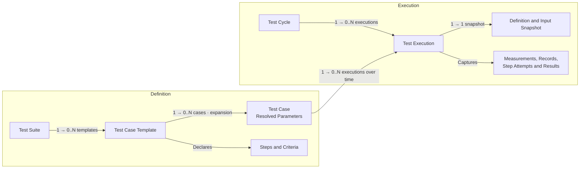

# Dokime Product Guide

Detailed concepts, supported interfaces and existing authoring examples. For installation, start with the [Quick Start](../README.md#quick-start).

## Install Tools With Mise

Select matching CLI and authoring-tool release archives in your mise configuration. For Windows x86-64:

```toml
[tool_alias]
dokime = "github:stokker-technologies/dokime"
cargo-dokime = "github:stokker-technologies/dokime"

[tools]
dokime = { version = "0.1.0", asset_pattern = "dokime-cli-*-x86_64-pc-windows-msvc.zip" }
cargo-dokime = { version = "0.1.0", asset_pattern = "cargo-dokime-*-x86_64-pc-windows-msvc.zip" }
```

For Linux x86-64, use `dokime-cli-*-x86_64-unknown-linux-gnu.tar.gz`
and `cargo-dokime-*-x86_64-unknown-linux-gnu.tar.gz`. Each archive contains its command at the root,
LICENSE, README and generated CHANGELOG; Unix commands retain executable modes.
The [mise aliases](https://mise.jdx.dev/dev-tools/aliases.html) give each tool its
own installation directory. Cargo-binstall metadata selects the same archive names, although this
Cargo subcommand is distributed through release assets and mise.

Release downloads include native installers, CLI and authoring-tool archives,
`dokime-distribution-<version>-<Rust-target>.zip` distributor inputs and
`dokime-sidecars-<version>-<Rust-target>.zip` (Windows) or `.tar.gz` (Unix).
Each sidecars archive contains every shipping native plugin as an unversioned
`.dokime` member. `plugins.json` format 2 maps plugin names and targets to archives,
members and member SHA-256 hashes. Future target-independent guests use
`dokime-guests-<version>.zip`; guest execution is not currently admitted.
`latest.json` is the signed desktop updater feed. CHANGELOG and SHA256SUMS also
ship; archive and feed digests are in SHA256SUMS. Standalone `.sig` files are not
downloads. The dev-channel uses the same asset names and workspace version,
omits unsigned `latest.json`, and identifies its source commit in release notes.
OBC and remote examples remain candidate/source fixtures. Python distributions
publish to PyPI. CI's `upload.json` is not a release download.

`mise run release:rehearse` consumes existing release-profile packages for every
configured target and runs staging and registry dry runs with credentials
removed. It does not create a remote rehearsal release. The integration owner
must re-register crates.io and PyPI Trusted Publishing to `release.yml`,
environment `release`, before the first publication under this workflow.

## The Test Domain

Definitions describe what can be tested. Execution captures what happened when
concrete cases ran. A **suite** organizes related **templates**; each template
materializes **cases** with resolved parameter values. A **cycle** groups the
executions selected for a test campaign.



Each execution identifies exactly one case and one cycle. Repeating a case
creates another execution; retrying a step is recorded as a step attempt within
that execution. A cycle can bring together cases from different templates and
suites—it is not a copy of one suite. A cycle is created explicitly, starts
empty and grows as explicit execution attempts are appended. Appending never
starts hardware; an execution is the Start/Stop unit.

Execution and cycle record and sample queries include evidence they produced
or captured. An observer row can belong to several executions through capture;
its producer scope remains unchanged. SQLite capture links and Arrow batch
ranges select that membership without storing additional sample payloads.

Several cycles can stay **Active** at once, with one execution running across
the server. Start admits an execution once by its durable identity. Optional
server-owned ordered continuation can start the next unstarted member after
natural completion and evidence drain; it defaults to false. Stop durably disables that
continuation policy. Each execution saves and seals its evidence while its cycle stays
Active. Select the destination cycle in the Library before adding attempts.

**Seal Cycle** closes admission immediately, stops that cycle's running work,
cancels unrun executions and waits for every execution and the cycle report to
be durably saved. The phase advances through **Sealing** to **Sealed**. Other
cycles continue. Shutdown stops running executions without regenerating cycle
reports. Startup seals previous-session Active cycles without replaying device
operations.

The desktop reads a bounded record tail, then appends changes from its stream.
Execution files refresh with runtime changes; an idle view does not poll the
file list. The status bar follows the existing runtime subscription without
periodic health queries. Long record and execution lists render only the visible
rows and their nearby rows.

For a charger campaign, one template might measure steady-state charging while
another checks overcurrent protection. Cartesian expansion turns the operating
points into concrete cases:

```text
Input Voltage:  207 V, 230 V, 253 V
Load Impedance: 80 Ω, 100 Ω, 120 Ω

3 Voltages × 3 Loads → 9 Cases Of The Same Procedure
```

A list can also be one parameter value. An ordered load sequence such as
`[100, 50, 10]` Ω can describe three steps within one case; it does not have to
mean three separate cases. Expansion is declared explicitly.

## Notifications

Interface feedback appears in the bottom-right toast area. Errors remain until dismissed; informational feedback closes automatically. The sidebar's Notifications page shows unread counts and records each message's time, source and detail. Dismissing a toast keeps its history. Use Clear Notifications to remove the saved history.

Routine background loading, page navigation and connection progress stay in the inline status indicators without toasts or history entries. Notifications record user-relevant outcomes and failures; backend failures identify the failed operation in their title.

The desktop's WebView stores notification history locally and reads it in bounded pages. Retry controls retain their operation context when a message moves to notifications. Execution evidence and reports retain their own authoritative records.

Each history entry shows a severity icon beside its primary title, with secondary message text and a muted source path below. Relative times align to the right; hover over a time to see its full local date and time. History and relative times update while the page is open. The toolbar keeps the count on the left and Clear Notifications on the right; Newer and Older navigate saved pages.

Click a toast or history entry, or focus it and press Enter or Space, to open its details. The dialog shows the full message, source, severity, absolute and relative time, and available failure reason, operation and request/invocation identifiers. Validation failures list each affected field and its reason. Causes appear with the root first; dependent startup consequences remain collapsed. Expand Technical Details for backend diagnostics or backtraces. Copy includes all details, including collapsed sections. Press Esc or Close to return to the notification. Set Secret and Open Plugin Settings remain separate actions.

## Native Remote Access

Choose **Export Remote Access** in Settings → Remote Access. The native save
picker suggests a readable label and `.dokime-remote` filename. If the listener
is off, one confirmation enables it on the saved port (8765 by default) and
continues the export. The same confirmation warns that the file is secret.
Rename its client later by selecting its label in **Paired Clients**.

Each file has an independent revocable key. Anyone holding it has full control;
transfer it privately and revoke its client if it is lost. Raw keys never enter
the WebView, logs or saved backend profiles. The host retains only verifiers.

Endpoints are automatic: a specific bound address, or the hostname followed by
real interface addresses in the listener address family, with private networks first
and IPv4 link-local addresses last. Remote Access shows these addresses with their
adapter names before export. Virtual/VPN adapters are
excluded. Loopback addresses (`127.0.0.1`, `::1`) work on the same PC only; exports
for a specific loopback bind carry **Same PC** in their generated label.
The backend signs its listener leaf with a persistent CA, which the file pins.
New interface addresses trigger a leaf reissue under that same CA, so existing
files keep their trust. An old file still needs at least one reachable candidate,
such as the hostname; export a new file if all its addresses become obsolete.

Remote files are UTF-8 JSON v1, limited to 1 MiB, with exactly `version`,
`endpoints` (an ordered nonempty list), `backend_identifier`, `label`,
`ca_certificate_pem` and `access_key`. CA/key values may be null for explicitly
unsecured lab listeners. Unknown fields, invalid identities or PEM, wildcard
origins and inconsistent TLS/CA combinations are rejected. `.dokime-pair` files
and the old single `endpoint` format are unsupported. The remote security store
also keeps format v1; old stores require a fresh application root and are never
silently reset.

Management remains available only through the native local listener. TLS and
access-key authentication are independent advanced settings; disable either
only in an isolated lab. Changing interface names or explicitly reissuing the
leaf preserves its CA and existing access keys.

Windows installation never needs administrator rights and does not change the
firewall. On the computer exporting remote access, Settings → Remote Access checks
Windows Firewall when the listener runs on a non-loopback address. If inbound access
is blocked, **Allow In Firewall…** requests administrator approval to allow the app
on the listener's active **Private**, **Public** or domain networks. The notice
identifies each adapter, network and profile. The inbound rule permits only this
executable's TCP listener port, with peers restricted to the local subnet.
Cancelled or refused approval leaves the app usable.
Connecting to another backend only uses outbound access and needs no firewall rule.
Disabling remote access attempts to remove this installation's rule without a UAC
prompt; a standard user is told when cleanup needs an administrator. Per-user
uninstall leaves any rule in place and never requests administrator access.
On other platforms, permit the saved listener port through the host firewall.

### Direct Cable Between Two PCs

Connect the Ethernet cable and use a different address on each PC in the same
subnet. Static addresses are recommended, for example `192.168.50.1/24` and
`192.168.50.2/24`, without a gateway; choose a subnet unused by other adapters.
Automatic IPv4 link-local addresses (`169.254.x.x`) also work once both adapters
have acquired them. IPv6 link-local is excluded because it requires an interface
zone identifier that remote files do not support.

On the exporting PC, check the cable address and adapter name in Remote Access,
then select **Export Remote Access**. Import the file on the second PC. A cable
without a gateway may be classified as a Public unidentified network. If the
firewall notice reports blocked access, optionally select **Allow In Firewall…**
and approve the administrator prompt; the rule covers that profile for peers on
the same subnet. Installation never changes firewall rules.

## Full-Control Access And Plugin Capabilities

A valid access key grants full control over remote product operations and
installed plugins, including request-dependent channel, stream and source scopes.
An authentication-off listener grants the same control to every connection;
use that setting only in an isolated lab. There are no per-user roles or server
permission files. TLS controls transport encryption and certificate verification
independently of access-key authentication.

Native-only operations and internal host providers remain unavailable remotely.
Plugin identity comes from the original runtime registration, never an owner
name supplied by a caller. Plugins still declare their own requirements for
calls into other plugins or host services; an operator's key cannot expand those
capabilities. A grant must name the operation being called. Discovery and
invocation use the current provider contract; rediscover after provider changes.

## Backend Profiles

The desktop status bar shows the selected backend and its connection state. Click that status to open Backends in Settings.

Settings → Backends and the CLI share `backends.json`. Each profile has a
machine **Identifier** and a human **Label**. Choose **Import Remote**, or drop
one `.dokime-remote` file onto the desktop window, as the primary setup path. The native importer saves its key in the OS keyring and its CA and
expected identity and ordered endpoints in the profile, then connects. Validation precedes mutation; a failed profile
save rolls back the newly created keyring entry. Duplicate identifiers are refused.

The desktop tries its saved default once. An unavailable or mismatched backend
opens selection without silently falling back to Local. Confirm deletion to
remove a profile; deleting the active profile disconnects it and clears its default.
Profile editing and local appearance preferences remain available offline.

```sh
dokime backend add --remote lab.dokime-remote --identifier lab
dokime backend use lab
dokime status --backend lab --json
dokime operation list --backend lab
dokime operation show dokime.runtime.health --backend lab --json
```

Omit `--identifier` to use the file's backend identifier. CLI remote import verifies
the connection immediately; manual lab additions only save the profile. Manual entry is
reserved for unsecured labs:

```sh
dokime backend add --identifier lab --label "Lab PC" --endpoint http://lab.example:8765
```

Python constructs a client without opening a channel, then uses its normal
asynchronous connection lifecycle:

```python
import asyncio
from pathlib import Path
from dokime_client import DokimeClient

async def main() -> int:
    async with DokimeClient.from_pairing("examples/lab.dokime-remote") as client:
        async with client.new_cycle("Example Lab Tracking") as cycle:
            run = await cycle.start("example.demo.tracking", duration_min=10)
            async for record in run.records("example.tool.connected", "example.tool.disconnected"):
                print(record.type)
        await cycle.save(Path("target/reports/tracking") / run.id, report="cycle.summary")
        return run.outcome.exit_code

raise SystemExit(asyncio.run(main()))
```

The example requires the corresponding installed template. With the OBC fixture,
use `cycle.start("obc.checks.pulse", sample_count=8)`. Cycle contexts seal and drain
on normal exit, exceptions and cancellation, including Ctrl+C; cleanup failures
are grouped with the original failure. Await a run directly for its saved outcome.
Terminal record/sample iterators accept positional filters and provide `.to_json()`.
The outcome's exit code is 0 for passed, 1 for nonpassing, 130 for interrupted or
cancelled. A template expansion returns an ordered tuple of all execution handles.
`cycle.save` writes per-execution ZIPs, cycle.zip, optional report.html and a
manifest.json with relative paths, byte sizes and SHA-256 digests. Existing files
are refused. See the [Python client guide](../packages/dokime-client/README.md#creating-cycles).

All clients try endpoint candidates in parallel with a short stagger configured
by `client.endpoint_stagger_ms` (250 ms by default). Only a connection verified
against the pinned CA and expected backend identity can win. The profile remembers
the last successful endpoint and tries it first next time. Other candidates keep
their original order. A failed connection leaves the imported profile available
for retry. Python `from_pairing` retains its successful endpoint for that client;
`from_profile` also saves successful endpoint selection in the shared profile.

The SDK retains the imported key only in its redacted client credentials.
Every first connection and reconnect validates expected backend identity before
application calls. A mismatch never changes the saved default.

`operation list` and `operation show` read live provider contracts, including
owner, generation, grants, gRPC availability and conditional access. Discovery
is bounded and does not promise admission of a later invocation. `show` retains
all visible providers of the selected operation.

`operation list` displays operation ID, provider owner and description. Select a
provider explicitly for metadata or a call:

```sh
dokime operation show OPERATION_ID --owner OWNER --backend lab --json
dokime operation call OPERATION_ID --owner OWNER --backend lab --input request.json --output response.json
dokime operation call OPERATION_ID --owner OWNER --backend lab --json '{"enabled":true}'
dokime operation call OPERATION_ID --owner OWNER --backend lab --input request.json --input-stream-file items.jsonl --output response.json
```

`--input` and `--json` are mutually exclusive request sources; omitting both
sends `{}`. Inputs use the discovered contract's protobuf JSON shape. Streaming
input is one item per line. Without `--output`, stdout emits one JSON item or
completion event per line. A response file contains one JSON array of those
events, including the final completion; a unary call has only that completion.

Existing response files require `--overwrite`. Predictable output conflicts are
rejected before dispatch. The complete response is written to a temporary sibling
and published atomically after successful completion. A failed output write
never replays the device command. Diagnostics go to stderr and failures return
nonzero.

Ctrl+C stops waiting locally. A timeout or disconnection after dispatch can leave
the device outcome unknown, even when no response was received. Check device
state before manually resending; calls are never retried automatically. Manual
operations can affect a running test and are not logged into its execution
evidence. From Rust, `dokime::client::Client::call_operation` uses the same live
contract discovery and shared Harmos codec:

```rust
let client = Client::connect(Target::new(endpoint, None)?, Some(token), None).await?;
let stream = client
    .call_operation("obc.bench.get_status", Some("plugin_obc"), b"{}", Vec::new())
    .await?;
while let Some(event) = stream.message().await? {
    println!("{event:?}");
}
stream.close().await;
```

Browse the registered suite catalog, start an attempt and stop work explicitly:

```sh
dokime catalog list --backend lab --json
dokime catalog show REGISTERED_SUITE_ID --backend lab --json
dokime execution start EXECUTION_UUID --backend lab --json
dokime execution stop EXECUTION_UUID --backend lab --json
dokime cycle seal CYCLE_UUID --backend lab --json
```

Replace the identifiers with those returned by the backend. `catalog list
--json` emits one complete suite definition per line; a later read failure
returns a nonzero exit status after any earlier lines. `execution stop` stops
the selected execution and halts its cycle's automatic continuation. Wait for
its saved outcome before downloading evidence. To repeat a case, append a new
execution identity and Start that attempt; earlier evidence remains unchanged.
Cancelling an ordinary local wait leaves admitted backend work running.

`cycle seal` waits for the durable cycle seal. Repeating it is safe, including
after a lost response. Other cycles remain available. The Python
client provides the same durable boundary with `await cycle.seal()`, and
`async with client.new_cycle(label)` applies it automatically on every exit.

Download saved evidence without running any work again:

```sh
dokime execution export EXECUTION_UUID --backend lab --output execution.zip
dokime cycle seal CYCLE_UUID --backend lab --json
dokime cycle export CYCLE_UUID --backend lab --output cycle.zip
```

A sealed execution is exportable while its cycle stays Active. A cycle export
requires its durable seal and includes every exact member revision. The ZIP
contains `manifest.json`, `evidence.sqlite`, captured files and saved HTML
reports. The manifest records source identities, revisions, row counts and
payload checksums. SQLite retains relational evidence and the `files`,
`artifacts`, `streams` and `stream_summaries` catalogs. Telemetry is stored in
ZSTD-compressed Arrow IPC files under `telemetry/<stream>.arrow`. Exports copy
complete finalized files produced by the execution byte-for-byte. Captured rows
from shared observer files are materialized from indexed ranges at the selected
evidence frontier, excluding unrelated samples. Producer scopes stay unchanged.
Each file contains typed `values` and
`_storage` metadata. Timestamps use UTC microseconds. Arrow field metadata retains units,
descriptions and stream identity; schema metadata identifies the execution, Dokime version and contract.

Execution bundles place captured files under `artifacts/<relative path>`.
Cycle bundles use `executions/<execution-id>/artifacts/` and
`executions/<execution-id>/telemetry/`, with their saved cycle report in `reports/`.
Telemetry is cataloged as a file and never appears as a captured artifact.

Exports use saved storage snapshots and survive server restart. Missing
required evidence fails the export. The server admits one export at a time,
with an 8 GiB archive limit. The client verifies contiguous chunks, size,
SHA-256 and final transport success before publishing the ZIP atomically.
Existing destinations require `--overwrite`. Failed downloads preserve the
previous output; retry starts a fresh download and never repeats execution.
The desktop's **Export Evidence** action uses the same exporter and a native
save dialog. The Python handles provide `await execution.export(path)` and
`await cycle.export(path)`, with `overwrite=True` for explicit replacement.

Selection uses explicit `--backend` or `--endpoint`, then `DOKIME_BACKEND`, then
that configuration's saved default. An explicit endpoint uses only secrets
supplied for that invocation. Profile edits affect future connections.
`backend list`, `show`, `use`, and `remove` operate offline; removal clears a
matching default. Revoke access on the host through Paired Clients; removing
a local profile alone does not revoke its key. `status` performs a bounded live
identity, authentication and readiness check and returns nonzero on failure.
Backend identity includes the compiled Rust target and product version.

Configuration lives at `$XDG_CONFIG_HOME/dokime/backends.json` (falling back to
`$HOME/.config/dokime/backends.json`) on Linux, `$APPDATA/dokime/backends.json` on
Windows, or `$HOME/Library/Application Support/dokime/backends.json` on macOS.
`--profiles-file` overrides `DOKIME_PROFILES_FILE` and the standard location.

The version 1 JSON contract keeps secrets in a separate OS secret store:

```json
{
  "version": 1,
  "default": "lab",
  "profiles": [{
    "identifier": "lab",
    "label": "Lab PC",
    "endpoint": "https://dokime.example:8765",
    "endpoints": ["https://dokime.example:8765", "https://192.168.1.50:8765"],
    "expected_backend_id": "BACKEND_ID",
    "ca_certificate_pem": null,
    "secret": "keyring"
  }]
}
```

`endpoints` preserves imported candidate order; `endpoint` is the last verified
success, initially the first candidate. Manual profiles use an empty candidate
list. The OS keyring association stays stable when the winning endpoint changes.

Identifiers contain 1–128 ASCII letters, digits, dots, underscores or hyphens;
`.` and `..` are refused. Labels are nonblank, control-free and at most 256 bytes.
Unknown fields, duplicate identifiers, unsupported versions, invalid endpoints
and dangling defaults are refused. CLI edits lock and atomically replace the
file; contention refuses the edit for retry. Tokens stay outside JSON.

Development contracts remain v1. Use fresh storage when a schema or evidence
format becomes incompatible. There are no migrations, compatibility aliases or
automatic root resets; existing files and evidence are never silently deleted.

## Shared Plugin Secrets

Each backend owns a catalog of secrets keyed by identifier. Plugins use the shared
`dokime.secrets.lookup` operation with an identifier; a missing or deleted identifier returns
an error. Replacing a value affects future lookups. A value already fetched by
a running plugin remains its responsibility.

A declared secret's identifier is its Secret Storage identifier. At plugin start,
Dokime reads each declaration directly from the store. A missing required secret
fails startup with ``secret `api_token` is not in Secret Storage; add it and restart``
(the identifier varies). Optional secrets are absent when missing. Add the exact
identifier in Secret Storage and restart Dokime, or use the existing plugin Retry
to read the store again. There are no per-plugin bindings, environment-variable
sources, automatic retries or fallback identifiers.

Open **Settings → Secret Storage** to see the owning host, add an identifier, edit
its label or description, replace its value, or explicitly confirm deletion.
Existing values are never fetched for display. Leave the replacement field
empty to retain a value. References lists plugins that declare each identifier,
including installed plugins that failed to start. Plugins can also look up
identifiers dynamically, so this list is not exhaustive. Switching
backends opens that backend's catalog and discards the previous edit form.

Values are stored in the host's OS keyring, separately from backend login
tokens and signing keys. New writes require that
keyring; there is no plaintext fallback. The catalog stores identifiers, labels,
descriptions and opaque keyring slot identifiers. Names contain 1–128 ASCII
letters, digits, dots, underscores or hyphens; values contain 1–65536 bytes,
with at most 1024 catalog entries per host.

The Linux native desktop acceptance story starts a private D-Bus session and
unlocked GNOME Keyring in its disposable workspace; CI installs `dbus` and
`gnome-keyring`. Windows uses its native Credential Manager.

**Export Selected Secrets** saves a `.b64` file through the native file
picker. It contains a Base64-encoded version 1 JSON document with the selected
identifiers, metadata and values. Base64 is not encryption: anyone with the file can
read its secrets. Store and share it accordingly.

**Import Secrets** previews the file's identifiers and conflicts before applying
changes. Existing identifiers start unchecked; select each replacement explicitly
and leave entries unchecked to skip them. A changed destination catalog
requires a fresh preview. Invalid input or failed secure-store staging writes
no values.

Each transfer holds at most 512 KiB of decoded JSON, with the corresponding
Base64 file limited to 699052 bytes. Larger selections must be exported
separately. If catalog publication cannot be confirmed after a filesystem
error, both generations' secure slots are retained; refresh the catalog
before retrying.

Secrets use a shared table with Identifier and Label columns. **Add Secret**
opens a dialog; the monospace Identifier is the machine key, while Label is the
human display text. No `name` alias is accepted in secret contracts.

### Plugin Settings

#### Host Settings

The host plugin declares its 20 settings in
[`plugins/sidecars/host/src/settings.rs`](../plugins/sidecars/host/src/settings.rs).
Edit the host plugin form in **Settings → Plugins**, then use the existing
Retry workflow or restart Dokime. Each startup resolves one settings snapshot.
Collection selects the Wi-Fi/Bluetooth adapters, latency target (default
`1.1.1.1`) and minimum active-scan interval (30 s). Empty adapter selectors use
the native default.

| Probe Timing | Default | Allowed [ms] |
| --- | ---: | ---: |
| Network Inventory/Connectivity Timeout | 2,000 ms | 1–2,000 |
| System Git Identity Timeout | 2,000 ms | 1–2,000 |
| Existing CPU Calibration Window | 1,000 ms | 1–1,000 |
| Unix Wi-Fi Link Command Timeout | 2,000 ms | 1–2,000 |
| Unix Wi-Fi Scan Command Timeout | 12,000 ms | 1–12,000 |
| Windows Active Wi-Fi Scan Window | 6,000 ms | 1–6,000 |
| Unix Latency Process Timeout | 4,000 ms | 1–4,000 |
| Echo Reply Timeout | 2,000 ms | 1–2,000 |
| Unix Bluetooth D-Bus Method Timeout | 6,000 ms | 1–6,000 |
| Bluetooth Deep Refresh Interval | 300,000 ms | 1–86,400,000 |
| Unix Control D-Bus Method Timeout | 30,000 ms | 1–30,000 |
| Windows Radio Settle Timeout | 15,000 ms | 1–15,000 |

Sampling settings select the minimum throughput denominator (1 ms, allowed
1–60,000 ms), congestion contribution (10 % per fully overlapping network,
allowed 0.01–100), echo payload (32 bytes on Windows, 56 on Unix, allowed
1–65,000 bytes), and existing calibration batch (4,096 iterations, allowed
1–65,536). The active-scan minimum permits 1–3,600 s. Unix ping rounds the echo
wait up to whole seconds; its independent process timeout still bounds it.
Native Windows inventory calls remain synchronous and have no cancellable
timeout API. Per-command and per-method waits do not replace the operation's
overall deadline. Radio writes and inverse restoration use the same resolved
native timing settings.

Every stream's collection cadence is editable in **Collection Intervals**:

| Stream | Default [ms] | Allowed [ms] |
| --- | ---: | ---: |
| System | 1,000 | 1–86,400,000 |
| Network | 1,000 | 1–86,400,000 |
| Wi-Fi Link | 1,000 | 1–86,400,000 |
| Wi-Fi Scan | 60,000 | 1–86,400,000 |
| Wi-Fi Latency | 10,000 | 1–86,400,000 |
| Bluetooth | 5,000 | 1–86,400,000 |

The producing observer resolves its cadence from the startup settings snapshot,
overriding its declared initial interval. Both the declaration and settings default
share one value in `settings.rs`. General process observers require
`#[dokime::observer(interval_ms = …)]`; an optional synchronous
`fn interval(resources: &ExecutionContext) -> Result<Duration, Error>` overrides
that default at activation.
Consumers lease the stream without selecting its interval. Static schemas omit a
nominal interval; demand comes from the owner's observer inventory. Minimum Scan
Interval and Bluetooth Deep Refresh Interval independently protect native probes.
An interval shorter than collection work does not overlap that observer's calls;
missed ticks are skipped.

Operation policies remain Harmos declarations: collection bounds are 2/2/2/12/4/6 s
for system, network, link, scan, latency and Bluetooth; controls allow 30 s and
restoration 60 s. These policies use no retries or cancellation grace. Making their
timeout, attempt timeout, cancellation grace or retry/backoff policy configurable
requires a separate Harmos operation-policy change. The 4,096-row publication
window remains a static replay and notification-batch contract.

Unit conversions, percent scales, native ABI layouts and enum discriminants,
Wi-Fi channel/frequency mappings, congestion model identifiers, schema v1 and
stream/operation identifiers retain their fixed meanings. CPU kernel arithmetic
and accumulator layout define the existing calibration workload; its time
window and batch size are settings. Windows ICMP reply storage follows the
native API's required trailer layout. These are measurement or protocol
definitions rather than deployment tunables.

#### Ordinary Settings And Shared Secrets

**Settings → Plugins** keeps ordinary plugin settings editable after startup
fails. Its read-only **Required Secrets** list shows each declared identifier,
whether it is required or optional, and whether it exists in Secret Storage.
**Add In Secret Storage** opens **Add Secret** with that exact identifier prefilled.
Secret values are entered only in Secret Storage; the plugin settings form has no
secret fields. Existing saved references are ignored on load without migrating
values or changing storage v1. A stored identifier such as `example.api_token` does
not satisfy a declaration named `api_token`.

Declare `api_token: dokime::plugin::Secret` for a required shared identifier or
`api_token: Option<dokime::plugin::Secret>` for an optional one. The field name is
the store identifier; secret declarations have no default or `from_environment`
argument. Rebuild external plugins against the matching SDK after this clean break.

## Planning And Creating Cycles

Name a template by the readable ID that `dokime catalog show` lists. Preview
its cases, then materialize them before constructing execution attempts:

```sh
dokime plan preview --template obc.charger.steady.measurement --backend lab --json
dokime plan materialize --template obc.charger.steady.measurement --backend lab --json
dokime cycle create --label "Campaign 1" --backend lab --json
dokime cycle append CYCLE_ID --case-id CASE_ID --backend lab --json
```

Materialization captures the case's definition and provider revision. Append
refuses stale cases and creates distinct execution UUIDs for each repeated
`--case-id`, preserving order. A cycle is explicitly created empty; append
registers attempts without starting hardware. An omitted cycle `--identifier`
is derived by the backend.

For a linear script, `--id-only` prints materialized case IDs, the created cycle
UUID, or execution UUIDs from that exact append. This pulse selection produces
one case and one attempt:

```sh
case_id=$(dokime plan materialize --template obc.checks.pulse --parameters-json '{"sample_count":8}' --backend lab --id-only)
cycle_id=$(dokime cycle create --label "Remote Pulse" --backend lab --id-only)
execution_id=$(dokime cycle append "$cycle_id" --case-id "$case_id" --backend lab --id-only)
dokime execution run "$execution_id" --records --samples --record-type 'obc.run.*' --stream obc.pulse --wait-seconds 60 --backend lab
dokime execution export "$execution_id" --output pulse.zip --backend lab
dokime cycle seal "$cycle_id" --backend lab
dokime cycle export "$cycle_id" --output cycle.zip --backend lab
```

`execution start` admits one execution and returns without waiting.
`execution run` composes that same Start with a durable wait and requested
listener drain. Both use the execution's identity for idempotency: reconnect
with the same UUID and mode after an uncertain Start response. A finished
execution never restarts; append a fresh attempt to run its case again.
There are no caller-managed Start keys or cycle Run/Stop commands.

`--records` and `--samples` observe all captured records and samples.
Repeated `--record-type` and `--stream` flags restrict their respective
selection with case-sensitive whole-identifier globs. Observations and the final
drain summary appear on stderr; the final result appears on stdout.
`execution wait` observes an already admitted execution without starting it.
A saved nonpassing outcome returns nonzero. Interrupting an ordinary wait leaves
remote work running; `execution stop EXECUTION_ID` requests a cooperative stop.

Several cycles can stay Active, with one execution running server-wide.
`continue_automatically` defaults to false. To let the server continue with
the next unstarted member after natural completion and durable sealing, create
the cycle with `--continue-automatically`. A failed execution is a result, not
a reason to halt: continuation proceeds regardless of verdicts. Explicit execution Stop durably sets the cycle's
`continue_automatically=false`. Later explicit Start runs only the selected
attempt until the user explicitly re-enables that policy.
Completion fixes the next eligible member before publishing its terminal receipt.
Appending afterward cannot extend that continuation decision. Appending to an idle
cycle starts no hardware, and reaching the end keeps the cycle Active until it is
explicitly sealed.

Sealed cycles remain in History after a server restart, including cycles with
no executions. History lists their saved headers independently of execution
results; an empty cycle has no passing or failing outcome and its saved report
can still be opened.

Scripts can opt into cancellation and evidence recovery while running or waiting:

```sh
mkdir -p recovery
dokime execution wait "$execution_id" --backend lab \
  --cancel-on-interrupt --owned-cycle "$cycle_id" --recovery-directory recovery
```

The same options work with `cycle append`, `execution start`, `execution run`,
`execution export` and prompt `next/show/answer`.
They verify exact cycle membership before mutation. Use `--owned-cycle` only
for a cycle created and reserved by the script: Ctrl+C stops that execution,
seals that cycle and downloads `execution-<UUID>.zip` and `cycle-<UUID>.zip`.
Sealing cancels its unstarted members; other cycles and the shared server remain
available. Existing recovery files are refused before connection. A lost
connection cannot confirm cancellation or a completed download; retain the
original identities and inspect them before resubmitting.
PowerShell terminates a native command whose output it captures when Ctrl+C
arrives, before recovery can finish. Run recovery-armed commands uncaptured and
read their UUIDs from `--id-file <path>`, which `cycle append` and prompt `next`
truncate before connecting and fill with one confirmed UUID per line.
Batch recovery applies while these native commands are observing an interrupt;
it cannot reliably cover connection setup or gaps between commands. A lost
Create reply leaves the cycle identity unknown and requires manual inspection.

The [Remote CLI Workflows](remote/cli.md) include
linear device, test and confirmation exercises for POSIX shell, PowerShell 7.3+ and
Command Prompt. Edit their connection, execution, observation and file globals,
then run without arguments. Their names, grouping and meanings match the
[Python examples](../packages/dokime-client/examples/remote/python/control-test.py).
The scripts require the matching CLI and simulated OBC plugin; a matching
first-party release combination and native workflow validation remain pending.
The [candidate walkthrough](remote/overview.md) explains
how to obtain matching native CI artifacts and prepare a local Python wheel from the same revision.

`--parameters-json` supplies single template parameter values as a plain
JSON object. The default pulse has no prompt. To require one confirmation,
materialize that case and explicitly Start its attempt so the script can answer:

```sh
case_id=$(dokime plan materialize --template obc.checks.pulse \
  --parameters-json '{"require_confirmation":true}' --backend lab --id-only)
cycle_id=$(dokime cycle create --label "Remote Confirmation" --backend lab --id-only)
execution_id=$(dokime cycle append "$cycle_id" --case-id "$case_id" --backend lab --id-only)
dokime execution start "$execution_id" --backend lab
prompt_id=$(dokime execution prompt next "$execution_id" --wait-seconds 60 --backend lab --id-only)
dokime execution prompt show "$execution_id" "$prompt_id" --backend lab
dokime execution prompt answer "$execution_id" "$prompt_id" --action yes --backend lab
dokime execution wait "$execution_id" --wait-seconds 60 --backend lab
```

Prompt reads and answers require both exact identities. The server refuses stale
or duplicate answers. After an ambiguous response, inspect `prompt show`
before deciding what to do. Actions `cancel` and `abort` submit a cancelled
response. Seal the script-owned cycle before exporting its complete bundle.

`--input-file` takes the operation's canonical JSON without flag overrides.
For `plan materialize`, the request contains one registered template selection:

```json
{
  "selection": {
    "suite_id": "SUITE_ID",
    "template_id": "TEMPLATE_ID",
    "parameters": [],
    "files": []
  }
}
```

For an append whose exact identities must survive a lost response, retain its
canonical `AppendExecutions` input before calling `cycle append --input-file`:

```json
{
  "cycle_id": "CYCLE_UUID",
  "executions": [
    { "execution_id": "EXECUTION_UUID", "case_id": "CASE_UUID" }
  ]
}
```

Repeating that append with the same bindings cannot duplicate attempts;
conflicting identity reuse fails. Flag-based appends print their registration
identities to stderr before transmission. Retain those identities if the reply
is lost.

Until a cycle or execution seals, operators can rename it with the pencil
beside its desktop title or with `Execution/RenameCycle` and
`Execution/RenameExecution`. Sealed, archived and History subjects refuse
with `FailedPrecondition`. Renaming an execution renames its case, including
other attempts, and records an `operator.label_edited` record with both labels.

For `cycle create --input-file cycle.json`, retain the explicit continuation
policy alongside its metadata:

```json
{
  "metadata": {
    "identifier": "campaign.1",
    "label": "Campaign 1",
    "description": null,
    "tags": [],
    "attributes": [],
    "created_at": null,
    "updated_at": null
  },
  "continue_automatically": false,
  "context": null
}
```

```sh
dokime cycle create --input-file cycle.json --backend lab --id-only
```

Cycle creation is a separate non-idempotent mutation. If its response is
uncertain, inspect the backend before creating another container.

## Examples

### Qualify An On-Board Charger

Harmos supplies the runtime and plugin boundary. Applications use
`Runtime::<A>::launch(origin, config)` with the shared `Lifecycle`: `prepare`
registers catalogs, lanes and resources through `Setup`, and `initialize`
activates resources that need the live runtime. Server composition is prepared
before Dokime launches; listening uses the initialized service. Dokime adds the testing domain:
procedures, parameter expansion, operator interaction, acceptance criteria, and
self-contained reports.

The [OBC charger simulation](../plugins/sidecars/obc/src/suites/) demonstrates startup,
steady-state measurement, overcurrent protection, and recovery. It models a
charger testbench for learning the workflow; it is not a validated electrical
model or a ready-made vehicle qualification standard.

### Define The Operating Points

A shortened version of OBC's
[steady-state parameters](../plugins/sidecars/obc/src/suites/steady/measurement.rs) declare the
nine-case voltage/load sweep:

```rust
// Cargo.toml: dokime = { git = "https://github.com/stokker-technologies/dokime", features = ["plugin-sidecar"] }
use dokime::definition::ParameterDefault;

#[dokime::parameters]
pub struct Parameters {
    #[parameter(
        label = "AC Voltage (RMS)", unit = "V",
        expansion = "cartesian",
        default = ParameterDefault::space([207.0, 230.0, 253.0]),
    )]
    pub ac_voltage_v: f64,

    #[parameter(
        label = "Load Impedance", unit = "ohm",
        expansion = "cartesian",
        default = ParameterDefault::linspace(80.0, 120.0, 3),
    )]
    pub load_ohm: f64,
}
```

The template names its parameter type once. Every expanded case resolves those
inputs before execution, so the procedure and its document see the same values.

### Run The Procedure And Capture Evidence

OBC's [steady-state template](../plugins/sidecars/obc/src/suites/steady/measurement.rs)
initializes shared device resources, energizes the charger, observes its
waveform, asks the operator to inspect the trace, and attaches a measurement
summary. Cleanup stops the simulated device.

This excerpt is the template's measurement observer. `InputMeasurement`,
`Samples`, `ObserverStreams`, and `reading` belong to the example:

```rust
#[dokime::observer(interval_ms = 5, streams = ObserverStreams)]
async fn samples(ctx: &mut ObserverContext<'_>) -> Result<(), Error> {
    let row = reading(ctx.resources())?;
    ctx.stream::<InputMeasurement>()
        .into::<Samples>()
        .push(row)
        .await;
    Ok(())
}
```

The same template uses `ctx.ask(...)` for operator sign-off and writes its
summary through `ctx.artifacts()`. Its criterion checks that enough samples
were captured and that the completion record accepted the run:

```rust
#[dokime::criterion(id = STEADY_ACCEPTANCE_CRITERION, label = "Trace Accepted")]
fn accepted(ctx: &CriterionContext<'_>) -> Result<bool, Error> {
    Ok(
        ctx.samples::<Samples>().len() as u64 >= ctx.parameters().sample_count()?
            && super::super::support::decided(
                ctx.records::<Completed>(),
                |run| run.accepted,
            )?,
    )
}
```

These are excerpts from the complete template, not standalone programs.
The [protection template](../plugins/sidecars/obc/src/suites/protection/overcurrent.rs)
adds an automated load ladder and verifies that an overcurrent fault disconnects
the supply and prevents restart. A real charger integration can extend these
procedures with regulation, efficiency, and thermal criteria for its hardware.

A step also reaches two built-in operations through `ctx.host()`, with nothing
to declare. `RunProcess` runs a vendor tool in the execution's artifact folder,
sends its output to the execution log or into an artifact, and records its exit.
`WatchFile` captures a device log written during the step into an artifact and
turns matching lines into rows and records. The
[startup template](../plugins/sidecars/obc/src/suites/startup/sequence.rs) tails the
simulated charger's log this way:

```rust
let watch = ctx
    .host()
    .submit(WatchFile {
        execution_id: None,
        source: Some(FileWatchSource {
            payload: Some(FileWatchSourcePayload::Local(LocalWatchSource {
                root: self.log.to_string_lossy().into_owned(),
            })),
        }),
        output: "charger".into(),
        artifact: Some("charger/device.log".into()),
        policy: FileWatchPolicy::Stream,
        selection: FileWatchSelection::All,
        wait_for_source_seconds: None,
        poll_interval_ms: Some(100),
        maximum_seconds: Some(1),
        maximum_bytes: None,
        matchers: vec![LineMatcher::publishing::<ChargerLog>(
            r"t=(?P<elapsed_s>[\d.]+) state=Running input_power_w=(?P<input_power_w>[\d.]+)",
        )],
        markers: Vec::new(),
    })
    .await?;
watch.armed().await?;
// The baseline is established; the charger can now start logging its readings.
let captured = watch.join().await?.into_owned();
```

`All` follows baseline files and later arrivals. `Latest` selects the newest
baseline file by modification time, breaking ties by path, while `New` captures
only files discovered after the baseline, from byte zero. Accessible empty
directories arm immediately for `All` and `New`. Detected replacement and
copy-truncate boundaries retain separately named artifact segments; the file
limit bounds simultaneous captures rather than the lifetime number of rotations.
Use `wait_for_source_seconds` for bounded waiting when a local source or an FTP
file beneath an accessible root may appear later. Unavailable FTP roots fail
immediately because FTP status 550 cannot distinguish missing roots from denied
access. Permission and invalid-path failures remain immediate.

Use `instance.request_cancel().await?` to signal cancellation and retain the
handle, or `instance.cancel().await?` to cancel and receive its final response.
Processes return their exit status; file watches finish capturing before replying.
Anything a step leaves running is cancelled when the step ends, with a warning
record.

### Capture And Edit Traceability

Steps contribute traceability through their context, alongside document additions:

```rust
ctx.traceability().section(TraceabilitySection::new("dut", "Device Under Test"));
ctx.traceability().row("dut", TraceabilityRow::text("serial", "Serial", "SN-7"));
// A later step can correct the same row without duplicating it.
ctx.traceability().row("dut", TraceabilityRow::text("serial", "Serial", "SN-8"));
```

`section` adds or replaces the complete section by identifier. `row` adds or
replaces a row in an existing section, preserving its other rows. Missing
sections, duplicate row identifiers and reserved host-derived section identifiers
are refused and logged. Edits use the same buffered evidence delivery as documents;
the GUI and new reports show the latest captured values. Sealed reports and Python
checkpoint reads retain the values captured at their persisted boundary.
Criteria consume captured evidence and cannot mutate traceability. Initialization,
observers and cleanup have no traceability mutation handle. The former template
`traceability()` lifecycle method is removed; move identity discovery into steps.
The storage baseline remains v1 and existing storage is never automatically reset.

### Present The Result

Compose plots from the same typed measurement fields used by the procedure.
This shortened example follows OBC's
[measurement document](../plugins/sidecars/obc/src/suites/common/measurement.rs); `stream` selects
the suite-owned stream carrying `InputMeasurement` rows:

```rust
let mut voltage = Plot::xy_line("Battery Voltage");
voltage.unit("V");
voltage.x(InputMeasurement::column_elapsed_s().on(stream));
voltage.y(InputMeasurement::column_dc_voltage_v().on(stream));

let mut charging = Section::new("Battery Charging");
charging.plot(voltage);

let mut document = Document::new("default", "Charger Qualification");
document.section(charging);
```

Declare a bare label and a structured unit, such as `"Battery Voltage"` and
`.unit("V")`. The GUI and report HTML render these as `Battery Voltage [V]` on
one line. All unit-bearing labels use square brackets directly after the label;
table headers truncate with a full-text tooltip instead of wrapping the unit
below the title. Preserve unit symbols and case.

Column handles keep plot expressions tied to the declared data shape, and they
compare straight into filters: `voltage.only(column.gt(0.0))` narrows a plot,
and `section.each(column, "Point {value}")` repeats a section once per distinct
value, in ascending order. Templates can also add parameter-based reference
bands; the
[soak starter](../crates/cargo-dokime/templates/src/suites/soak/hold.rs) demonstrates
a target-temperature band and event markers.

Time series and scatter plots list their traces in a statistics table beneath
the plot instead of a legend: count, min, max, mean, median, std, and rms of
each trace over the window shown, computed by the backend over the exact rows
rather than the reduced points the plot draws. Clicking a row hides or shows its
trace, a live plot's table also reads the value under the cursor, and the report
freezes the table with its plot. Compatible time axes within one plot group share cursor movement; trace visibility and zoom remain specific to each chart. Drag a box to zoom. Hold Shift while dragging, or use the middle mouse button, to pan the held viewport; time plots pan horizontally, and XY plots pan both axes. Double-click or use Follow / Reset Zoom to resume the default view. Zoom and pan reselect points from retained input for the new viewport.
An unavailable plot shows its diagnostic in a centered, tinted overlay. A terminal
stream error replaces the displayed chart while retaining its last frame for recovery.

Open or download a cycle's or an execution's **self-contained report** to share
the plots, verdicts, and context without requiring access to the testbench. A
running cycle's report is materialized at a fixed persisted-data boundary. Final
reports retain their original HTML and frozen execution context. A cycle report
queries each member's retained evidence at its original persisted boundary. Missing or damaged report artifacts
produce an explicit error. Stopping a test preserves the last persisted evidence
boundary for report finalization. If publication fails, the recorded test
verdicts stand and no partial report is kept. Retrying cycle sealing publishes
from the same persisted boundary, including after a restart. Cycle Seal also
finalizes an empty cycle with its report.

## Finite Evidence Queries

The Python client discovers executions and cycles in the connected backend's
local retained history, then selects records or projected telemetry at one fixed
snapshot. These reads never start, stop, seal or follow an execution. Existing
`records()`/`samples()` still replay and follow through the execution seal.

```python
from dokime_client import DokimeClient

async with DokimeClient.from_pairing("examples/lab.dokime-remote") as client:
    async for execution in client.executions(template="example.measurement", status="failed"):
        async with execution.telemetry("example.stream", fields=["counter"]) as samples:
            frame = await samples.to_polars(max_rows=10_000)
            metadata = samples.metadata
            assert metadata is not None
            print(frame, metadata.schema, samples.snapshot, samples.complete)
```

The selected template/stream must be installed. Install the optional helper from
the same matching wheel, for example
`uv add ./dokime_client-0.1.2-py3-none-any.whl --extra polars`; use `--extra pandas`
and `to_pandas(max_rows=...)` for Pandas. Iteration and `collect` need neither extra.
The [client guide](../packages/dokime-client/README.md#optional-dataframes) describes
declared nullable dtypes, exact large integers, UTC timestamps and metadata access.

Factories are lazy; `pages()` pulls on demand and exposes effective limits,
captured schema, snapshot and completeness. Sparse empty pages can continue.
`at=reader.snapshot` reuses a compatible cut after the first response; windows are
half-open UTC intervals. Collections and dataframe helpers default to finite
client `QuerySettings.max_rows` and decoded `max_bytes`; exceeding either or
losing a later page raises without returning a partial materialization.
Close abandoned readers with their async context or `aclose()`.

The same five operations support [CLI first/next-page requests](query-api.md#transport-access-and-cli-paging).
Keep the returned continuation unchanged, including after an empty page, until
`complete=true` with no continuation. The [remote Python guide](remote/python.md#query-retained-evidence)
covers snapshot reuse, server statistics and optional wheel installs.

## CLI Reference

The `dokime-cli` package installs the `dokime` executable.

`dokime` connects to a backend; `cargo dokime sidecar` authors plugin bundles
and `cargo dokime installer` assembles native distributions. Every
command prints its full flags with `--help`. Backend RPC commands accept
`--endpoint` or `--backend` and `--timeout-seconds`; most accept `--json` for scripts.

### Connection And Backends

| Command | Purpose | Key Flags |
| --- | --- | --- |
| `dokime status` | Check backend identity, authentication and readiness. | `--endpoint`, `--backend` |
| `dokime backend add\|list\|show\|use\|remove` | Manage profiles; remote import also verifies the connection. | `--remote`, `--identifier`, `--label`, `--profiles-file` |
| `dokime server` | Run the server in the CLI process. | `--application-root`, `--port` |
| `dokime gui` | Open the installed desktop GUI on a running backend. | `--endpoint`, `--gui` |

### Catalog And Plans

| Command | Purpose | Key Flags |
| --- | --- | --- |
| `dokime catalog list\|show` | Browse registered suites and their templates. | `--json` |
| `dokime plan preview` | Preview cases without registering them. | `--template`, `--parameters-json` |
| `dokime plan register` | Register cases with a caller-retained idempotency key. | `--template`, `--request-key`, `--max-cases` |
| `dokime plan materialize` | Materialize template cases without creating executions. | `--template`, `--parameters-json`, `--id-only` |

### Cycles And Executions

Exercised by [control-test](../packages/dokime-client/examples/remote/cli/control-test.sh)
and [control-prompt](../packages/dokime-client/examples/remote/cli/control-prompt.sh).

| Command | Purpose | Key Flags |
| --- | --- | --- |
| `dokime cycle create` | Create an empty active cycle. | `--label`, `--continue-automatically`, `--id-only` |
| `dokime cycle append` | Register executions in an existing cycle. | `--case-id`, `--id-only`, `--cancel-on-interrupt` |
| `dokime cycle seal` | Close admission, stop the cycle's work and wait for sealing. | `--json` |
| `dokime cycle export` | Download the evidence ZIP of a sealed cycle. | `--output`, `--overwrite` |
| `dokime execution start` | Start one execution without waiting. | `--mode` |
| `dokime execution run` | Start one execution and wait for its seal. | `--mode`, `--wait-seconds`, `--records`, `--samples` |
| `dokime execution wait` | Wait for a durable outcome. | `--wait-seconds` |
| `dokime execution stop` | Request that one execution stop. | `--json` |
| `dokime execution prompt next` | Wait for the next answerable prompt. | `--wait-seconds`, `--id-only`, `--id-file` |
| `dokime execution prompt show` | Inspect one prompt. | `--json` |
| `dokime execution prompt answer` | Answer one prompt. | `--action`, `--values-json` |
| `dokime execution export` | Download a sealed execution's evidence. | `--output`, `--overwrite` |

### Query Budgets

Finite-query settings are programmatic startup configuration under
`crates/dokime-runtime/src/config/query.rs`, supplied through `Config.query` or
`RuntimeConfig.query`. They are validated before opening storage and retained as
an immutable `RuntimeHandle::query_config()` snapshot. Runtime handlers serve
history, record and telemetry queries through native and gRPC operation calls.
These settings are not application preferences or request policy overrides.

```rust
let mut config = RuntimeConfig::new(storage_root, metadata);
config.query.page_rows = 128;
config.query.max_page_bytes = 512 * 1024;
config.query.page_bytes = 256 * 1024;
config.query.scanned_rows = 500_000;
config.query.active_time = std::time::Duration::from_secs(3);
```

| Setting | Startup Default |
| --- | --- |
| Page Rows / Maximum Rows | 256 / storage response batch rows |
| Page Bytes / Maximum Bytes | 1/8 storage response batch bytes / storage response batch bytes |
| Working Bytes / Schema Bytes | storage response batch bytes / 1/8 batch bytes |
| Scanned Rows / Bytes | 4,194,304 / 128 response batches |
| Active Time / Admission Wait | 1/2 / 1/10 declared sample-query attempt ceiling |
| Concurrency / Pending Requests | storage active / pending query ceilings |
| Predicate Terms / IN Members | 64 / 256 |
| Fields / Captured Versions / History Alternatives | 128 / 32 / 256 |
| Partitions / Buckets / Aggregate Outputs | 64 / 4,096 / 64 |
| Token Bytes / Snapshot Lifetime | 4,096 / 15 min |

Composition clamps page ceilings to storage response budgets, concurrency/pending
admission to storage capacity, working memory to schema preparation bytes, schema
bytes to working/page budgets and fields to schema preparation work. Defaults are
clamped with effective ceilings. A serving transport's message-byte budget further
clamps each page; schema and metadata must fit that same budget. Callers may request
smaller positive row/byte budgets. Zero budgets, unaddressable memory, defaults above
configured page ceilings, admission waits above active time and active deadlines
above any of the five declared operation ceilings fail startup. Snapshot lifetimes
must fit an unsigned 64-bit nanosecond duration.

Complexity and scan exhaustion fail explicitly; these defaults establish no latency
or throughput claim. Snapshot tokens are authenticated, finite scans account for
admitted rows/bytes, and runtime operation admission bounds active and waiting
queries. The [query contracts](query-api.md) describe page/failure shapes and
[finite records versus follow](query-api.md#finite-records-and-follow).

### Operations And Plugins

The [Query API Foundations](query-api.md) describe the finite query declarations;
the five operations share runtime handlers and existing read authorization.
Use the generic operation command for [first and next pages](query-api.md#transport-access-and-cli-paging).
Python exposes [lazy readers and bounded conversions](#finite-evidence-queries)
over those same contracts.

Exercised by [control-device](../packages/dokime-client/examples/remote/cli/control-device.sh).

| Command | Purpose | Key Flags |
| --- | --- | --- |
| `dokime operation list\|show` | Discover operations and their provider contracts. | `--json` |
| `dokime operation call` | Call a provider and read its items and completion. | `--json`, `--input`, `--output` |
| `dokime plugin install` | Verify and install a bundle directly for next-boot activation. | Bundle path and backend selection |

### Plugin Authoring

| Command | Purpose | Key Flags |
| --- | --- | --- |
| `cargo dokime sidecar new` | Create a native plugin offline. | `--name` |
| `cargo dokime sidecar build` | Compile a plugin and freeze it into a `.dokime` bundle. | `-p`, `--release`, `-o` |
| `cargo dokime sidecar package` | Bundle a collected build without compiling. | `--build-json`, `-o` |
| `cargo dokime sidecar dev` | Rebuild on change and run the bundle in an isolated host. | `-p`, `--headless`, `--port` |
| `cargo dokime sidecar inspect` | Verify a bundle and print its manifest as JSON. | |

Ordinary `sidecar build` compiles the selected plugin and produces its `.dokime`
bundle. For a build system that already compiled the plugin, collect its Cargo
JSON and metadata, then assemble those exact executables:

```sh
cargo dokime sidecar build --from-cargo-json compiler.json --metadata-json metadata.json --json > collected.json
cargo dokime sidecar package --build-json collected.json --output dist
cargo dokime sidecar inspect dist/my-plugin.dokime
```

The advanced collection path and `sidecar package` do not invoke the compiler.
The former top-level `new`, `build`, `package`, `dev` and `inspect` commands are
replaced by the `sidecar` group.

### Native Installers

Default Windows NSIS installers use `currentUser` mode and request user-level
execution. Installation and uninstallation never need administrator rights; setup
does not add or remove firewall rules. Exposing remote access to other PCs may need
an administrator to allow the listener's local-subnet firewall rule in Settings →
Remote Access on the exporting computer.

| Command | Purpose | Key Flags |
| --- | --- | --- |
| `cargo dokime installer package` | Assemble unchanged local or versioned release distributions. | `--manifest`, `--artifacts`, `--plugin` (repeatable), `--output`, `--format`, `--target`, `--sign`, `--json` |

Packaging reports each phase, release download sizes and verified cache hits to
stderr, then summarizes the output paths and elapsed time. Stdout contains only
the output paths, or their JSON array with `--json`.

An installer manifest selects the distribution version, optional installation
identifier, organization override and exact Dokime binary version/target. For example, save
`company/installer.toml` for a native Windows build:

```toml
[installer]
version = "0.1.0"
identifier = "com.example.testhub"
organization = "organization"
formats = ["nsis"]

[dokime]
version = "0.1.3"
target = "x86_64-pc-windows-msvc"

[[plugin]]
name = "plugin-host"

[[plugin]]
path = "plugins/acme-bench.dokime"
```

`organization` resolves relative to that manifest. It may contain a partial
[organization override](#organization); omitted values and files inherit the
selected distribution's organization defaults. On Linux, use `target = "x86_64-unknown-linux-gnu"` and
`formats = ["deb", "rpm"]`. Assembly requires the matching native operating
system. `--format` accepts repeated or comma-separated `nsis`, `deb`, `rpm`
values; `--target` overrides the manifest target.

`identifier` is a lowercase reverse-DNS identifier, such as `com.example.testhub`.
It fixes the distribution's storage and install identity; omitting it uses the
distribution's compiled identifier. Packaging writes `{ "schema": 1, "identifier":
"com.example.testhub" }` to `distribution.json` beside the executables and hashes it
in `installer.json`, the inventory used for bundled-plugin startup
reconciliation. A malformed or unreadable identity file fails startup; only an absent file falls back to the compiled identifier.

Explicit identifiers derive a filename/package slug by replacing dots with
hyphens. NSIS uses the identifier for its install folder and uninstall registry
key; DEB/RPM package names use the slug. On Linux, binaries, organization assets
and the identity file live together under `/usr/lib/<slug>/`, with launchers
`/usr/bin/<slug>` and `/usr/bin/<slug>-gui`. Plain Dokime retains the `dokime` slug.
These paths let a branded distribution coexist with plain Dokime. Windows keeps
`dokime.exe` and `dokime-gui.exe` inside each identifier's install folder; use the
full path when choosing between distributions with the same command name.

The resolved organization manifest's `[app] label` supplies installer titles and
pages, shortcut names, the Windows Add/Remove Programs display name, Linux
package descriptions and desktop entries. It also supplies the desktop's display
name; changing the distribution identifier does not change this label.

The product build exports `product/installer-distribution/` under its matching
`target/build/<profile>/<target>/` directory. It contains `distribution.json`, the
unchanged CLI and GUI executables, license and the complete authored
`organization/` default pack. Its manifest records compiled identity, exact
Dokime version/target and SHA-256 hashes for every input, including every
organization asset. Assembly resolves these distribution defaults with the optional
company override, so it retains the selected release's appearance even when the
authoring tool was built with different defaults.
Using that directory requires no application compilation:

```sh
cargo dokime installer package --manifest company/installer.toml --artifacts target/build/dev/windows-x86_64/product/installer-distribution --output dist
```

Use top-level `[[plugin]]` entries to select installer plugins. Each entry sets
exactly one of `name` or `path`; invalid entries report their one-based index.
`name` selects a plugin from the release feed and need not match its bundle
filename. `path` names a local bundle relative to `[installer] organization`,
or to the distribution's `organization/` when no override is selected. Paths
must stay inside that pack; a missing override file never falls back to a base
plugin with the same filename. For this example, the local bundle lives at
`company/organization/plugins/acme-bench.dokime`.

The pack's `plugins/` folder is storage only. Unlisted files are excluded from
the installer, and plugin files are never overlaid or discovered automatically.
Repeatable `--plugin <path>` arguments are the CLI equivalent of path entries,
with paths relative to the invocation directory. Explicit paths also accept a
local sidecars ZIP or tar.gz and include its `.dokime` members. Every selected
bundle receives the same integrity, native-target and `requires_dokime` checks
before embedding; duplicate filenames or package names fail. The product
packaging task selects shipping plugins explicitly from `.stkr/project.toml`; OBC is
test-only.
`cargo dokime sidecar build` and `package` include integrity-indexed `dokime.json`
metadata (schema v1) containing `requires_dokime`, taken from the plugin's Cargo
`dokime` dependency requirement. Rebuild older bundles that lack this metadata
before using them in an installer.

On first start and after installer upgrades, bundled packages
install through the ordinary plugin store under their own names. An absent or
older package is installed; an equal or newer installed version is retained.
Upgrades preserve plugin settings and disabled state. Later plugin updates use
the configured release source. Ordinary restarts preserve removed plugins; a
completed reconciliation is recorded against the installer's distribution digest.
Only bundles in the installer's integrity index participate; leftover files from
previous installers are ignored.
Without bundled plugins, the runtime starts
without host telemetry.

Product `mise run package:rust --profile dev` invokes the matching built
`cargo-dokime`, packages those outputs, and publishes a portable
`dokime-distribution-<version>-<Rust-target>.zip` beside the installers. The ZIP
preserves the distribution bytes and executable modes; downstream distributors can
extract it and supply its directory through `--artifacts`.

#### Distribution From A Release

Omit `--artifacts` to resolve `[dokime] version` from the Dokime GitHub release.
Use an exact semantic version such as `"0.1.3"`, `"dev-channel"`, or omit the key
to use the running `cargo-dokime` version. The target defaults to the native
platform and can be set in the manifest or overridden by `--target`.

The tool downloads `SHA256SUMS`, the matching distribution ZIP, `plugins.json`
and the archives needed by the selected plugin names. It verifies archive and
feed hashes against SHA256SUMS, then each requested member against the feed and
its bundle identity before validating distribution files and plugin compatibility.
For dev-channel, the distribution metadata supplies the actual Dokime version.

Verified downloads are cached by SHA-256 under
`%LOCALAPPDATA%/dokime/cache/releases/sha256` on Windows or
`${XDG_CACHE_HOME:-$HOME/.cache}/dokime/releases/sha256` on Unix. Every cache hit
is rehashed; corrupted bytes are replaced only by a verified download. Feed v1
and the old `release_url`/`sha256`, `[dokime] plugins` and
`[[dokime.external_plugins]]` manifest keys are rejected.
Manifest parse errors include the file path, TOML details and line/column;
removed installer keys also include a hint for their replacement.
`--artifacts <dir>` retains build-tree assembly without acquiring a distribution;
when named release plugins are requested, their release feed is still resolved.
Native installers are outputs and cannot substitute for a distribution archive.

Native assembly uses Tauri's bundler. The NSIS template at
`crates/dokime-packaging/src/installer/installer.nsi` is adapted from
`tauri-bundler` 2.10.4: `PRODUCTNAME` is the display label, while install folders
and registry keys use `BUNDLEID`. Keep that separation when updating the upstream
template. NSIS uses Tauri's default solid LZMA compression, and Windows NSIS
tooling is provisioned by that backend. Packaging does not inspect completed
installers. Signature checks with `--sign` still use `signtool`, `debsig-verify`
or `rpmkeys`. Generated icons, configuration and organization staging live in
temporary directories; completed installers persist.

The public command replaces only the exact versioned package filenames it
produces. Signed output replaces its `.exe.sig` and `latest.json`. Repacking
that installer unsigned removes its old `.exe.sig`, and removes `latest.json`
only when it names that overwritten installer. Other versions and signatures,
and a manifest pointing to another retained version, remain untouched. The
product's package adapter uses fresh staging and replaces its owned installer
directory.

Runtime windows and the tray use their organization artwork roles; Linux
launchers use the application artwork. Installer artwork sets the native
installer icon. Windows packaging replaces the staged GUI executable's PE icon
with application artwork, which its desktop/Start-menu shortcuts also use. The
source distribution remains unchanged. Organization installer settings select a
solid-color sidebar or a custom PNG; see [Organization](#organization).

#### Signing

Signing runs only with `--sign`. Configure the backend explicitly; missing
credentials or a failed signing/verification command fails packaging. Installer
signatures and Windows updater signatures have separate settings.

```toml
# Windows Authenticode: private credentials stay in the certificate store.
[signing.installer]
certificate_thumbprint = "0123456789ABCDEF0123456789ABCDEF01234567"
timestamp_url = "https://timestamp.example.com"
```

Use an actual certificate thumbprint and timestamp service. Windows requires
`signtool` and the certificate in the current user's store. Linux instead sets
`key_id` in `[signing.installer]` to the hexadecimal GPG key ID, with credentials
supplied by an external GPG agent. DEB requires `debsigs` and `debsig-verify` with
its verification policy installed; RPM requires `rpmsign` and `rpmkeys` with the public key trusted.
RPM packaging rejects the ambient Tauri variables `TAURI_SIGNING_RPM_KEY` and
`TAURI_SIGNING_RPM_KEY_PASSPHRASE`; unset them and select the explicit
`--sign` / `signing.installer.key_id` backend instead.

```toml
[signing.updater]
private_key_path_env = "DOKIME_UPDATER_KEY_PATH"
password_env = "DOKIME_UPDATER_PASSWORD"
artifact_base_url = "https://updates.example.com/releases/0.1.0"
```

Updater signing requires native Windows, `minisign`, and equal
`installer.version` and `dokime.version` values. A different company distribution
version is supported for unsigned/manual deployment. Choose exactly one of
`private_key_file` (manifest-relative file), `private_key_path_env` (environment
variable naming a file) or `private_key_env` (environment variable containing the
base64-encoded key). Key files accept a minisign secret key or its base64 encoding.
`password_env` names the external password variable. No secret is a CLI value or
manifest value. The tool verifies signatures against the distribution's compiled
updater public key and emits `.exe.sig` and `latest.json`. A company organization
override defaults to disabled updates unless it explicitly sets `updates.mode`;
changing a pack does not replace compiled updater trust.

The host includes an immutable `Configuration.sidecar` policy snapshot during
plugin initialization. Retain it in the prepared plugin and pass it to suite
binding; the shipped [plugin starter](../crates/cargo-dokime/templates/src/lib.rs)
shows the complete construction path. `execution::serve(table, &sidecar)` and
`Workflow::new(workflow, source, &sidecar)` use that explicit snapshot. Analysis
resources expose its analysis section through `AsRef<AnalysisSettings>`.

The host also supplies `DOKIME_SIDECAR_BOOTSTRAP` for native invocation capacity,
thread stack size and runtime shutdown time before initialization can run.
Malformed supplied bootstrap settings stop startup. A standalone authoring
process without that host payload uses canonical defaults. Static operation
policies remain declared operation contracts.

## Crate Layout

| Crate | Responsibility |
| --- | --- |
| `dokime` | Entry library for plugins, Rust consumers and shipped interfaces. |
| `dokime-cli` | Installs the `dokime` command; owns parsing and commands. |
| `dokime-domain` | Internal pure definitions, exposed as `dokime::domain`. |
| `dokime-runtime` | Internal runtime implementation, re-exported by `dokime`. |
| `dokime-client` | Remote implementation, exposed as `dokime::client`. |
| `dokime-server` | Shared server library embedded by CLI and GUI. |
| `dokime-gui` | Native desktop and embedded local server ownership. |
| `dokime-packaging`, `cargo-dokime` | Sidecar and native-installer packaging and authoring tools. |

The entry library also owns connection, installation and version helpers. With
`client` enabled, connection errors live under `dokime::client_error`; root
`dokime::Error` and `dokime::Result` always name the runtime's error contract.

Host telemetry is supplied by `plugin-host.dokime` through plugin ingest. The runtime
has no built-in host collector or implicit plugin seed. OBC is an explicit
test fixture under `plugins/sidecars/obc`, excluded from shipping defaults.

## Cargo Features

These flags configure the `dokime` entry library. Defaults are empty; plugin
authors enable `plugin` for native support and authoring macros. Shared
definitions are available under `dokime::domain` in every feature set.

| Feature | Default | Enables |
| --- | --- | --- |
| `plugin` | No | Native plugin support and authoring macros (`native`, `derive`). |
| `client` | No | Remote access under `dokime::client` and connection/installation helpers. |
| `diagnostics` | No | Captured error chains, span traces and backtraces. |
| `terminal` | No | Shared terminal output used by command-line interfaces and packaging. |
| `native` | No | Native runtime, storage, gRPC, sidecar SDK, plugin prelude and release archive verification. |
| `derive` | No | Suite, template, step, observer, and other authoring macros. |
| `storage` | No | Storage APIs and the SQLite backend. |
| `fft` | No | Spectrum analyses on top of `native`. |
| `simulation` | No | Simulated time and devices on top of `native`. |
| `media-native` | No | Native camera, microphone and screen capture on top of `native`. |

The application stores state checkpoints and their journal through Harmos's file
state backend; SQLite holds the data catalog and evidence. A root written by an
earlier storage layout is refused as incompatible with this build and needs a
fresh storage root. Versioned local history projections, membership indexes
and persistent query token identities are part of that layout; retained older
roots are preserved and are not rebuilt in place. Finite history queries cover this local catalog only; merged browse
discovery remains a separate API. Host payloads now use native repeated fields and framework
publication timestamps; the earlier wrapped host row layout also requires a fresh
root. Schemas remain v1 during development. Existing data is never silently reset.

For remote automation, enable the entry library's client surface:

```toml
[dependencies]
dokime = { git = "https://github.com/stokker-technologies/dokime", rev = "<tested-commit>", features = ["client"] }
```

Replace `<tested-commit>` with the revision used by your integration.
`dokime::client` exposes remote connection, authentication, discovery, listening,
recovery and profile access. The `dokime` crate also exposes plugin authoring; its
`storage` feature does not enable `native` or `derive` when defaults are disabled.
Disabling defaults retains the SDK's underlying Harmos dependency. See the
[Entry Library Manifest](../crates/dokime/Cargo.toml) and
[client manifest](../crates/dokime-client/Cargo.toml) for details.

## Documentation

- [Remote OBC Walkthrough](remote/overview.md) — candidate installation, host setup, second-PC scripts and SQLite evidence.
- [OBC Plugin](plugin-obc.md) — the charger simulation and complete test templates.
- [Plugins](plugins.md) — the host telemetry plugin, plugin lifecycle, bundles and installation.
- [Desktop GUI](gui.md) — frontend layout, generated outputs and the desktop transport rules.
- [Repository Tooling](tooling.md) — mise tasks, Python tooling and desktop development processes.
- [Screenshots](../screenshots/README.md) — the published product images and how to regenerate them.
- [Plugin Starter](../crates/cargo-dokime/templates/) — a complete temperature-soak procedure.
- [Entry Library And Plugin SDK](../crates/dokime/src/lib.rs) — public entry point for authoring APIs.
- [Client API](../crates/dokime-client/src/) — programmatic access to cycles and executions.
- [Contributing](../CONTRIBUTING.md) — repository setup and development workflow.


## Organization

The authored defaults live in
[organization/organization.toml](../organization/organization.toml), with
`theme/{typography,base,light,dark}.css`, fonts and logos. The
[logo pack](../organization/logos) supplies transparent and contained artwork
for light and dark surfaces. Logos accept SVG or PNG; artwork roles require
valid PNG input. Manifest asset references are relative to the pack root, such as `logos/transparent-on-light.svg` or `icons/icon.png`.

```toml
[app.artwork]
application = "icons/icon.png"
tray = "icons/icon.png"
installer = "icons/icon.png"
```

Native Windows installer styling also belongs in `organization.toml`:

```toml
[installer]
sidebar_color = "#1B1915"
# Optional PNG, relative to the organization pack root:
# sidebar_image = "installer/sidebar.png"
```

`sidebar_image` takes precedence over `sidebar_color` for both install and
uninstall sidebars. PNGs are resized to fill the native 164×314 sidebar;
transparent pixels are composited over `sidebar_color`. Without an image,
packaging generates a solid-color bitmap.
Colors use opaque `#RRGGBB`; omitted settings default to `#1B1915`. Invalid
colors, missing image files and invalid PNG data fail validation. Folder
overrides follow the same two-layer merge rules as other organization settings.
DEB/RPM packages do not display these sidebar assets.

Windows packaging replaces the staged GUI executable's icon resources with
`app.artwork.application`, which installed shortcuts also use. It preserves the
input distribution and compiled application identity. When installer signing is
requested, it signs the modified executable before recording its final hash,
then signs the finished installer. Installer artwork supplies the setup icon.

The connection screen and sidebar share a `.brand` block containing `.logo` artwork and a `.wordmark`. The text fallback also carries `.logo`. Customize this block in the pack's `theme/base.css`, for example:

```css
.brand {
  --brand-logo-size: 2.5rem;
  --brand-flow: column;
  --brand-align: center;
  --brand-gap: 0.75rem;
}
```

The default classes `brand-row` / `brand-column` select flow and `brand-start` / `brand-center` select alignment. Organization themes can override their variables without changing components. The connection screen keeps its 2.5rem logo and the sidebar its 1.5rem logo by default.

The root element carries `.light` or `.dark` for the active mode, so shared
styles can target `.light .logo` and `.dark .logo` symmetrically. Alternatively,
put mode-specific treatments in `theme/light.css` and `theme/dark.css`. This
class styles the in-app logo; native window, tray and installer icons use the
`app.artwork` assets.

Resolve the installation's default pack with an optional organization override
before validation. Manifest tables merge recursively; present scalar and array
values replace defaults. Omitted fields and files inherit, while a supplied file
replaces the whole file at the same relative path. There are no deletion markers.
Installer plugin selection is separate: the pack's optional `plugins/` folder
stores local bundles, and only explicit `[[plugin]] path` entries (or CLI
`--plugin` paths) include them. Plugin storage is excluded from the installed
organization pack. See [Native Installers](#native-installers) for the manifest.
A partial override can therefore contain only this manifest and a replacement
`theme/light.css`:

```toml
[app]
title_template = "Stokker Technologies — {app}"
```

The desktop's label, title, window/tray artwork and newly captured reports use
the resolved pack. Installers place their default organization folder beside the
Windows executables or under `/usr/lib/<slug>/organization` on Linux. Captured
reports embed their fonts, artwork and styles; historical reports retain the appearance captured with them. Installer assembly
uses the resolved application and installer artwork to create native assets.
Desktop and report browser tabs use the brand's logos, preferring contained artwork
for the viewer's color scheme and keeping the default favicon when no logos apply.
The installer manifest's distribution identifier owns storage identity; the
organization pack changes appearance only. An organization manifest cannot set
`app.identifier`, `app.slug` or `app.deep_link_scheme`. Without `distribution.json`,
the compiled identifier is used. The desktop, CLI and server share this resolver:

| Directory | Windows | Unix |
| --- | --- | --- |
| Application | `%LOCALAPPDATA%/<identifier>` | `${XDG_DATA_HOME:-$HOME/.local/share}/<identifier>` |
| Data And Plugins | `<application>/data`, `<application>/data/plugins` | `<application>/data`, `<application>/data/plugins` |
| Logs | `<application>/logs` | `${XDG_STATE_HOME:-$HOME/.local/state}/<identifier>/logs` |
| WebView | `<application>/EBWebView` | Engine profile beneath `<application>/webview` |

`DOKIME_APPLICATION_ROOT` overrides the application root for tests and isolated
runs, including logs beneath `<root>/logs`. Changing an identifier creates a new
installation; existing data stays under the old identifier and is never moved or
deleted automatically. Each desktop launch opens its own window. A local backend
exclusively owns its data folder; if another backend already owns it, the desktop
shows the folder and offers connection controls. Connect to another or remote
backend, or close the other instance and retry Start Local Backend.
Protocol/deep-link identity, updater verification trust and code-signing identity
remain compiled. Reusing binaries with different distribution identities does not
isolate those mechanisms.

For source development, `mise run prepare:organization` refreshes the default
JSON and theme under `crates/dokime-gui/src/generated/organization/`. Desktop icon
outputs and their integrity record live under `crates/dokime-gui/src-tauri/icons/`.
The authored organization folder contains no `generated/` inputs. Rebuild when
changing compiled defaults; installed packs can change runtime appearance
without rebuilding the application.

To import an override, zip its organization folder and select it under Settings
› Appearance › Organization Pack. Files may be at the ZIP root or under one top
folder. A ZIP needs exactly one `organization.toml`, is limited to 20 MiB and
200 entries, and accepts `.toml`, `.css`, `.woff2`, `.svg` and `.png` inputs.
Licence `.txt` and `.md` files are skipped. Paths must stay inside the pack and
links are refused. Include authored artwork under `icons/`; generated inputs
are invalid.

The imported override applies on the next start. Startup resolves and validates
the pending pack before promotion; invalid pending input remains available for
diagnosis and retains the last valid active pack. If the active override cannot
load, the default appearance applies. Activation errors appear under Settings
› Diagnostics. Import and activation preserve application storage and historical
reports.

Organization overrides are stored under `organization/`. New archives use only
`organization.toml`.

Organization packs can also declare update defaults. Settings › Updates selects
one source and `disabled`, `manual` or `automatic_check` locally. Automatic mode
checks at startup and after a source change; installation always needs an explicit
action. Disabled mode makes no update requests. Public sources need no account.

```toml
[updates]
mode = "manual"
source = "company"
[updates.sources.company]
kind = "direct"
manifest = "https://updates.example.com/latest.json"
plugins = "https://updates.example.com/plugins.json"
```

GitHub sources use `kind = "github"` and `repository = "owner/repository"`.
GitLab sources use `kind = "gitlab"` and `project = "group/project"`.
Update sources must be public and accessible without signing in. There is no
release-account management or provider credential store. Changing a source
invalidates reviewed candidates. Desktop signatures use the compiled
verification key, which packs cannot replace.

Provider sources discover `latest.json` and `plugins.json` in their latest
release. A direct source can omit `plugins` when it offers no plugin releases.
The plugin feed has this shape (the digest below is illustrative):

```json
{
  "format_version": 2,
  "plugins": [{
    "name": "instruments",
    "kind": "sidecar",
    "version": "1.2.3",
    "requires_dokime": ">=0.1.3, <0.2.0",
    "targets": {
      "x86_64-pc-windows-msvc": {
        "archive": "dokime-sidecars-0.1.3-x86_64-pc-windows-msvc.zip",
        "member": "instruments.dokime",
        "sha256": "0123456789abcdef0123456789abcdef0123456789abcdef0123456789abcdef"
      }
    }
  }]
}
```

Release staging generates this feed from the shipping declarations and inspected
bundles. Publish the feed, archives and SHA256SUMS together. A direct source
serves the archives and SHA256SUMS beside its plugins.json URL. Provider sources
resolve asset URLs from one release snapshot. Settings → Plugins lists all
compatible plugins, verifies archive and member hashes and inspected identity,
and installs only the explicitly selected member. Restart the host to activate it.
Picking or dropping a local bundle uses the ordinary installation path.
Missing or incompatible entries fail without per-plugin asset fallback.

## Plugin Start Failures

Plugin startup failures show readable root causes in notifications, Settings →
Plugins, CLI errors and Python error text. Unavailable operations from a failed
startup/prepare pass are summarized separately. When the pass has a construction failure, all missing-resource
errors in that pass are consequences, regardless of reporting order. Other errors
remain roots; without a construction failure, missing resources remain roots.
This is a prepare-pass rule, not a resource dependency graph. Expand the consequence
summary in the desktop to inspect each unavailable operation without mixing it into the root message.

A missing secret retains its identifier. **Set Secret** opens Secret Storage’s
**Add Secret** dialog with that identifier prefilled, including after a failed start.
Save the correction, then use **Retry Startup** on the plugin page to restart Dokime.
All owners in an inactive bundle keep their ordinary settings editable; secret
declarations show their identifiers read-only.

The recorded failure carrier preserves the full structured startup report,
including each original refusal code, detail and diagnostic chain. The application
log also retains structured startup diagnostics; the root message is a presentation
of that data, without Rust Debug formatting.

## Generated Clients

Export the operation catalog's language-neutral protobuf contract without a running backend:

```sh
cargo dokime bindings proto --output target/contracts/proto
```

The output contains `.proto` files, `descriptors.bin`, `contracts.json` and their manifest.

The server contract producer generates descriptors from every canonical public
operation. Regenerate all tracked Python/TypeScript contracts and catalog
snapshots together through the task-owned compiler preflight:

```sh
mise run prepare:bindings
```

This task builds the contract generator and server export with the dev compiler
profile, selects `cargo-dokime` from those compiler messages, exports Python from
the server contracts and runs `bindings proto` before the TypeScript generator.
The `prepare:generated` prerequisite of ordinary builds checks tracked clients
for drift while preparing their message modules. Client descriptors and
fingerprints match the server export; application settings come from that same
build-script export. Wheel and source-package installation use tracked files
and need no Rust compiler.

The desktop WebView never talks to the network. Every call from the generated
client crosses one opaque IPC bridge into the shell, which forwards the
protobuf bytes undecoded to the session's Rust client, owned backend or
attached: one `rpc` command for unary calls, and one Tauri channel per server,
client or bidirectional stream. The bridge knows paths and bytes only, fences
every request and reply with the connection generation, cancels a stream when
its subscription or session ends, and bounds messages by the limits the backend
advertises. Endpoints and secrets stay in the shell. Artifact uploads and
recordings keep a native file-backed adapter, because their bytes are hashed and
patched in the shell rather than framed by the WebView.


## Long-Running Evidence And Report Saves

Telemetry admission retains a bounded in-memory tail. A flush writes a
ZSTD-compressed Arrow batch and syncs it before committing SQLite catalog metadata
and advancing saved progress. Live plots, queries and aggregate outputs merge indexed saved batches
with the unflushed tail; historical reads retain their requested saved frontier.
Changing a display window never deletes raw evidence. Only flushed batches are
durable; accepted tail rows can be lost in a crash.

`RuntimeConfig.local_storage.telemetry_rows` and `telemetry_interval` configure
row and time thresholds; either triggers a flush. Defaults are 65,536 rows and
five seconds. Explicit evidence barriers and shutdown also drain pending rows.
Runtime files live at `telemetry/<sha256(execution_id | stream)>.arrow`, with
session-scoped files for telemetry outside executions. Finalize writes only the
footer from the retained batch descriptors. Capture ranges link executions and
cycles to samples in their original producer files without duplicating payloads.
Recovery rebuilds an interrupted footer from batch headers and catalog checkpoints
without decoding sample bytes.
Files close before rename or deletion on Windows.

This experimental storage layout keeps the v1 baseline and requires a fresh
root for incompatible development data. Existing roots are never reset or
silently deleted. Captured records keep their bounded durable queue and recovery
restores saved frontiers without replaying device actions.

Retiring superseded metadata seeks its matching evidence references. It does not
scan the accumulated telemetry signals or captured records.

Numeric execution outputs update in the same SQLite transaction as each saved
telemetry batch. Rolling moments and an on-disk numeric rank index retain exact
counts, extrema, means, medians, standard deviations, RMS values, sums and
percentiles. Completion reads these indexes instead of replaying each field's
whole stream. Pending index work is bounded by the admitted write batch; raw
evidence remains unchanged. Development roots with older evidence indexes need
a fresh storage root and are never reset automatically.

Report presentation is built during ingestion. Each numeric field has adaptive
time buckets containing first, last, minimum, maximum and count, committed with
its raw samples. Plots render the resulting extrema envelope within their display
budget; extending a run coarsens time resolution while retaining peaks and dips.
Tables show bounded first/last rows. Each report identifies its execution and
saved evidence frontier; evidence paging and exported bundles retain the full data.
Numeric summaries, including percentiles and the built-in mean analysis,
use all samples through the incremental numeric indexes. Within-cap plot
summaries preserve typed integers until the final numeric result.

SQLite construction settings `RuntimeConfig.local_storage.previews` own
`bucket_count`, `bucket_interval`, `exact_points`, `grid_columns`, `grid_rows`,
`groups` and `report_concurrency`; application report
settings own `table_rows`, `plot_points`, `source_bytes` and `value_depth`. Defaults are 256 buckets, a 1 ms starting interval, 32 rows at each
end, four background renders and 2,000 display points. Each bucket contributes at most four points, and
report plots merge buckets further when their authored display budget is smaller.
Report envelopes replace the live plot's chosen downsampling technique; the viewer
fits their extrema to its measured pixel width.
Document input/materialization defaults to 64 MiB and report value encoding to
128 levels. These are presentation bounds, independent of raw evidence retention.
Lifecycle definitions, annotations and file inventories retain complete captured
metadata; capture cost still scales with their cardinality, rather than sample history.

Plot-specific checkpoints apply filters and scopes before accumulating data. They
keep exact inputs up to `exact_points` (2,000 by default). Longer time series use
extrema envelopes; XY scatter keeps paired coordinates in a density grid (64 by
64 by default), re-binning occupied cells as extents grow. Each cell retains its
sample count. Group counters and numeric moments update incrementally, and
record durations retain the preceding matching record and telemetry context.
`groups` bounds series and correlation keys (256 by default). Plots with fewer
than four points render normally. Analyses that need more exact history than the
configured cap identify their specific limitation. History-dependent repeated
sections remain unavailable. Full evidence remains available for external analysis.
Plot checkpoints commit with the telemetry batch that advances them. A historical
cut whose plot checkpoint has advanced, and captures and plots without a
plot-specific checkpoint, are reconstructed from bounded evidence pages through
the requested cut; a historical cut whose field preview has advanced is refused.
Running reports capture field previews, plot checkpoints, exact summaries and
first/last rows in one committed storage snapshot, shared across active cycle
members. They show an **As Of** time and the saved evidence frontier for that cut;
ingestion can continue while the report renders. Final reports retain their exact
frozen cut.
Development roots without report previews require a fresh root; storage remains
v1 and existing data is never migrated or reset automatically.

Stop and Cancel close and drain evidence, then return while HTML publication runs
in the background. Execution detail exposes report **Pending**, **Ready** or
**Failed**, including the failure cause. The GUI shows it beside report actions;
CLI `operation call dokime.execution.get_execution --json '{"execution_id":"<uuid>"}'`
and Python `await execution.snapshot()` expose the same `report` field. A report failure never fails Stop or changes the execution result.
Execution-scoped sample follows drain the closed evidence frontier independently
of HTML. Report download and evidence export wait for readiness and return publication
failures. `cycle.save(...)` uses those same waits. Shutdown preserves pending
publication for startup recovery without waiting for HTML or replaying providers.

Capture close callers join the same in-flight sealing work. Cancelling a waiter
does not cancel sealing; later Stop or shutdown calls await that work. Closing
capture admission refuses new capture producers, and successful provider cleanup
stages remain complete across retries.

Execution logs segment at 64 MiB and stop capture explicitly at 1 GiB per
execution or permanent disk failure. Existing evidence remains intact. Capture
failure appears in evidence health and affects the terminal result when required
evidence is lost; bounded retries preserve acknowledged offsets.

**Save Report** asks for a destination before materialization or network work.
Cancellation makes no report request. The native client streams to a unique
adjacent temporary file, verifies length, contiguous frames and digest, syncs,
and atomically publishes with overwrite consent. Failure, cancellation or a
connection-generation change removes the temporary output and preserves an
existing destination. Open uses the native cache. Report requests allow 300 s;
ordinary requests keep their 30 s default. HTML bytes never cross the WebView.
Document bindings retain their 64 MiB bound; large raw evidence remains paged.

Diagnostics retain the live log and Collect Diagnostics bundle. Startup doctor
and diagnostics snapshot artifacts are no longer produced or bundled.
